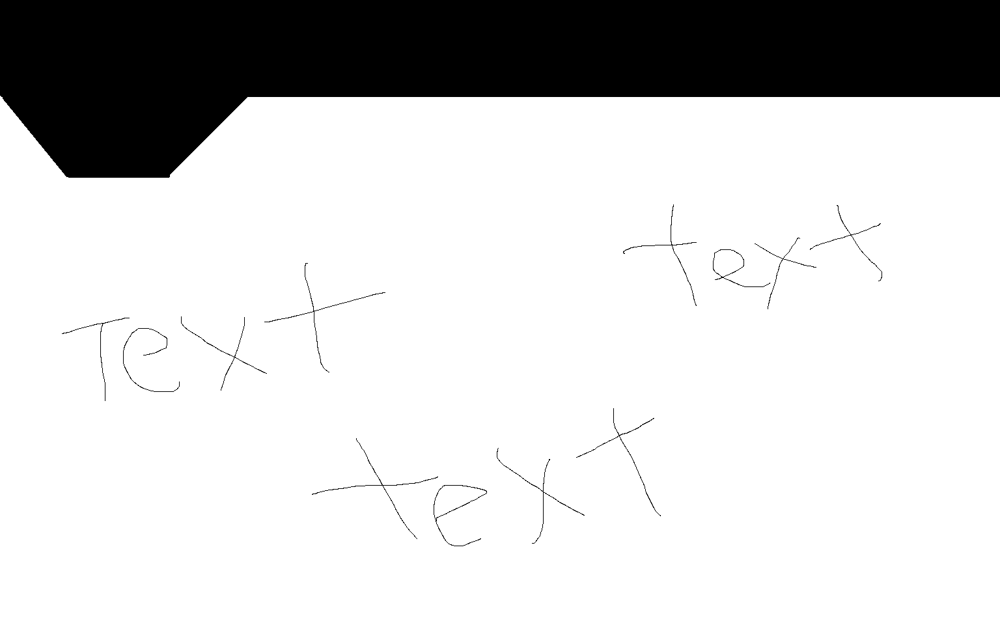

# bengusa.pro — Requirements, version 1

**Living spec.** The tech writer updates this file every time a requirement is added or changed.

- **Release 1 (BUWEB-114, new 2026-10-18) [C6]:** the first public release is the real site with Home, About and a short Privacy page only. **Changed 2026-11-02 (Rob, BUWEB-123): for now the site is ONE page, Home. About is shown on Home; the About and Privacy pages are hidden and every other address goes to Home (18.f.ii.f). Privacy must return before any form goes live.** **Changed 2026-11-06 (Rob, BUWEB-125): the Privacy page is live again at /privacy/, linked in the footer; About stays hidden (19.k). Visits are counted from the server's own 14-day log (19.l). The subscription / personal-details part of the policy is held (19.m).** The apps, the Apps menu, the app pages, the footer app links and Contact are hidden, and the app pages and Contact are not built into the site (decision 19). The signup, the Contact page and the launch gate in the lines below apply to the **later release that opens them**, not to Release 1.
- **Status:** **Plan approved 2026-10-05.** Building has started. The open items below hold up the **launch**, not the work.
- **Target go-live:** within a month of 2026-10-04 (about **2026-11-04**).
- **Signup gate (new 2026-10-05):** the signup cannot go live until the **PO box address** is in the form and the emails, and the **Contact page delivers to an inbox Rob reads** (decision 13.h). Order the box by Fri 2026-10-09. Hard stop 2026-11-02. If it misses, the pages and Contact launch and the signup opens later. No placeholder goes live in the meantime (13.h.v).
- **Launch gate (changed 2026-10-05):** **the site cannot launch at all** until the Contact page delivers to an inbox Rob reads (13.h.v, must-have 28). That inbox must be on a plan that includes a data agreement (14.f.iv). Everything else about Contact is built and tested without the address (decision 14.f).
    - *Supersedes the "Contact gate" line: "the Contact page cannot launch until Rob names a delivery address."*
- **Next:** The design is done (BUWEB-100, decision 14). The backend engineer and the frontend engineer build the foundation and the header (BUWEB-104). Rob sees a header mockup first (decision 12.c). Before any signup code (BUWEB-107b), the backend engineer runs a check of the list service, now about 3.5–4 hours (14.d). The contact form code (BUWEB-107a) can start now.
- **Waiting on rulings:** no launch item waits on a ruling. The legal reviewer still approves the final Privacy page words (15.i).
    - **Closed 2026-10-05:** open item 19 (what a showcase card may hold). The legal reviewer and the product lead ruled (16.i). No app is showcase at launch, so nothing at launch changes.
        - *Supersedes: "open item 19 (what a showcase card may hold) waits on the legal reviewer and the product lead."*
    - *The legal reviewer ruled on open item 18 on 2026-10-05 (13.h.v). The threat modeler and the privacy reviewer ruled earlier the same day (decision 15), which closed open items 16 and 17.*
- **Last updated:** 2026-11-13 (Our U.S. Debt block on Home: 19.n, BUWEB-128, address moved to bengusa.pro/ourusdebt/ and link opens in a new tab; earlier: Privacy page live again, visitor counts, subscription part held, 19.k to 19.m, BUWEB-125)
- **Decisions come from:** Rob. Requirements interview run by the business analyst on 2026-10-04. The product lead made the early-access, success-target and site-pricing calls on 2026-10-04, from the business advisor's advice. Rob ruled on the project lead's plan on 2026-10-05 ([C2]). The legal reviewer ruled on the claims, the identity lines and the postal address on 2026-10-05 ([Legal], BUWEB-103). The architect set the site design and the list service on 2026-10-05 ([Architect], BUWEB-100). The product lead checked the Vault sync facts against Vault's own records on 2026-10-05. On 2026-10-05 the threat modeler ruled on the one double opt-in exception, the privacy reviewer set what we keep and for how long, and the legal reviewer checked the rejoin and perk-email wording ([Threat model], [Privacy], [Legal], BUWEB-100a). Later on 2026-10-05 the legal reviewer ruled on the late-PO-box Privacy line and the privacy reviewer's draft Privacy lines, and the privacy reviewer checked the Privacy page draft against her data map and ruled on the Contact inbox ([Legal], [Privacy], BUWEB-102b). The legal reviewer's check of the page words widened the identity-check rule and added the Catche label, and the product lead checked the app facts ([Legal], [Product], BUWEB-102a). Last on 2026-10-05: the legal reviewer approved the email and Privacy lines, the privacy reviewer rechecked them and passed the Fastmail inbox, the finance lead priced the inbox options, the architect ruled on the welcome email and fixed tag IDs, and the threat modeler ruled on the perk-line fallback and the welcome email ([Legal], [Privacy], [Finance], [Architect], [Threat model], BUWEB-102). Then Rob asked about putting more apps on a carousel. The team's default answer (the product lead, the brand strategist, the frontend engineer, the architect, the legal reviewer and the business advisor) stands unless he overrides it ([Team], decision 16). Last, the legal reviewer ruled on showcase cards and the listing bar, the product lead set what showcase is for, and the architect's add-an-app decision record (ADR-0004) let open and showcase switch. The project lead kept the product lead's rule that a free or live product gets no card ([Legal], [Product], [Architect], 16.d.iii, 16.e, 16.i). Then the project lead confirmed the add-an-app cost and ruled who may retire an app, and the add-an-app steps were matched to ADR-0004 (16.d.x, 16.d.iii, 16.f, 16.i.iii). Last, the project lead ruled that the product lead may retire a cancelled or shelved case-A app at any time (16.d.iii). On 2026-10-06 Rob made seven changes ([C3]): the docked header size, the hero, Vault's Off-grid badge, a question about trademarks, the app-grid heading, an Off-grid popup, and the two Off-grid sentences. The legal reviewer, the brand strategist, the frontend engineer and the product lead ruled on them the same day, and the product lead recorded that Vault's later version is opt-in ([Legal], [Brand], [Frontend], [Product], A5, 13.b.v, 13.k, decision 17). The same pass folded in the legal reviewer's round-1 page-word rulings and his approval of the second Privacy page and email drafts (13.f, 13.g.iii, 13.j, 15.i). Later on 2026-10-06 the legal reviewer gave his final read of the third page-word draft: the tile's words (16.c), the E3 colon note (13.f.vii), a check on Vault's feature lines (13.b.v) and a trimmed keep-it-whole rule (13.d.iii, 18.e.v). The popup colours were settled the same day as a product call (17.c.vi). Last on 2026-10-06, Rob changed the docked logo to 2.5× and kept the lettering at its 2× size (6.c). Also on 2026-10-06, the legal reviewer cleared the brand strategist's call to put Vault's trust line before its sync line ([Legal], [Brand], 13.e.ii). Also on 2026-10-06, Rob placed the Off-grid legend on Home in its own "Off-grid, explained" section, between the hero lines and the app grid, and the project lead ruled that it needs no new legal ruling ([C3], 13.a.ii, 17.a.v).
- **Project notes for engineers:** the root `README.md` (how to run, test and build) and `tests/README.md`.

## How to read this

- **[R1]–[R4]** = Rob's answer in round 1–4 of the business analyst's interview.
- **[C1]** = a change Rob made after the interview (2026-10-04). It wins over an older answer.
- **[C2]** = Rob's rulings on the project lead's plan (2026-10-05). They win over an older answer.
- **[C3]** = Rob's changes of 2026-10-06: the docked header size (6.c), the hero, the place of Home's Off-grid section (17.a.v), the app-grid heading and the Off-grid popup (decision 17), and Vault's Off-grid badge (4.c, A5). They win over an older answer.
- **[C4]** = Rob's change of 2026-10-15: the About page (decision 18). It wins over an older answer.
- **[C5]** = Rob's change of 2026-10-15, later the same day: his co-founder's About photo shows him on his scooter (18.a.iv, 18.d.ii, 18.e.i). It wins over an older answer.
- **[C8]** = Rob's About changes of 2026-10-22: the final story words, a fuller work bio, and two photos per founder (18.f). They win over an older answer.
- **[C6]** = Rob's go of 2026-10-18: Release 1 is the real site, with the apps and Contact hidden (decision 19). It wins over an older answer. **[C7]** = Rob's ruling of 2026-10-15 on photos and people he supplies (18.e). It wins over the older launch conditions.
- **[Spec]** = Rob said it before the interview. **[Rule]** = from Rob's standing rules.
- **[Product]** = a call the product lead made. The 2026-10-04 calls are built from the business advisor's advice. The 2026-10-05 Vault sync facts come from Vault's own records. Her showcase rule (16.i) is also from 2026-10-05. Her 2026-10-06 record that Vault's later version is opt-in is in A5.b.
- **[Legal]** = the legal reviewer's claims rulings (BUWEB-103), his wording checks on the rejoin and perk emails (BUWEB-100a), his Privacy page rulings (BUWEB-102b), and his showcase rulings (16.d.iii, 16.e, 16.i), all 2026-10-05. Also his 2026-10-06 rulings on Rob's changes and Vault's badge (A5, 13.b.v, 13.d, 13.e, 13.k, decision 17), his 2026-10-06 final read of the third page-word draft (13.b.v, 13.d.iii, 13.f.vii, 16.c, 18.e.v), and his 2026-10-06 ruling on the order of Vault's trust line and sync line (13.e.ii). They win over older wording. Lines they replace carry a *Supersedes* note.
- **[Architect]** = the architect's site design (BUWEB-100, 2026-10-05), his rulings on the welcome email and fixed tag IDs (BUWEB-102, 2026-10-05), and his add-an-app decision record, ADR-0004 (16.d.i, 16.d.iii, 16.d.x, 16.f, 16.i.ii, 2026-10-05). It wins over older defaults. Lines it replaces carry a *Supersedes* note.
- **[Finance]** = the finance lead's inbox options and prices (BUWEB-102, 2026-10-05).
- **[Privacy]** = the privacy reviewer's data map and privacy rulings (BUWEB-100a, 2026-10-05): what we keep, for how long, and the consent record. Also her check of the Privacy page draft against that map, with three rulings (BUWEB-102b, 2026-10-05). They win over her 2026-10-04 guidance.
- **[Threat model]** = the threat modeler's ruling on the one exception to double opt-in (BUWEB-100a, 2026-10-05), and his rulings on the perk-line fallback and the welcome email (BUWEB-102, 2026-10-05).
- **[Team]** = the team's default answer to Rob's 2026-10-05 question about more apps on a carousel (decision 16). It comes from the product lead, the brand strategist, the frontend engineer, the architect, the legal reviewer and the business advisor. **It stands unless Rob overrides it.**
- **[Brand]** = the brand strategist's call on the app grid (decision 16, 2026-10-05), his 2026-10-06 calls on the hero, the colours and the popup (6.f, decision 17), and his 2026-10-06 call to put Vault's trust line before its sync line, which the legal reviewer cleared (13.e.ii). **[Frontend]** = the frontend engineer's call on the same grid (decision 16, 2026-10-05), and his 2026-10-06 design for the docked size, the heading guard and the popup (6.c, decision 17).
- **A1–A9** = assumptions (section 3). Shown to Rob, or not yet shown — the label says which.
- **[Analyst]** = a must-have the business analyst added (section 4), with the reason.

---

## 1. Version 1 in short

1. A **fully redesigned** bengusa.pro whose job is to **sell bengUSA.pro's apps**.
2. No app is ready yet, so it launches as a **waitlist**.
    - **a.** Visitors see the upcoming apps: **Catche, TimeTracker, Vault**. Catche shows as **"Catche (working name)"** and Vault as **"Vault (working name)"** (decision 13.e).
        - *Supersedes: "Vault shows as 'Vault (working name)'" alone. Catche got the same label on 2026-10-05* [Legal].
        - **The apps sit in a grid that can grow, not a carousel.** A "More in the works" tile ends it and names no app. More apps join later, one at a time, only after they clear a listing bar (decision 16). [Team]
    - **b.** They pick the apps they want and leave an email.
    - **c.** In return: launch news, early access and an early-bird discount.
    - **d.** Early access = a **free beta seat**, offered by email in the order people joined. People on the news list only get no perks.
3. People can also join a general **email list** for news and updates, and send a message through a **Contact** page.
4. Catche, TimeTracker and Vault get an **"Off-grid"** badge. Each Off-grid app's page says **what it connects to** (decision 13.b). Vault's line is based on its design until its first outside build is checked (13.b.v). [C3]
    - *Supersedes: "Catche and TimeTracker get an 'Off-grid' badge. Vault does not." Rob reversed it on 2026-10-06 (4.c).*
5. **"Cloud-killers"** is the playful tagline. Home leads with **"Makers of Off-grid apps."** (decision 17). [C3]
6. Pages: **Home, one page per app, About us (decision 18), Contact, Privacy.** Plus two small pages people land on after the confirm or unsubscribe link (5.e).
7. Logo and colors stay. The **header is new**: a big logo on landing that shrinks into a hexagon-shaped tab as you scroll.
8. The team writes the words in a playful voice. Rob approves them.
9. The store, payments and subscriptions come **later**. The site shows **no price and no pricing model** (pricing is not decided).
10. **Success** = 150 confirmed people who picked at least one app, by 2027-02-02.
11. **The signup opens only when the PO box address and a working Contact page are ready** (Canada's anti-spam law, decision 13.h). If the PO box is late, the site launches without the signup, and the signup opens later. **The site does not launch at all until the Contact page works** (13.h.v).
    - *Supersedes: "If they are late, the site launches without the signup." That still holds for the PO box, but no longer for the Contact page.*

---

## 2. Decided

1. **The brand and platform**
    - **a.** The site is for **bengUSA.pro**, a RandBMedia brand. RandBMedia is Rob's own company with his wife. Not client work. [Spec]
        - **Known context:** The LLC was dissolved 2026-08-12. The site uses the brand name only. The legal reviewer words any legal-identity line. *(Verified 2026-10-04 by the legal reviewer, the privacy reviewer and the finance lead.)* **Worded 2026-10-05:** decision 13.g.
    - **b.** **Hosting: AWS Lightsail.** Not standard AWS (no EC2, ALB or Route53). [Rule]
        - **One approved exception:** Amazon SES (standard AWS) sends the contact-form mail (12.b.iii). [C2]
    - **c.** **Code home: GitHub, account `robguida`.** Rob did not know the code was on Bitbucket. [R4] **Done 2026-10-04:** Ops moved it to a private repo, `robguida/bengusa.pro`.
2. **Goal and audience**
    - **a.** Audience = **app buyers only.** [R1]
    - **b.** The site's number one job = **sell apps.** [R1]
3. **Launch model, waitlist and email list**
    - **a.** No app is ready at launch. [R1]
    - **b.** Launch = **waitlist now, store later.** [R2]
    - **c.** Waitlist perks = **early-bird discount + early access + launch news** (all three). [R3] Who gets them, and what early access means: 3.e. The perk terms under the form: 13.f.
    - **d.** **A general email list** for news and updates, alongside the app waitlist. [C1]
        - Rob's words: "we should allow people to get on a list... and we can set up a email list."
        - **Decided 2026-10-05** [Architect]: **one list.** Each person's app picks and the news choice are tags on their one record (14.b).
            - *Supersedes: "One list or separate lists is open (section 5, item 13)."*
    - **e.** **Early access, defined.** [Product]
        - **i.** It is a **free beta seat**: free use of the app's beta build until the store opens.
        - **ii.** Seats go out **by email, in join-date order**, in **small waves with a cap**. The order is each person's first confirmed join date for that app.
        - **iii.** **Everyone on an app's list**, seat or not, gets into the store **before the public**, with a **personal early-bird code**.
        - **iv.** **People on the news list only get no perks.** The perks are for people who picked an app. The form says so under the news tick box: "Only news, no apps? You get launch news, no perks." (13.f.ii)
        - **v.** Each app starts its waves at a **milestone, never a date.** Before any app's first invite, it needs a signed Windows installer and a short beta agreement (the legal reviewer). Neither is v1 site work.
            - Catche: its name is picked, the AGPL licensing problem is solved, the sellable v1 is done, and its AI-model download host is live.
            - TimeTracker: the day-90 price test passes, and automatic backup (TT-62) and in-app key backup and recovery (TT-65) have shipped.
            - Vault: backup and restore, session lockdown and the recovery-key flow are done, and the security reviewer clears a beta for outsiders before the security audit.
        - **vi.** Wave sizes, the store head start and how long an invite lasts are internal numbers. They are never printed on the site (must-have 18). The detail (the business advisor, 2026-10-04) is kept in the project's private decision notes.
    - **f.** **Signup consent covers three things:** news, early access, and the occasional one-question survey. [Product] See must-have 19.
        - The consent text also shows the **mailing address** and the **Contact page link** (Canada's law, 13.h). Approved consent sentence: 13.f.vi. [Legal]
4. **Apps and Off-grid**
    - **a.** Apps shown = **Catche, TimeTracker, Vault.** Rob typed this list himself. [R2]
        - Catche and Vault show as **"Catche (working name)"** and **"Vault (working name)"** at every fixed spot (cards, the signup app picker, menu, footer, page titles, share text and email pick lists) and at their first mention on each page (13.e). [Legal]
            - *Supersedes: "Vault shows as 'Vault (working name)' on its card, in the signup app picker, and at its first mention on each page." Catche added 2026-10-05.*
        - **Launch keeps these three** [Team] (2026-10-05). No other app is added for launch. A new app joins only after it clears the listing bar (16.e), through the add-an-app steps (16.f). Then it is added here.
    - **b.** **The Off-grid promise:** the app keeps your data on your device, not in our cloud. If you buy it, all we keep is your **purchase record**. [Legal] Exact wording: 13.a.
        - *Supersedes [Spec]: "the app stores nothing in the cloud except the subscription." "Subscription" was wrong while pricing is open (13.c).*
    - **c.** **One app list.** Off-grid apps get a badge. All three launch apps are Off-grid, Vault included. [C3]
        - **Vault wears the badge (Rob, 2026-10-06; replaces [R3]). Opt-in rule for the later version recorded by the product lead, 2026-10-06** (A5.b).
        - Vault's badge is a design claim. It rests on Vault's written design until its first outside build is checked (13.b.v). [Legal]
        - *Supersedes [R3]: "Vault gets no badge." Rob reversed it.*
    - **d.** The badge says **"Off-grid."** **"Cloud-killers"** is the playful tagline. [R4] Where "Cloud-killers" may appear: 13.d.
    - **e.** **Claire** is still a bengUSA.pro app, but **not on the site yet.** [R3]
        - **Claire is first in line** for the listing bar, then Life Log (16.g). [Team]
    - **f.** **Ruled 2026-10-05:** The legal reviewer's claims check (BUWEB-103) set the Off-grid badge and promise wording. It is in decision 13.
        - *Supersedes the "Under review" hold that stood here: "Leave the wording as it is until he rules."*
5. **Pages**
    - **a.** **Home**, **a page per app** (3), **About us.** [R4]
    - **b.** **Contact** page with a contact form. [C1] This reverses round 4's "no Contact page."
        - Rob's words: "a contact form would be good."
    - **c.** **Privacy** page — a must-have the business analyst added (section 4, item 1).
    - **d.** **No FAQ** in version 1. [R4]
    - **e.** **Two small landing pages, `/confirmed` and `/unsubscribed`.** The list service sends people there after they click the confirm or unsubscribe link in its email. [Architect] The Buttondown check confirms the service can do this (14.d).
    - **f.** **About us** tells the founders' story and shows the two co-founders (decision 18). [C4]
6. **Header, logo and brand**
    - **a.** **Keep the logo and colors.** [R1]
    - **b.** Rob is not keen on today's small top bar. He wants the header to **stand out.** [R1]
    - **c.** **Landing page: large logo.** As you scroll, it shrinks to the top-left, ending at **2–3× today's header logo size.** [R1]
        - **Changed later on 2026-10-06** [C3]: the docked **logo** (the hexagon mark, which docks into the hexagon tab) is **2.5× today's header logo: 115 px tall on a computer, 69 px on a phone** (today's logo is 46 px tall). [Frontend]
            - **The "bengUSA.pro" lettering keeps the size the 2× option gave it.** On a computer it shrinks as the logo shrinks and stops at **29 px tall** when docked. On a phone it is **24 px tall** at every size, so only the logo changes size.
                - **Narrow phones** (queued fold, build measured 2026-10-06): under about 388 px wide the lettering starts smaller than 24 px (22.69 px at 375 px wide, 15.52 px at 320 px) and grows one way to about 24 px once docked. It is never larger than 24 px on a phone. *Supersedes: "24 px tall at every size" for screens narrower than about 388 px.*
            - Rob's words: "We [w]ant the header to be 2.5x when it 'scales' back from the original size."
            - *Supersedes: "the docked size is 2× today's header logo: 92 px tall on a computer, 58 px on a phone (today's logo is 46 px tall). Rob picked it with the mockup's size switch. On a computer the 'bengUSA.pro' lettering shrinks with the logo. On a phone only the hexagon changes." On a phone, the lettering stays 24 px tall through the whole shrink, and only the logo changes size. On a computer, the lettering shrinks from its landing size to 29 px tall when docked. The code and the test notes change in BUWEB-106a.*
            - *That 2× line had replaced the build's first default of 2.5× (115 px computer, 69 px phone), which was never written into this spec.*
    - **d.** **Header shape:** a hexagon-shaped tab on the left, with the bar running right from it. [R1]
    - **e.** **Redesign every page.** [R2]

    **Rob's sketch** (`docs/assets/header-shape.png`):

    

    - The black area is the header shape. A bar runs across the top. On the left, a tab hangs down with angled sides, like the bottom half of a hexagon.
    - The "text" scribbles stand for page content.
    - Rob's words: "The black shows the shape, but it does not move." The sketch shows the shape only, not the scroll motion.

    - **f.** **Colour rules, for every page** [Brand] (new 2026-10-06):
        - **i.** **Navy (#002A42) is for text.**
        - **ii.** **Green (#006454) means Off-grid and nothing else:** the badge, the word "Off-grid" in the hero (17.a.i), and the dotted underline on the word "Off-grid" where it opens the popup (17.c.vi).
        - **iii.** **Red (#CF2F32) is for the signup button only.** No red text: red means "act", and red text reads like an error message.
        - **iv.** **Red never sits on light blue.** It fails the contrast minimum there. [Frontend]
        - **v.** **The logo and the "bengUSA.pro" wordmark keep their own colours** (6.a). The rules above cover everything else.

7. **Words and voice**
    - **a.** **Have fun with it.** [Spec]
    - **b.** **The team drafts the words in a playful voice. Rob approves.** [R3]
    - **c.** **Every page follows the must-not-promise list** (must-have 18). [Product]
8. **Domain**
    - **a.** **The new site takes bengusa.pro.** [R4]
    - **b.** The **"bengUSA Admin" app moves** to a sub-address (for example admin.bengusa.pro). [R4]
    - **c.** **Renewal:** the domain was due to expire on 2026-10-24. Rob says it is good to go (AIR #1, decision 12.a). Ops confirms the new expiry date with a read-only lookup. Nobody re-asks Rob. [C2]
9. **Timeline**
    - **a.** **Live within a month.** [R2]
    - **b.** **See something early.** Rob wants a first look before the details are settled, so the header comes first (decision 12.c). [C2]
10. **Signup success target** [Product]
    - **a.** **150 confirmed people who picked at least one app, by 2027-02-02** (day 90 after launch).
    - **b.** **Day-30 check: 50 by 2026-12-04.**
    - **c.** **Each app needs at least 50 picks** by day 90.
    - **d.** **News-only signups do not count.**
    - **e.** "Confirmed" means the person clicked the link in the confirmation email (double opt-in).
        - **One exception** [Threat model]: a confirmed person who signs up again to add an app needs no new click (15.e).
        - **A mail scanner's automatic click is not consent** [Privacy]. A confirm needs the person's own act (15.g.iii).
    - **f.** **If we miss it or beat it** (the business advisor's plan, adopted as written):
        - **i.** Under 50 at day 30: the word is not getting out. Use the free channels (Rob's LinkedIn, his video channel, his consulting site, one or two community posts per app). No paid ads.
        - **ii.** 150–299 at day 90: stay on plan.
        - **iii.** 300 or more: start the signing identity if it has not started. The app with the most picks gets ready for the store first. Pay up to about $10 a month for the email list once it outgrows the free plan.
            - *Changed 2026-10-05* [Architect]: the list likely costs **$9 a month from launch day**, not from 300 people, because of the confirm email's legal footer (14.c). It is still inside the "about $10 a month" line.
        - **iv.** Under 150: no ad spend. Under 75 after a real push: rewrite the home and app pages, then measure for 60 more days. An app under 25 picks gets no new store-readiness spending until it reaches 50. It stays on the site.
    - **g.** Counted from the list itself, since the site runs no tracking scripts (A9). **Confirmed 2026-10-05** [Architect]: each record shows whether the person confirmed and holds a join date per app. The counts come from the list service's export (14.g).
        - *Supersedes the inferred note: "each signup has to record whether it is confirmed and which apps it picked, so these counts can be pulled."*
        - **Added 2026-10-05** [Threat model], [Privacy]: some picks are reported apart from the rest.
            - **i.** Picks added without a confirm click ("unverified", 15.e.iii) are reported separately.
            - **ii.** Held picks (15.f) and records that left never count. "Left" means unsubscribed, or our email bounced or was marked as spam (15.a). [Privacy]
                - *Supersedes: "Held picks (15.f) and unsubscribed records never count." The privacy reviewer's 2026-10-05 ruling treats a bounce or spam report like an unsubscribe.*
            - **iii.** If Buttondown confirms the moment the link opens, confirms within 30 seconds of the email are reported separately (15.g.iii).
11. **Pricing on the site** [Product]
    - **a.** **The site shows no price and no pricing model.**
    - **b.** Pricing itself is **not decided** (section 5, parked item 5). Catche's ADR 0001 (a subscription, accepted by Rob 2026-05-03) **stands until Rob changes it.**
    - **c.** This does not block launch. The one place pricing touches the words is the Off-grid line. The legal reviewer ruled it says **"purchase record"**, which is true under any pricing model (13.c).
        - *Supersedes: "The legal reviewer owns that (4.f)", the hold before his ruling.*
12. **Plan approval and setup choices** [C2]
    - **a.** **The project lead's version 1 plan is approved.** Rob answered the project lead's three action items on 2026-10-05.
        - Rob's words: "AIR #1: That is good to go. AIR #2: I don't have an email. Let's wait on that. ... AIR #3: For what? We canwork out the details, let me just see something that we can work with."
        - **AIR #3 is the go.** AIR #1 is the domain renewal (8.c). AIR #2 is the email address (12.d).
    - **b.** **These defaults stand.** Rob raised no objection.
        - **i.** **Hosting:** the site gets its own small Lightsail server. **Confirmed 2026-10-05** [Architect]: decision 14.a.
        - **ii.** **Signup list:** a hosted list service, with tracking turned off. Rob creates the account and accepts its data agreement. **Named 2026-10-05** [Architect]: **Buttondown** (decision 14.b).
            - *Supersedes: "Which service → the architect (open item 14)."*
        - **iii.** **Contact-form mail:** sent by **Amazon SES.** SES is standard AWS, so it is the one approved exception to the Lightsail-only rule (1.b).
        - **iv.** **Name:** brand name only. The footer says "bengUSA.pro" (no LLC). The Privacy page says Rob Guida runs the site. The legal reviewer words both lines (1.a). **Worded 2026-10-05:** 13.g.
    - **c.** **Rob's priority: see something early.**
        - The header and the site skeleton moved forward into the first build ticket (BUWEB-104).
        - The frontend engineer builds a header mockup first. Rob sees it as a private page on his phone, before any server exists.
    - **d.** **Held: the contact and privacy email address.** Rob has no inbox to give yet. The planned `hello@bengusa.pro` address waits with it.
        - The contact form is still built (BUWEB-107a). **It cannot go live until Rob supplies an address** (open item 7).
        - **Everything else about Contact is built and tested without the address** [Architect] (14.f). Only real delivery to Rob's inbox waits for it.
        - **Now it also gates the signup** [Legal]: the signup cannot open until the Contact page delivers to an inbox Rob reads (13.h.vii). `hello@` itself stays optional.
        - **Changed 2026-10-05: it now gates the whole launch** [Legal]. The site does not launch unless the Contact page delivers (13.h.v, must-have 28).
        - **Changed 2026-10-05: the inbox must be on a plan that includes a data agreement** [Privacy], not a free personal mailbox (14.f.iv).
            - *Supersedes: "Any inbox Rob reads will do."*
        - **The Privacy page no longer needs an email address.** It points to the PO box address and the Contact page (13.g.ii).
            - *Supersedes the inferred note: "the Privacy page's line for privacy questions waits on the same address."*
    - **e.** **Changed 2026-10-05: the PO box now gates the signup going live** [Legal]. Full rule and dates: 13.h.
        - *Supersedes: "Deferred: the PO box ... Rob orders a PO box or virtual mailbox before the first list email," and the open question of whether the confirmation email counts. The legal reviewer ruled it does, under Canada's law.*
        - Setup takes 1–2 weeks (risk 5).
13. **Claims, identity and postal-address rulings** [Legal]
    - The legal reviewer's BUWEB-103 rulings, 2026-10-05. They replace the wording holds in 4.f, 11.c and 12.e.
    - **How to use the wording below:** it is a starting draft. The copywriter may make it playful, but **every fact must stay.** Rob approves the final words (7.b).
    - The full ruling, with its legal sources (the legal reviewer, 2026-10-05), is kept in the project's private decision notes. The legal reviewer is the team's advisor, not counsel of record.
    - **a.** **The Off-grid badge lines.** Approved for Catche, TimeTracker and Vault. Catche keeps the badge, because its page names its two outside connections (13.b). Vault's badge rests on its written design until its first outside build is checked (13.b.v). [Legal] (2026-10-06)
        - *Supersedes: "Approved for Catche and TimeTracker."*
        - **i.** **Short form** (cards, tooltips, anywhere the badge shows with little room): "Off-grid: your data lives on your device, not in our cloud."
        - **ii.** **Full legend** (the badge legend, and next to the badge on each Off-grid app's page): "Off-grid: the app keeps your data on your device, not in our cloud. If you buy it, all we keep is your purchase record. Each app's page lists what it connects to. We call Off-grid apps Cloud-killers."
            - On an app's own page, drop the sentence "Each app's page lists what it connects to." The app's connects line sits right below instead.
            - **On Home, the legend has its own section, between the hero lines and the app grid (17.a.v),** with every sentence above kept. **That section's heading reads "Off-grid, explained", on Home and on each Off-grid app's page.** It is a plain heading, not a popup trigger: "the heading" in 17.c is the app-grid heading (17.b). [C3] (2026-10-06)
            - **Changed 2026-10-05** [Legal] (BUWEB-102a): The brand strategist's wording, approved by the legal reviewer. "Them" could be read as pointing at a company named in the connects line. Naming "Off-grid apps" removes that. The legend is outside the consent version, so no new version is needed.
                - *Supersedes: "We call them Cloud-killers."*
            - **The connects box sits directly below the legend,** with nothing between them. Its label stays plain ("What Catche connects to"), with no "Cloud-killers" inside it. [Legal]
        - **iii.** **Never, for any Off-grid app (Catche, TimeTracker, Vault):** "offline", "100% offline", "never connects", "nothing leaves your device", "never touches the internet", "zero data". Catche's map makes all of these false today. [Legal] (changed 2026-10-06)
            - **For Vault:** the user's own cloud-folder option and Windows clipboard sync make "nothing leaves your device" false. "Opens with no internet connection" may come back only after Vault's build check proves it (13.b.v).
            - *Supersedes: "Never, for either app: …"*
    - **b.** **"What it connects to" lines.** One on each Off-grid app's page, right below the legend.
        - **i.** **TimeTracker:** "What TimeTracker connects to: nothing. The app makes no internet connections. If your PC lacks a standard Microsoft component (WebView2), the installer downloads it from Microsoft."
        - **ii.** **Catche:** "What Catche connects to: its map loads from OpenStreetMap. Like any website, OpenStreetMap sees your IP address. It also sees which part of the map you view, which can hint at where your photos were taken. An optional AI model downloads from Hugging Face, only if you click Download. Catche doesn't send your photos, file names or tags anywhere. If your computer lacks a standard Microsoft component (WebView2), the installer may download it from Microsoft."
            - **AI sentence changed 2026-10-05** [Legal] (BUWEB-102a). Two rules come with it:
                - **Delete the sentence before any build without the Download button ships.** It stays while the button is in any build a stranger can get, because clicking it contacts Hugging Face.
                - **Never describe what the AI does,** on any page or in any email. The feature is not working today and is not in the Catche v1 brief.
                - *Supersedes: "The AI model downloads from Hugging Face, only when you click Download."*
        - **iii.** **These lines are design rules** (the product lead's rule). If a Catche v1 item or TimeTracker's TT-41 design adds a connection, or keeps anything about users, the site line changes **before** that item ships.
            - Catche v1 items in question: licence check, update checks, telemetry, crash reports, news fetch, download logs.
            - **Also the AI model download** [Product] (added 2026-10-05): whether it is in Catche v1 at all, where it downloads from, and what starts it.
                - Why: Catche's records disagree. Today's build downloads the model from Hugging Face when you click Download. The newest Catche v1 plan drops the AI download. The accepted design (Catche's ADR 0001) starts the download when you turn AI on, checks for new versions in the background, and downloads from our own server.
                - Until Catche v1 settles it, the site keeps the legal reviewer's line, because it is true of the only build that exists (13.b.ii). If a build ships without the Download button, the AI sentence is deleted first (13.b.ii).
        - **iv.** The Catche and TimeTracker lines rest on two code reviews. Each app's traffic capture at its first outside build must match them before any build reaches a stranger. *(That check is app work, not site work.)*
        - **v.** **Vault: a design-based connects box** [Legal], [Product] (new 2026-10-06). No Vault build exists that a stranger can get, so the box rests on Vault's written design.
            - **The box** (on Vault's page, directly below the legend): "What Vault connects to: Vault is still being built. As designed, it goes online for just two things: checking your purchase and getting updates. It doesn't send your vault or anything in it. If your PC lacks a standard Microsoft component (WebView2), the installer may download it from Microsoft."
                - It matches the calls named in Vault's design: the purchase check, the updater, and the installer's WebView2 download.
                - It leaves out the user's own synced folder on purpose. Vault only writes a file on the PC, and the user's own sync app moves it. Import reads files on the PC only, so it needs no mention.
                - "Checking your purchase" may overstate the free beta. Overstating what we connect to is the safe direction.
                - It is a design rule, like 13.b.iii. Any new connection (a licence check, crash reports, telemetry, news) changes the box first.
            - **The build check, before Vault's first beta invite.** The security reviewer and the backend engineer each run their own check of what that build sends out. Then the legal reviewer re-checks the site's Vault lines. It comes before the first invite, not before the site launches, because no build exists yet.
                - If a check finds a call the box doesn't name, the box changes or the badge comes off, before the invite goes out.
                - "Vault is still being built. As designed," comes off once the checks match.
                - **Vault's feature lines join this check** [Legal] (new 2026-10-06). These are the lines on Vault's page that say what it does (section 4.b of the BUWEB-102a page words, not decision 4.b here). They rest on Vault's written design, because no build exists. If the first outside build lacks a feature that one of those lines names, that line comes off before the first beta invite.
            - **Design conditions that keep the Off-grid lines true for Vault** (the product lead carries them to the Vault side):
                - Off-grid Vault keeps no vault data on our side, in any version: no sync, no cloud backup, and no crash report carrying vault data. If any item would send vault data to us, the site's lines change before that item ships.
                - The update host and the purchase service keep nothing about the user beyond the purchase record: no IP logs tied to users, and no device ID in the update request (version and platform only). Otherwise "all we keep is your purchase record" is false for Vault. The same holds for Catche's model host.
            - **The clipboard condition, before the first outside build:** Vault marks each copied secret so Windows keeps it out of clipboard history and cloud clipboard sync, and Vault's clipboard auto-clear works. The site gets no line for this now: it comes from the user's own Windows setting, not a Vault connection, and nobody can get a build yet.
                - **If the beta ships without both,** Vault's page adds this line under the connects box: "Heads-up: if Windows clipboard history and its sync are turned on, Windows can send what you copy, secrets included, to Microsoft's cloud. You can turn that off in Windows Settings."
            - The rulings (the legal reviewer and the product lead, 2026-10-06) are kept in the project's private decision notes.
    - **c.** **"Purchase record" replaces "subscription"** in the Off-grid promise (4.b).
        - **i.** Why: it is true under a subscription (Catche's ADR 0001 still stands), under a one-time licence, and today, with no sale.
        - **ii.** Not "licence": pricing is open. Not "account": the Off-grid apps may never need one.
        - **iii.** **Store-phase check, not v1:** today the shared billing service keeps more than a purchase record (sign-in details, the MFA secret, and the IP and browser of each terms acceptance). Before the store opens, either trim it, or change the line to "your account and purchase record." (Parked item 3.d.)
            - **It bites harder for Vault** [Legal] (2026-10-06). Vault's purchase check uses a signed token, which likely means an account. So for Vault, "your account and purchase record" is the likelier end state. Not a v1 blocker.
        - **iv.** **Rob said "subscription" on 2026-10-06. It stays "purchase record."** [Legal] No app has a subscription today, and Off-grid Vault may be a one-time buy. "Purchase record" is true either way. The two Off-grid sentences in 13.a still hold with Vault Off-grid.
    - **d.** **"Cloud-killers" and the hero line.**
        - **i.** "Cloud-killers" appears in the badge legend and on the Catche, TimeTracker and Vault pages **only** (on Vault, in the legend only). Never in the hero, page titles, share text, email subjects, or next to a named company. No ™.
            - Why it is safe: it reads as playful exaggeration because its definition sits right beside it.
            - **Vault added 2026-10-06** [Legal]. The ban's only reason was that Vault wasn't Off-grid. Two conditions:
                - The sentence about Vault's later version (13.e.ii) never sits in the legend box.
                - If that later version is ever sold from Vault's page, the legal reviewer rules again.
            - *Supersedes: "on the Catche and TimeTracker pages only. Never in the hero, page titles, share text, email subjects, the Vault page, or next to a named company."*
        - **ii.** **"Apps that mind their own business"** is legally cleared. **Since 2026-10-06 it is the hero's subline, not its main line** (17.a) [C3], [Legal]. Rob's alternative subline, "Off-grid apps mind their own business.", passes too. The old rules carry over to either one:
            - Keep it whole (13.d.iii).
            - No ™ and no registration (13.k.i).
            - It stays safe while it stays broadly true: no app shown ships ads, analytics or data selling. If any app adds analytics or telemetry, the line is re-checked before that build ships (13.b.iii).
            - *Supersedes: ""Apps that mind their own business" is legally cleared as the hero line. It stays safe while it stays broadly true: no app ships ads, analytics or data selling."*
        - **iii.** **Keep it whole.** Never shorten it (for example, to "Mind your own business"), and never turn it into initials or an abbreviation. No ™, no registration. Rob's alternative ("…mind their own business.") keeps it whole. [Legal] (changed 2026-10-06)
            - Why: a short form could clash with names others already use. The detail is in the project's private decision notes.
            - *Supersedes an earlier wording that named another company. That detail now lives only in the project's private decision notes.*
    - **e.** **"Catche (working name)" and "Vault (working name)".**
        - **i.** Both apps carry the label in the same places. Show the full label at every fixed spot: the app's card, the signup app picker, the header menu and the footer, page titles and share text, and the list of picks in emails. In body text, use it at the first mention on each page, then the plain name ("Catche", "Vault").
            - Why: the real name needs a clearance search before any beta build ships.
            - **Catche added 2026-10-05** [Legal] (BUWEB-102a), placed exactly like Vault. Why: Catche's name is being retired, and its rename waits on Rob's pick (open item 3). Without the label, visitors would read "Catche" as the final name, which must-have 18.b bans.
            - **Never inside the fixed legal lines.** The "What Catche connects to" line (13.b.ii) stays word for word.
            - **Each app has a long form and a short form** ("Catche (working name)" and "Catche"). When the new name lands, both are swapped.
            - **No new consent version.** App names sit outside the consent version (15.d.i), so adding the label, or later swapping in the new name, needs none. The 10-28 lock (15.d.vii) doesn't apply.
            - **A rename never changes the tag a pick is stored under** (for example `catche`). Only the name people see changes, so nobody loses a join date.
                - **Confirmed 2026-10-05** [Architect]: his rule LR-29 (14.g.vi). The fixed tag IDs `catche`, `timetracker` and `vault` never change. Names are for display only. This holds for both the Catche and the Vault rename.
                - *Supersedes: "The architect and the database engineer confirm this (15.h.iii)." 15.h.iii is a different question (how Rob removes a pick). It is still open with the architect and the database engineer.*
            - The label comes off only after the new name passes its clearance search (open item 3). The rename line (13.f.iii) needs no change.
            - *Supersedes: "Show 'Vault (working name)' on its card, in the signup app picker, and at the first mention on each page. Plain 'Vault' after that." The rule now covers both apps and names every fixed spot.*
        - **ii.** **Sync line** (Vault page, after the connects box, never inside the legend) [Legal], [C3] (2026-10-06): "Vault (working name) starts on Windows. A later version may add sync between devices. That version would keep an encrypted copy of your vault in our cloud, so it won't wear the Off-grid badge."
            - **Checked 2026-10-06** [Product], [Legal]: matches Rob's decision. Our hosted sync belongs to a later version with no date. The line names no version number, date, price or name.
            - *Supersedes: "Vault (working name) starts on Windows. Sync between devices is planned for a later version. When it comes, it will keep an encrypted copy of your vault in our cloud. That's why Vault doesn't wear the Off-grid badge." and its 2026-10-05 check note, which said our hosted sync comes in v1.1.*
            - **Trust line** (Vault's page, under 'Where your vault lives') [Legal] (2026-10-06): "Your vault is saved on your PC, and we keep no copy of it."
                - True by design: Off-grid Vault keeps no vault data on our side (13.b.v).
                - Still banned in it: "encrypted" (no build and no audit yet) and "stays on your PC" (people may keep the file in their own cloud folder).
                - *Supersedes the round-1 draft: "In the first version, your vault is saved on your PC, and we keep no copy of it." "In the first version" drops, because the badged Vault never gets our sync.*
            - **Order under 'Where your vault lives'** [Legal], [Brand] (2026-10-06): the trust line first, then the sync line. Both stay after the connects box and outside the legend, side by side, in the same size and style, with no words between them.
            - **Vault's card shows the short form only** (13.a.i) [Legal]. The old card note "Sync between devices is planned for a later version." drops, with no replacement. The sync line lives on Vault's page.
        - **iii.** **Not yet:** "end-to-end", "zero-knowledge", "we can't read it", "unhackable", "military-grade", "audited". Vault's design requires zero-knowledge, but sync isn't built.
        - **iv.** **Allowed later:** "Encrypted on your PC before it leaves, so we can't read it," once sync is built and the security reviewer verifies it.
        - **v.** **Vault's later version gets no public name** [Legal] (new 2026-10-06). Its working name is never printed on the site or in emails. "A later version" says enough. Anywhere public, the later version also gets:
            - no date, "v1.1", "soon", "coming", season or price;
            - no "zero-knowledge", "end-to-end" or "we can't read it" (13.e.iii);
            - no promise of how people move to it, or that Off-grid Vault stays on sale;
            - no perk tied to it.
            - If a name is ever printed, it needs the legal reviewer's clearance first. It then carries "(working name)" at every fixed spot and at its first mention, the same as 13.e.i.
        - **vi.** **Never on the site:** "for now", "Off-grid for now", or anything that hints Vault's badge is temporary. [Legal] (new 2026-10-06)
    - **f.** **Perk terms** (under the signup form). No number.
        - **Locked before 2026-10-28** (new 2026-10-05), together with the news-only line (13.f.ii) and the consent sentence (13.f.vi). Any later change is a new consent version (15.d.vii).
        - **i.** "Pick an app to get its perks. Early access: free beta seats go out by email in small groups, in the order people joined, so not everyone gets one. Early-bird discount: everyone on the app's list can buy before the public, at a discount we'll tell you before you pay. Perks come by email, so unsubscribing stops them. Sign up again within 3 years and your place comes back. No dates yet."
            - **Changed 2026-10-05** [Legal]: "ends" became "stops", and the rejoin sentence was added. The privacy reviewer's ruling keeps an unsubscribed record for 3 years (15.a.ii), so a person who rejoins gets their place back.
                - "Stops", because "ends" sounds final and the next sentence would contradict it.
                - "Within 3 years", because after that the record is deleted. An open-ended "comes back" would then be false.
                - "Your place" covers every earlier app and its date, not just the apps picked this time (15.a.iii).
            - The Privacy page says the same thing (15.i.i).
            - *Supersedes: "Perks come by email, so unsubscribing ends them."*
        - **ii.** **Under the news tick box:** "Only news, no apps? You get launch news, no perks." [Legal] (changed 2026-10-05, round 1)
            - The same words go on the signup page and in the welcome email, all from the one consent file.
            - Why: it reads right on the form, where the person hasn't picked anything yet, and in the email.
            - It lands before the 10-28 lock, so the first consent version simply uses it (15.d.vi).
            - *Supersedes: "News only: launch news, no perks."*
        - **iii.** **Required** [Legal], [Team] (changed 2026-10-05): "If an app is renamed, your perks move with it. If it's cancelled, we'll tell you."
            - Why: more apps are queued for the site (decision 16), and more early-stage apps make it likelier that one is cancelled.
            - **It must be in the perk terms before the 2026-10-28 lock** (15.d.vii). Adding it after that would be a new consent version.
            - *Supersedes: "Optional, recommended."*
        - **iv.** **OK to say:** "early access", "early-bird discount", "get in early", "before the public", "Save my spot".
        - **v.** **Never:** a number or "%", dates, months, seasons, "soon", "guaranteed", "lifetime", "free forever", "pre-order", "reserve your copy".
        - **vi.** **Signup consent sentence:** "We'll email you about launches, early access, your early-bird discount and an occasional one-question survey. That's it. Unsubscribe anytime."
            - **Changed 2026-10-05** [Legal] (round 1): "the odd" became "an occasional" everywhere the sentence appears (the form, the signup page and the welcome email), and in the Privacy page's own line about what we email (section 1.4). It lands before the 10-28 lock, so the first consent version simply uses it (15.d.vi).
                - *Supersedes: "…your early-bird discount and the odd one-question survey."*
            - This fixes the brand strategist's sample, whose "That's it" left out the survey (must-have 19).
            - **Checked 2026-10-05** [Legal]: no change needed for the add-an-app rule (15.e). The sentence covers the whole list, and the news-only line (13.f.ii) stays too.
        - **vii.** **Every perk email carries this line** [Legal] (new 2026-10-05): "You're on the list for: <apps>. If that's wrong, tell us on the Contact page (bengusa.pro/contact) and we'll fix it."
            - Example: "You're on the list for: Catche (working name) and Vault (working name). If that's wrong, tell us on the Contact page (bengusa.pro/contact) and we'll fix it."
            - **The apps:** every app on the person's record, in this order: Catche, TimeTracker, Vault. An app added later takes its place in the app list's order (16.f). Catche shows as "Catche (working name)" and Vault as "Vault (working name)" (13.e.i). Leave news out, because it isn't an app.
                - *Supersedes (2026-10-05, Catche label)* [Legal]: the example "Catche and Vault (working name)" and "Vault shows as 'Vault (working name)'" alone.
            - **Where:** just above the footer of every email sent because someone picked an app (early access, early-bird, or an update about one app). Emails to the whole list don't need it.
            - **Why "on the list for", not "you signed up for":** the person may not have picked the app this time. For example, it came back when they rejoined. "On the list for" is true in every case.
            - **"We'll fix it" is a promise,** so a fix exists: Rob removes the pick by hand (15.h).
            - **The Buttondown check** confirms Buttondown can fill in each person's apps.
            - **Fallback, if it can't** [Threat model], [Legal] (ruled 2026-10-05): the line names only the app the email is about. The threat modeler accepted it, and the legal reviewer approved the wording as written. Rules:
                - **One app per perk email, sent only to that app's list** (the people with that app's tag ID, 14.g.vi). Never to "either of two apps", and never to the whole list.
                - The line names that same app, with its label. **The words, now the default** [Legal] (approved 2026-10-05, second email draft), one per app: "You're on the list for Catche (working name). If that's wrong, tell us on the Contact page (bengusa.pro/contact) and we'll fix it." The same for TimeTracker and for Vault (working name).
                    - They mirror the main line, so a fallback email doesn't say "because" twice next to the footer's "You get this because…" line.
                    - No colon on purpose: it names one typed app in a sentence. The main line's colon opens the filled-in list. [Legal] (2026-10-06)
                    - True only while the one-app-per-email rules here hold.
                    - *Supersedes the example "You're on the list for: Vault (working name)." and the copywriter's draft "You're getting this because you're on the list for…".*
                - Because the audience decides the app, the line is typed into each send. It needs no per-person fill-in.
                - **An email about two apps goes out as two emails,** one to each app's list.
                - **An email to the whole list is news.** It carries no line.
                - **The Buttondown check also shows a send can go to one tag only.** If it can't, the fallback goes back to the threat modeler and the architect.
                - The ruling (the threat modeler, 2026-10-05) is kept in the project's private decision notes.
                - *Supersedes: "If it can't, the fallback is to name only the app the email is about, and the threat modeler rules again."*
    - **g.** **Identity lines: brand only.**
        - **i.** **Site footer:** "© 2026 bengUSA.pro. All rights reserved." No "LLC", "Inc." or "company".
        - **ii.** **Privacy page:** "bengUSA.pro is run by Rob Guida. He decides what this site collects and why, so he's the one to contact about your data: write to [PO box address] or use the Contact page."
            - **If the site launches before the PO box is live** [Legal] (new 2026-10-05): "bengUSA.pro is run by Rob Guida. He decides what this site collects and why, so he's the one to contact about your data: use the Contact page." The full line comes back the day the box is live (13.h.v).
        - **iii.** **Footer of every list email:** "bengUSA.pro · [PO box address] · bengusa.pro/contact · Unsubscribe"
            - In the confirm email, the last link reads "Not you? Remove this address." What the click does, and how long we keep that record: 15.g.iv and 15.a.
            - **Above the address line, every list email carries "Didn't sign up for this? Unsubscribe below."** [Architect], [Legal] (new 2026-10-05). It goes in whether or not v1 sends a welcome email (13.j). It is one Buttondown setting, so it can't be forgotten on a news email.
                - If that footer setting also shows in the confirm email, the words must be true there too. The copywriter and the legal reviewer word it (worded 2026-10-05, below). "One click" may be added only if the Buttondown check shows the link unsubscribes in one click.
            - **Optional line, kept in:** "You get this because this address is on the bengUSA.pro list." (15.i.vii) [Legal]
            - **The footer block, approved** [Legal] (2026-10-05, second email draft): three lines, in this order:
                1. "You get this because this address is on the bengUSA.pro list."
                2. "Didn't sign up for this? Unsubscribe below."
                3. "bengUSA.pro · [PO box address] · bengusa.pro/contact · Unsubscribe"
                - Condition: the last link on the address line says "Unsubscribe" in every list email.
            - **If the confirm email gets the same footer lines** (the Buttondown check finds out) [Legal]:
                - Line 2 becomes: "Didn't sign up for this? Use the "Not you" or "Unsubscribe" link below." It names the link, so it is true in both emails, whatever the check finds about Buttondown's footer mention.
                - Line 1 comes out of that shared footer, because an address isn't on the list until it is confirmed.
                - The confirm email drops its own body line about the "Not you" link, so nothing is said twice.
        - **iv.** The PO box application lists "bengUSA.pro" as a name that gets mail there, so mail sent to the brand is delivered.
    - **h.** **The signup go-live gate: the PO box, and a Contact page that delivers.**
        - **i.** **The PO box gates the signup going live**, not just the first news email.
        - **ii.** **Why: Canada's anti-spam law (CASL).** The form is open to anyone, so Canadians will join. CASL needs the mailing address in two places:
            - on the signup form itself, where consent is asked;
            - in the confirm email, because CASL treats an email asking for consent as a commercial message.
        - **iii.** **Not because of US law.** A bare confirm email is not an ad, so the US address rule (CAN-SPAM) does not reach it. Under US law alone, the first email that needs the address is the welcome email if it pitches anything, otherwise the first news email.
        - **iv.** **Dates:**
            - Rob orders the box by **Fri 2026-10-09**. Setup takes 1–2 weeks.
            - The real address goes into the form and the emails by **2026-10-28** (Rob's test of the forms). Placeholders are fine until then, on the preview site only (13.h.v).
            - **Hard stop: 2026-11-02** (the release gate).
        - **v.** **If the box misses 11-02:** launch the pages and Contact. Open the signup the day the box is live.
            - **Ruled 2026-10-05** [Legal]. This closes open item 18.
                - **No placeholder ever goes live.** No bracket, no "address coming", no "TBA", on any live page.
                - **While the box is late, the Privacy page names only the Contact page.** The identity line becomes the short form in 13.g.ii. Two other Privacy lines drop "or write to [PO box address]". Nothing else on the page changes.
                    - Why that is enough: with the signup closed, the site sends no list email, so the anti-spam address rules don't apply. The privacy laws need *a* working contact route, not a postal one.
                - **The site does not launch unless the Contact page delivers.** The Privacy page points every privacy right at it. A Contact page that answers "not available" would make the page false on day one (must-have 28).
                - **Release-gate check:** the live Privacy page names only contact routes that work that day, and at least one does (must-have 29, acceptance check 21).
                - **When the box goes live,** one release adds the address to the Privacy page, the consent wording, the confirm email and every list-email footer, and opens the signup, all the same day. Adding a contact route is not a material change, so no email goes out.
            - *Supersedes the open note: "what the Privacy page's '[PO box address]' line says if the site launches before the box is live → the legal reviewer, open item 18."*
        - **vi.** **Rent the box for at least 6 months.** CASL requires the address to keep working for 60 days after each email.
        - **vii.** **The signup also needs the Contact page to deliver to an inbox Rob reads.** CASL wants the mailing address plus one more way to reach us. The Contact page's web address counts, so `hello@` is **not** needed for this. But the page must actually deliver by the time the signup opens (12.d, must-have 13).
            - **Since 2026-10-05 it must deliver by launch day**, signup or not (13.h.v). The inbox must be on a plan with a data agreement (14.f.iv).
    - **i.** **The confirm email stays bare.**
        - No app pitches. No discount talk beyond restating what the person picked.
        - **It lists the person's picks** [Privacy], [Architect] (added 2026-10-05). Then the click confirms the picks too. More confirm-email rules: 15.g.
        - It carries the address footer (13.g.iii) and a "Not you? Remove this address" link. CASL wants an opt-out in every commercial email.
        - Why bare: a sales-sounding subject line, or pitches placed ahead of the confirmation, can turn it into an ad under US law too.
        - **It never repeats the signup consent sentence** (13.f.vi). [Legal] (ruled 2026-10-05, BUWEB-102b). This is required, not just the default.
            - Why: the sentence mentions "your early-bird discount", which is discount talk beyond restating the picks. The confirm email is one email for everyone, so a news-only person would read a perk that isn't theirs. The form already showed the sentence, and Canada's law doesn't need it said again.
        - **The legal reviewer approved the confirm email's draft words** (BUWEB-102b), on one condition: the "Not you" link really sits at the bottom, because the body says so.
    - **j.** **The welcome email: off unless the Buttondown check passes.** [Architect], [Threat model], [Legal] (new 2026-10-05)
        - **i.** Buttondown can send a welcome email right after a person clicks confirm. **It is switched OFF when the account is set up.**
        - **ii. It goes on only if all of these hold:**
            - The Buttondown check passes on two points: which plan allows our own welcome wording, and when it sends. It must send once on a confirm click (and again on a re-confirm after an unsubscribe), and never when a waiting record is created, a confirm email is re-sent, a confirmed record's picks change, or our server retries. This is a hard pass, tested with the welcome on.
            - It carries the copywriter's welcome wording, which the legal reviewer approved as written. Buttondown's stock text is never sent.
            - It needs no plan above the one the confirm email already needs. We don't start paying earlier just for a welcome.
            - If any of these fails, v1 sends no welcome. Nothing else waits on it.
        - **iii.** **"Didn't sign up for this? Unsubscribe below." goes in every list email's footer either way** (13.g.iii). If the welcome uses that footer, it drops its own copy so the line doesn't appear twice.
            - **If the welcome can't use the list-email footer** [Legal] (approved 2026-10-05, second email draft): it keeps "Didn't sign up for this? Unsubscribe below." in its own body, under the sign-off, and carries its own footer: the optional line ("You get this because this address is on the bengUSA.pro list.") and then the address line. The optional line is true there, because the address was just confirmed. The list footer's order is also fine, if Buttondown's template allows it. Where it goes is the architect's call.
        - **iv. Rules if it is on:**
            - It lists the picks the person asked for, not the join dates, because Buttondown sends it before our server writes the join dates.
            - It prints only app names written into the template, matched from the fixed tag IDs (14.g.vi).
            - A restore or import never sends welcome emails. If the import can't switch it off, the welcome is turned off while the import runs.
            - The limit of 3 confirm emails per address in 30 days (15.g.ii) also limits welcomes. That limit is never loosened without the threat modeler.
        - **v. Why it is allowed** (the architect's ruling, the threat modeler agrees): the welcome is not a list automation under 15.e.v. Only the person's own confirm click sends it. The form can't cause that click, and adding an app never sends it.
        - The full rulings (the architect and the threat modeler, 2026-10-05) are kept in the project's private decision notes.
    - **k.** **Names and marks** [Legal] (new 2026-10-06, from Rob's trademark question). Product rules only. The legal reviewer's full answer is kept in the project's private decision notes.
        - **i.** **No ™ and no registration** for "Off-grid", "Cloud-killers" or the hero line (13.d.ii). We use them freely, as plain words.
            - Why: copyright doesn't cover single words or short phrases, and trademark offices refuse words that only describe what a product does.
        - **ii.** **"Off-grid" describes our apps. It is never our name.** [C3]
            - Use it the same way everywhere: as a description of our apps, next to our brand.
            - "apps" is always lowercase: "Off-grid apps", never "Off-grid Apps" or "Off-Grid Apps".
            - "Off-grid apps" is never a name, a product-line name, a logo, a page title, a domain or an app-store seller name.
        - **iii.** **Registered at the store phase, not v1, each after a clearance search:** the house brand, "bengUSA", and each app's final name (parked item 6).
        - **iv.** **Vault's later version is never named in public** (13.e.v).
14. **Site design and list service (BUWEB-100)** [Architect]
    - The architect's BUWEB-100 design, 2026-10-05. It settles open items 8, 9, 13 and 14. **It is final.** The threat modeler's ruling and the privacy reviewer's rulings landed the same day, and the architect folded them in (decision 15).
        - *Supersedes: "It is final except for one threat-model ruling (open item 16)."*
    - The full design, with its vendor comparison and sources (the architect, 2026-10-05), is kept in the project's private decision notes.
    - **a.** **How the site runs.** Plain web pages built ahead of time (a "static export"), plus **one small form program** that takes the signup and contact forms. Both run on the site's **own Lightsail server** (12.b.i). The server keeps no list data and has no database.
    - **b.** **The list service: Buttondown.**
        - **i.** **One list.** Each person's app picks and the news choice are tags on their one record (3.d).
        - **ii.** Open and click tracking is **off for the whole account**. Buttondown sends the confirm email and handles one-click unsubscribe. It puts no ads in our emails.
        - **iii.** Why Buttondown: no service met all 10 of the architect's tests. Buttondown met 8 in full. Every rival with a bigger free plan either cannot turn tracking off for the whole account, or gives out one all-powerful key.
        - **iv.** The two tests it half-meets: its free plan covers 100 confirmed people (the day-90 target is 150), and its emails carry a small "Buttondown" mention in the footer below its $79 plan.
        - **v.** **Fallback: Mailcoach Cloud.** Used only if the Buttondown check fails the core signup flow, Buttondown refuses or limits the account, Buttondown cannot raise its limit of 100 new people a day before launch, or its terms change for the worse.
    - **c.** **Cost: likely $9 a month from launch day.**
        - **i.** Why: the confirm email must carry the PO box address and the "Not you? Remove this address" link (13.g.iii, 13.h.ii). Buttondown lets you change the confirm email's wording only on a paid plan.
        - **ii.** If the Buttondown check shows the free plan's standard confirm email can carry both, it costs $0 to start, then $9 a month after 100 confirmed people.
        - **iii.** Either way, $9 a month covers up to 1,000 people. That is inside the business advisor's "about $10 a month" line, but it starts sooner than his 300-person point (10.f.iii).
        - **iv.** The fallback, if it is ever used, costs $9.99 a month, with no free plan.
    - **d.** **The Buttondown check comes before the signup code.** Before any BUWEB-107b code, the backend engineer spends about 3.5–4 hours testing Buttondown on the real, still-empty list. It settles the cost (14.c) and the landing pages (5.e). The contact work (BUWEB-107a) does not wait on it.
        - **Changed 2026-10-05** [Architect]: the check grew to cover the new rules. It now also finds out whether the confirm email can list the picks (15.g.i), what Buttondown's confirm and "Not you" links do when opened (15.g.iii–iv), whether perk emails can name each person's apps (13.f.vii), and which outside sites load on Buttondown's own pages (15.i.vi).
        - *Supersedes: "The backend engineer spends 2–3 hours."*
        - **Changed again 2026-10-05** [Architect], [Threat model], [Privacy]: **now about 3.5–4 hours.** It also tests:
            - **i.** the welcome email: its plan and exactly when it sends (13.j). The add-an-app test is run again with the welcome on;
            - **ii.** that a send can go to one app's tag only (13.f.vii);
            - **iii.** where a reply to a list email lands, and whether Buttondown emails the account owner about signups or unsubscribes. If it does, those emails go to `hello@` too, or are turned off (14.e);
            - **iv.** that Buttondown's footer mention is a plain text link. If it is an image loaded from Buttondown, it would tell Buttondown when an email is opened. Then the legal reviewer words a Privacy line, or the plan goes up.
            - *Supersedes: "about 3–3.5 hours."*
    - **e.** **Rob creates the Buttondown account.** He turns on two-step login and accepts its terms, which include its data agreement (12.b.ii).
        - **The account email and the reply-to are both `hello@bengusa.pro`** [Privacy] (new 2026-10-05). That is the Contact mailbox (14.f.iv).
            - Why: Buttondown forwards replies to list emails to the account email. If that were Rob's personal free inbox, list members' replies would land there, which 14.f.iv bans. With our own reply-to, replies come straight to `hello@` and skip Buttondown's copy.
            - The reply-to works only when list emails send from our own domain, not Buttondown's shared one.
            - **Due by signup go-live,** because the confirm email goes out from day 1. It is item 6 of the Contact go-live evidence (14.f.iv).
            - Replies are kept like Contact messages (15.a).
            - *Supersedes: "The login email never shows on the site, so any address he controls works."*
        - **The welcome email is switched off at setup** (13.j).
    - **f.** **Contact mail.** Sent through Amazon SES (12.b.iii) to one address set on the server. Messages are never stored, and nobody who writes is added to the list.
        - **i.** **Built and tested without Rob's address:** the full form path on a developer's machine with a stand-in mail server, and the real Amazon sending path on the preview site, using Amazon's test address.
        - **ii.** **Waits for Rob's address:** real delivery to his inbox, Amazon's one-time check of that address, and acceptance check 9.
        - **iii.** Until the address is set, the form answers "not available", and **the site cannot launch** (13.h.v, must-have 28).
            - *Supersedes: "the Contact page cannot launch (12.d, must-have 13)." The legal reviewer's 2026-10-05 ruling makes a delivering Contact page a condition of the whole launch.*
        - **iv.** **The inbox must be on a plan that includes a business data agreement** [Privacy] (new 2026-10-05). **Not** a free or personal mailbox. The test is the data agreement, not whether the plan is paid.
            - Why: two Privacy page lines say our providers work under a written agreement and the standard contract clauses. A free or personal mailbox comes with neither, so both lines would be false.
            - **Acceptable:** Microsoft 365 business plans (Business Basic and up) or Exchange Online Plan 1, set up in the US; Google Workspace Business Standard or higher, with the data region set to the US; Fastmail, any paid plan. Google Workspace Business Starter only with an extra Privacy line, because it can't keep mail in the US.
            - **Not acceptable:** free Gmail, free Outlook.com, Yahoo, iCloud or iCloud+ (even with our own domain), Google One, Microsoft 365 Personal or Family, and Amazon WorkMail (it is shutting down).
            - **Default pick: Fastmail Standard** [Finance], [Privacy], [Legal] (new 2026-10-05). **$6 a month, or $5 a month paid yearly ($60).**
                - Why: it is the cheapest plan that uses our own domain and comes with a data agreement for every customer. The privacy reviewer checked it against this rule and it passes.
                - **Rob picks the US region when Fastmail asks at signup.** Fastmail asks every new customer. If the region ever changes, the Privacy page's inbox row and "where it goes" line change first.
                - The mailbox is `hello@bengusa.pro`. `contact@` is a free alias. The form delivers to `hello@`.
                - The options and prices (the finance lead) and the check (the privacy reviewer), both 2026-10-05, are kept in the project's private decision notes.
            - **The rule follows the copy, not the hop.** Every mailbox that keeps a copy must be on an acceptable plan. Forwarding Contact mail into a free inbox counts the same as sending it there.
                - The form points straight at the business mailbox.
                - No copy reaches a free inbox by any route: no auto-forward, no fetching from another account, no import, no linked account.
                - Allowed: a "you have mail" alert to Rob's usual inbox or phone, with no name, address, subject or message text in it.
            - **How the mailbox is run:** Rob reads it in the provider's own app or website, or his phone's built-in mail app, not an app that copies mail into another company's cloud. With Fastmail, that means Fastmail's own web or phone app, or the phone's built-in mail app. Not Outlook's app. Two-step sign-in is on. It is never a UCCS mailbox.
                - **It is never connected to an AI tool** [Privacy] (changed 2026-10-05): no connector for it in any AI app, and no access token made for an AI tool (15.j.ii). If the plan has a built-in AI assistant, that is off too.
                    - Why: Fastmail has no built-in AI assistant to switch off, but it lets AI tools connect straight to the mailbox. One such connection would make the Privacy page's "never sees your details" line false.
                    - *Supersedes: "Its built-in AI assistant is off (15.j.ii)."*
                - Never paste a Contact message or privacy request into a Fastmail support ticket. Fastmail's support work uses outside providers the Privacy page doesn't name.
            - **Release-gate check, on the day Contact turns on** (acceptance check 22): the mailbox is on an acceptable plan, no copy reaches a free inbox, the Privacy page's inbox row and location match the plan, and the evidence below is saved.
            - **Contact go-live evidence: 7 items** [Privacy], [Legal] (new 2026-10-05). Item 6 is due by signup go-live.
                1. The inbox provider's data agreement as a PDF (for Fastmail, the 1 Aug 2025 version or later), with its list of sub-processors.
                2. A screenshot: the data region set to US.
                3. A screenshot: no forwarding rule, and no fetched or linked accounts.
                4. A screenshot: two-step sign-in on.
                5. A screenshot: no API tokens and no connected AI apps.
                6. A screenshot: the Buttondown account email and reply-to set to `hello@bengusa.pro` (14.e).
                7. **One line for each provider's saved agreement** (Buttondown, AWS and the inbox host): UK addendum or UK transfer agreement, yes or no; Swiss terms, yes or no. Buttondown's agreement is saved again, fresh.
                - *Supersedes: "and the data agreement is saved as a PDF" as the only evidence.*
            - **Safety net, not a way round the rule:** if the agreement were ever missing, the two Privacy lines would name only Buttondown and AWS, so the page stays honest. The mailbox must still be on an acceptable plan.
            - The inbox host and where it keeps mail go on the Privacy page the day Contact turns on (15.i.v).
    - **g.** **Record rules.** They follow decision 3.e and must-have 3.
        - **i.** One record per email address. Upper and lower case count as the same.
        - **ii.** App picks are only ever added. To leave, people unsubscribe, which takes them off everything.
            - **One exception** [Legal] (2026-10-05): Rob removes a pick by hand when the person asks, after checking it is them (15.h).
        - **iii.** Each app's join date is set once and never changed. For a new person, it is the moment they confirm.
        - **iv.** The counts in decision 10 come from the list service's export (10.g).
        - **v.** **Ruled 2026-10-05:** a confirmed person adding an app (15.e–f), and what we keep after an unsubscribe (15.a–b).
            - *Supersedes: "Two rules wait on rulings: a confirmed person adding an app (open item 16), and what we keep after an unsubscribe (open item 17)."*
        - **vi.** **Tag IDs are permanent. Names are for display only.** [Architect] (rule LR-29, new 2026-10-05)
            - Each app has a fixed ID (`catche`, `timetracker`, `vault`) plus a long and a short display name. A rename edits only the names.
            - The ID is the only thing stored or sent: form values, saved fields, counts, exports and send lists. No app name is ever written to a person's record.
            - An ID is never renamed or reused. A cancelled app's ID is retired, and its records keep their dates.
            - **Changed 2026-10-05** [Architect], [Team]: the build checks a list of every app ID ever used, which can only grow. It fails if an ID is removed, renamed or reused, or if a retired app's status changes. A new ID joins through the add-an-app steps (16.d, 16.f), not through a contract change. Bringing back a retired ID needs the architect's sign-off.
                - *Supersedes: "The build fails unless the app IDs are exactly `catche`, `timetracker` and `vault`. Changing that set needs the architect's sign-off."*
            - If a renamed app's page moves to a new web address, the old address redirects to the new one, and signups still record the old ID.
            - Emails turn each ID into a name inside the template text. At a rename, Rob changes only those words.
            - The rule (the architect, 2026-10-05) is kept in the project's private decision notes.
    - **h.** **Rebuild in place** (the architect's decision record 1). Same repository, with a fresh app on a newer version of the same framework. Only the setup, the colour tokens, the fonts, the logo files and the config files were kept. Everything else was deleted in one sweep (BUWEB-104a). This settles open item 9.
15. **Data, consent and list rules (BUWEB-100a)** [Privacy], [Legal], [Threat model]
    - The privacy reviewer's data map and rulings, the legal reviewer's wording checks and the threat modeler's ruling, all 2026-10-05. They settle open items 16 and 17, and the data-map part of open item 8. The architect folded them into his design the same day.
    - **Updated later on 2026-10-05 (BUWEB-102b):** The privacy reviewer checked the legal reviewer's Privacy page draft against her data map and made 8 fixes to this decision, and the legal reviewer ruled on her draft Privacy lines (15.a.v, 15.b.v, 15.c.vi, 15.d.vii, 15.i, 15.j). The legal reviewer's check of the page words (BUWEB-102a) widened 15.h and named the Privacy line in 15.d.i.
    - The full notes, with their legal sources (the privacy reviewer, the legal reviewer and the architect, 2026-10-05), are kept in the project's private decision notes.
    - Nothing is built yet, so these rules come from the design. The privacy reviewer checks them again against the built signup (BUWEB-107b) and at the release gate.
    - **a.** **What we keep, and for how long.** [Privacy]

        | What | What's in it | Where it lives | How long we keep it |
        |---|---|---|---|
        | **A confirmed person's record** | Email, status, app and news picks, the consent record (15.c), a waitlist ID | Buttondown (US) | While they stay subscribed. Reviewed in the store phase: 12 months after an app's store opens, its join dates have done their job. |
        | **A record never confirmed, still waiting** | Email, the picks asked for, when consent was first asked and in which wording, when the last confirm email went out | Buttondown | Deleted 30 days after the last confirm email, at the next monthly clean-up. **At most about 60 days.** |
        | **A record never confirmed, then removed:** "Not you" clicked, unsubscribed from the confirm email, or the confirm email bounced or was marked as spam | The same, marked removed | Buttondown | **90 days from the removal,** then deleted at the next monthly clean-up. **Gone within about 120 days.** 30 days instead if Buttondown's link acts the moment the page opens (15.g.iv). |
        | **A confirmed record that left:** unsubscribed, or our email later bounced or was marked as spam | Email, status, the date it left, picks, join dates, consent record | Buttondown | **3 years from leaving** (the unsubscribe date, or the date of the bounce or spam report), **then deleted.** A rejoin within 3 years gets the old place back (15.a.iii). |
        | **Deleted on request** | Nothing | Removed from Buttondown as soon as Rob has checked the request is theirs (15.h) | **None.** Copies in the vault backups roll off within about 3 months (15.b). |
        | **Backup of the list** (monthly; weekly for the first 4 weeks after launch) | The full list export (every record above) | Rob's encrypted vault only | **The latest 3** (about 90 days, rolling). |
        | **A contact message** | Name (optional), email, message, time | Passes through Amazon SES to Rob's inbox. **Never stored on our server.** | SES: only while delivering (it retries for up to about 14 hours). Rob's inbox: deleted after **12 months.** A privacy request and Rob's answer: kept **3 years**, as proof it was handled. |
        | **A reply to a list email** (new 2026-10-05) | The sender's email address, any name they give, the reply, the time | Comes straight to Rob's Contact inbox (`hello@`), by our reply-to (14.e). | **The same as a contact message:** deleted after **12 months.** A privacy request and Rob's answer: kept **3 years.** |
        | **Web server log** | Visitor IP, time, page address with no query string, result, size, browser type. No referrer. This includes the error log, which also records no referrer. | Our Lightsail server | **14 days**, rotated daily. |
        | **Form program log** | A request number, which form, the outcome. No email, name, message or IP. | Our Lightsail server | **14 days.** |
        | **Bot-check counters** | The visitor's IP and a scrambled (hashed) form of the email | Our server, in memory only, never on disk | **Up to 24 hours.** Gone on restart. |
        | **Server snapshots** | A copy of the server's disk, which includes the two logs above | Lightsail | **Automatic: the latest 7 days.** Manual: only before a big change, deleted within 7 days. Worst case, a log line lives about 3 weeks. |
        | **The click on a confirm or unsubscribe link** | IP and browser type, seen by Buttondown when its page opens | Buttondown | Buttondown's own policy (not public). |

        - **i. Never collected anywhere:** cookies, analytics, third-party scripts, IP addresses in the list, location. Fonts are bundled into the site when it is built.
        - **ii. Why an unsubscribed record is kept 3 years.** We must be able to prove each person agreed. Canada's law puts that on us, and its regulator can act for up to 3 years. The join dates are a few timestamps inside that same record.
            - While it is kept, it is used only to honour the unsubscribe, prove consent and restore a place. It is never emailed, and it never counts toward the targets (decision 10).
            - *Supersedes the privacy reviewer's 2026-10-04 guidance, "keep only the email" (open item 17.a).*
        - **iii. Rejoining.** A person who unsubscribed and signs up again within 3 years gets their place back: every earlier app and its join date. They get a new confirm email first. The old place comes back only after they click it. After 3 years the record is gone, and they start fresh.
        - **iv. A deletion request comes first.** Once Rob has checked the request is theirs (15.h), the record goes at once, place included. Buttondown removes it from its live systems at once. Its own backups follow its own schedule. Ops is asking Buttondown how long that is.
        - **v. Table changes, 2026-10-05** [Privacy], [Legal] (BUWEB-102b):
            - **Removed, never confirmed:** the row now covers every way a waiting record is removed, not only the "Not you" click.
                - *Supersedes the row label: "A record never confirmed, 'Not you? Remove this address' clicked."*
            - **Confirmed, then left:** a confirmed record whose email later bounces or is reported as spam is kept like an unsubscribe: 3 years from that date, never emailed, never counted, and used only to block mail, prove consent and restore a place. Why: a spam report is exactly when we may have to prove consent. The clock starts at the first date we have: Buttondown's unsubscribe date, then the bounce or report date, then the date the monthly run first sees the change.
                - *Supersedes: "An unsubscribed record (confirmed, then left) ... 3 years from the unsubscribe date."*
            - **Web server log:** the error log is covered too, with no referrer. The server's log settings must make "14 days" true (ops).
            - **Server snapshots:** a manual snapshot is deleted as the last step of the change it was taken for, and never later than 7 days. So a log line lives at most 14 days on the server plus 7 in a snapshot: **about 3 weeks.** The monthly run checks the snapshot dates (15.b.v). If manual snapshots can't keep to 7 days, the Privacy page says "within 45 days" instead.
                - *Supersedes: "Manual: only before a big change, deleted within 30 days. Worst case, a log line lives about 21 days." That figure left out manual snapshots; the legal reviewer caught it, and the privacy reviewer ruled 7 days.*
            - **Backup of the list:** weekly for the first 4 weeks after launch, then monthly. Still the latest 3, so still about 3 months at most.
                - *Supersedes the row label: "Monthly backup of the list."*
            - **Deleted on request:** removed once Rob has checked the request is theirs (15.h, widened the same day). [Legal]
                - *Supersedes: "Removed from Buttondown at once" (and "The record goes at once" in 15.a.iv).*
            - **Reply to a list email: new row** [Privacy] (BUWEB-102b). People can reply to any list email, and the map had no row for those replies. They now come to `hello@` (14.e) and are kept like a contact message.
    - **b.** **The monthly clean-up and the vault backup.** Allowed, with four conditions. [Privacy] *Settles open item 17.b.*
        - **i. Why:** the join dates can never be rebuilt. A backup protects everyone's early-bird place.
        - **ii. Straight into the vault.** The export is written only inside Rob's encrypted vault. No copy goes in Downloads, Documents, OneDrive, email, chat or git. If it is downloaded from Buttondown's dashboard instead, it moves into the vault the same day and the Downloads copy is deleted.
        - **iii. Keep the latest 3.** The same run deletes the oldest one, so every copy rolls off within about 3 months.
        - **iv. Deletions stick.** A deleted person's email goes on a short "deleted" list in the vault. It is kept 3 months, until the last backup holding them rolls off. Any restore applies that list and every unsubscribe first, so **a restore never re-adds or re-subscribes anyone.**
        - **v. One run does it all,** in this order [Privacy] (changed 2026-10-05):
            1. save the export;
            2. reconcile it (the architect's step);
            3. delete waiting records past 30 days;
            4. delete removed records past 90 days;
            5. delete confirmed records that left more than 3 years ago;
            6. rotate the backups;
            7. check that no manual server snapshot is older than 7 days. Any older one is deleted then and logged as a miss.
            - **It runs monthly, and weekly for the first 4 weeks after launch.**
            - **Rob runs it, or an agent under the counts-only rule (15.j.ii).** Dry run first. About 10 minutes. The database engineer builds it.
            - *Supersedes: "One monthly run does it all, in this order: save the export, delete waiting records past 30 days, delete 'Not you' records past 90 days, delete unsubscribed records past 3 years, then rotate the backups. Rob or ops runs it."*
            - *Supersedes the privacy reviewer's 2026-10-04 "purge every quarter." Monthly keeps the Privacy page's numbers true.*
    - **c.** **The consent record.** What the form program stores on each person's Buttondown record. The server writes every time, in UTC. [Privacy], [Architect]
        - **i.** The email (trimmed, lower case), its status, and a waitlist ID.
        - **ii.** The page where they first signed up.
        - **iii.** When they first and last gave consent, and which wording version they saw each time (15.d).
        - **iv.** When they first confirmed, and when the last confirm email went out.
        - **v.** For each pick (news, Catche, TimeTracker, Vault, and any app added later, 16.d): when it was asked for, the wording version, and its join date.
        - **vi.** The times of the last 3 confirm emails, for the limit in 15.g.ii. They are deleted with the record. [Privacy]
            - *Supersedes: "A count of recent confirm emails." The field holds the times, not a count.*
        - **vii.** Buttondown's own dates: created, subscribed, unsubscribed.
        - **viii.** **No IP address, browser or location.** Neither Canada's law nor the EU's needs them. The confirm click is stronger proof.
        - Must-have 2 named the minimum. This is the full set.
    - **d.** **Consent wording versions.** [Privacy]
        - **i. One version covers everything shown when someone agrees:** the consent box label "Yes, email me.", the consent sentence (13.f.vi), the address line under it (bengUSA.pro, the mailing address and the Contact page's web address), the perk terms and the news-only line (13.f.i–iii), and the Privacy link line, "How we handle your email: Privacy." Change any word and it becomes a new version.
            - **Updated 2026-10-05** [Legal] (BUWEB-102a): the box label and the address line are approved, and both must stay in the consent block and in the consent version. Together with the sentence, they meet Canada's rule for asking consent. The web address may show as text, as a link, or both.
                - *Supersedes: "the mailing address with the Contact link." The label was not listed.*
            - **Updated 2026-10-05** [Legal]: the Privacy link line is named word for word, so it can't be left out of the version (it was missing from the draft's consent file).
                - *Supersedes: "... and the Privacy link."*
        - **ii. Append-only.** Each version keeps its ID, its exact text, the date it went live and the date it was retired. A version is never edited or deleted, even after it is retired. The git history is the proof.
        - **iii. ID format:** the go-live date plus a number, for example `2026-10-28.1`.
        - **iv. After a change,** the form accepts the new version, plus the one before it for 24 hours, so pages already open in a browser still work. Each record names the version the person actually saw.
        - **v. At launch,** the live version must carry the real PO box address. A placeholder version may exist on the preview site only. It is retired before launch, and preview test records are wiped at cutover.
        - **vi.** Nothing is live yet, so the first version (going live 2026-10-28) simply uses the new perk terms (13.f.i). No version change is needed. [Legal]
            - **It must include the cancel line, now required** (13.f.iii). [Legal], [Team] (2026-10-05)
        - **vii. Lock date** (new 2026-10-05) [Legal]: the consent sentence (13.f.vi), the news-only line (13.f.ii) and the perk terms (13.f.i and iii) are **locked before 2026-10-28.** Any later change is a new consent version (15.d.ii–iv).
            - Why: all three are part of the consent version (15.d.i), and the first version goes live 2026-10-28 (15.d.vi). The copywriter flagged the date from the legal reviewer's ruling.
    - **e.** **A confirmed person adds an app: no new confirm email.** [Threat model] *Settles open item 16.*
        - **i. The rule:** a person who has already confirmed and signs up again to add an app gets it added at once. No new confirm email goes out, and no other email either. It is the one exception to double opt-in (10.e).
        - **ii. Its join date** for the added app is the moment it was added (must-have 3).
        - **iii. Picks added without a confirm click are marked "unverified"** and reported separately in the counts (10.g). This covers two cases:
            - an app added by a confirmed person signing up again (15.e.i);
            - an app added to a waiting record after its last confirm email went out, so that email never showed it.
        - **iv. Perks for an unverified pick.** If the person has at least one other app that came through a confirm, the pick gets perk emails as normal. Each one carries the "You're on the list for" line (13.f.vii). If the person has no other confirmed app (news only), the pick is held (15.f).
        - **v.** No list automation sends email when a record changes. None runs in v1. Adding one reopens this rule with the threat modeler.
            - **Clarified 2026-10-05** [Architect], [Threat model]: the test is what starts the email, not what the vendor calls the feature. Anything that sends on a record being created, a field change, a re-send or an import stays off, and goes back to the threat modeler before it is switched on. The welcome email is not one, because only the person's own confirm click sends it (13.j).
        - *Supersedes must-have 3's "Pending" note and open item 16.*
    - **f.** **Held picks: a news-only person who gets an app added.** [Privacy] Built in the store phase.
        - **i. The rule:** an unverified app pick (15.e.iii) on a record with no other confirmed app pick is **held**.
            - Why: the form told this person "Only news, no apps? You get launch news, no perks." (13.f.ii). Perk emails are exactly what they were told they would not get.
        - **ii. While held:** no perk email, and the pick does not count toward the targets. They keep getting news. The join date stays as written, so a real person loses no place in line.
        - **iii. Release:** when that app's first perk email goes out, held people get a short news email instead. The privacy reviewer's draft: "You asked for [App] perks on [date]. Want them? Just reply YES. Not you? Ignore this and nothing changes." The legal reviewer words the final line in the store phase.
        - **iv. A YES from the address on the record** releases the pick. Rob records it on the record and files the reply with the privacy requests (kept 3 years). **No reply means no perk email, ever.**
        - **v. v1 needs no code for this.** The "unverified" marker (15.e.iii) already finds these picks. The database engineer builds the hold into the perk send list in the store phase (about 1 hour).
    - **g.** **Confirm email rules.** [Privacy], [Architect]
        - **i. It lists the person's picks,** so their click confirms the picks too. The Buttondown check confirms Buttondown's template can do this. It still only restates the picks (13.i).
        - **ii. At most 3 confirm emails per address in any 30 days.** More signups for that address in that window send no email.
        - **iii. A mail scanner's automatic click is not consent.** A confirm needs the person's own act. What else is needed depends on Buttondown's confirm page, which the Buttondown check tests:
            - **If the link opens a page with a "Confirm" button:** nothing more. A press of the button is the person's act.
            - **If the link confirms the moment it opens:** three steps.
                - Ops asks Buttondown to turn on a page with a button.
                - The counts report confirms that came within 30 seconds of the email separately (10.g).
                - The first email after the confirm carries one line: "Didn't sign up for this? Unsubscribe below." **Since 2026-10-05 every list email carries it in the footer** (13.g.iii), whatever the Buttondown check shows, so this step is always met. [Architect], [Legal]
                    - *Supersedes: "The privacy reviewer's draft: 'Didn't sign up for this? Unsubscribe below. One click and you're off.' The copywriter and the legal reviewer word it." "One click" is out until the Buttondown check proves it.*
            - The site does not put its own confirm page in front of Buttondown's link.
            - The privacy reviewer rechecks this at the release gate with the real answer.
        - **iv. "Not you? Remove this address"** marks a waiting record as removed. While that record is kept (90 days from the click, 15.a), the form sends that address no confirm email.
            - A real person who later wants to join asks on the Contact page. Rob deletes the record, and they sign up fresh.
            - If Buttondown's link acts the moment the page opens (no button), the record is kept 30 days instead.
            - If Buttondown's link deletes the record instead of marking it, our server keeps a scrambled (hashed) form of the address with the date, never the address itself, for the same period.
    - **h.** **Operating rule: checking it's you, before any data request.** [Legal]
        - **i.** Before acting on **any request to see, change or delete a record**, including a "that's wrong" message about a pick, **Rob replies to the email address on the record.** He acts only on an answer from that address.
            - **Widened 2026-10-05** [Legal] (BUWEB-102a check): the Contact page and the Privacy page promise this check for every such request, so the rule has to match.
            - *Supersedes: "Operating rule: a 'that's wrong' message. Before removing a pick, Rob replies to the email address on the record."*
        - **ii. Why:** the Contact form doesn't check who is writing. Without the check, a stranger could see someone's data, or remove a join date or a record that can never be put back.
        - **iii.** How a pick is removed (the tag and its dates) is the architect's and the database engineer's call. Rob does it with the list's admin key.
        - This is the one exception to "picks are only ever added" (14.g.ii).
    - **i.** **What the Privacy page must say about the list.** Starting drafts. The copywriter may make them playful, but every fact must stay. The legal reviewer approves the final words.
        - **Since 2026-10-05, the legal reviewer has approved all four lines below** (BUWEB-102b). His full Privacy page draft uses them.
        - **i. After an unsubscribe** (approved by the legal reviewer, with his two edits to the privacy reviewer's draft): "If you unsubscribe, we stop emailing you at once. We keep your email, your app picks, your join dates and the record of what you agreed to for 3 years, so we don't email you by mistake and can show you agreed. Sign up again in that time and your place comes back. Want it all gone now? Ask on the Contact page."
            - **Edit 1:** "your app picks" was added. The record keeps them, and the Privacy page has to list everything we keep.
            - **Edit 2:** "never" became "don't". Typing an unsubscribed address into the form does send a new confirm email, so "never" would be false.
        - **ii. "Not you" records** (reworded and approved by the legal reviewer, 2026-10-05): "If you click "Not you? Remove this address", we keep that address, marked "removed", along with the details of the signup someone made with it, for 90 days. That stops anyone using our form to sign you up again. Then we delete it at our next monthly clean-up. If you change your mind, tell us on the Contact page and we'll clear it so you can sign up."
            - **Three facts fixed:**
                - The record keeps more than the address: the picks asked for, when consent was first asked and in which wording, and when the confirm emails went out (15.a).
                - The period is 90 days, then the next monthly clean-up, so up to about 120 days. "About 3 months" understated it.
                - Only our form is blocked, so "nobody can sign you up again" was too absolute.
            - If Buttondown's link acts the moment the page opens, "90 days" becomes "30 days" (15.g.iv).
            - *Supersedes the privacy reviewer's draft: "Clicked 'Not you? Remove this address'? We keep just that address, marked removed, for about 3 months, so nobody can sign you up again. Then it's deleted. Changed your mind? Use the Contact page."*
        - **iii. Backups** (the privacy reviewer's draft, **approved as written** by the legal reviewer, 2026-10-05): "We keep a backup copy of the list for up to about 3 months."
            - The weekly copies in the first 4 weeks (15.b.v) make the period shorter, never longer.
        - **iv. Deletion at Buttondown** (approved by the legal reviewer, 2026-10-05, made a full sentence): "Buttondown removes it from its live systems at once; its own backups follow Buttondown's own schedule."
            - When Buttondown answers ops, its real period replaces "its own schedule".
            - **Required companion line** [Legal]: a deletion leaves two things behind, and the page must say both. Our backup copies keep the record for up to about 3 months, and the email address sits on the "deleted" list for those 3 months (15.b.iv). The legal reviewer's draft words: "Our backup copies roll off within about 3 months. For those 3 months we keep only your email address on a short "deleted" list, so a restore can't add you back."
            - *Supersedes the privacy reviewer's draft: "Removed from Buttondown's live systems at once; its backups follow Buttondown's own schedule."*
        - **v. Facts the page must carry** [Privacy], [Legal]:
            - every period in the table (15.a);
            - who receives the data: Buttondown, Amazon Web Services, and the service that hosts Rob's Contact inbox, with where it keeps mail (14.f.iv). If that plan may keep mail outside the US, or the provider is based abroad, the "where it goes" line changes to match [Privacy];
                - **With Fastmail** [Legal], [Privacy] (2026-10-05): it handles Contact messages, replies to our list emails and privacy requests. It stores mail in the United States, and Fastmail is based in Australia. So the page says our providers *keep* data in the US, never that they are US companies;
            - **replies to our list emails** come to Rob's inbox and are kept the same way as a Contact message (15.a) [Privacy] (new 2026-10-05). The legal reviewer approved the final words (15.i.viii.b);
            - the "deleted" list: after a deletion, the email address alone is kept 3 months, so a restore can't add the person back (15.b.iv);
            - where it goes: the US, under the EU's standard contract clauses, plus any UK terms the provider adds;
                - **Changed 2026-10-05** [Legal], [Privacy]: the EU clauses alone don't cover UK data, and Fastmail's agreement has no UK terms. So the page never says the EU clauses protect UK data. It offers a copy of the clauses, "or of any UK terms added to them", on request through the Contact page. The legal reviewer words the final line. **Worded 2026-10-05:** 15.i.viii.a.
                - "With the UK addendum" can come back only if all three providers' saved agreements show it (14.f.iv, evidence item 7).
                - **Closed 2026-10-05** [Legal] (round 1): **UK law probably doesn't reach this site,** so the Privacy page needs no change and no UK representative. The same holds for EU law.
                    - Why: UK data protection law covers a site based outside the UK only if it offers goods or services to people in the UK, or tracks their behaviour there. A site that is simply open to anyone isn't "offering". We track no one: the site runs no tracking scripts (A9), and the list's open and click tracking is off for the whole account (14.b.ii).
                    - Never say "UK GDPR applies". The page names UK law only as "where … applies" (15.i.viii.f). Keep the 28-day answer target (15.j.i), which fits both laws. UK email-marketing rules would be met anyway: the box starts empty, and people confirm by email.
                    - **True only while** we don't aim at the UK (for example, prices in pounds or UK-aimed marketing) and tracking stays off. If either changes, the legal reviewer rules again.
                    - *Supersedes: "Open: whether UK law reaches this site at all. The legal reviewer confirms."*
                - *Supersedes: "plus the UK addendum."*
            - how to ask about your data: the Contact page or the PO box, answered within 30 days. Rob's own target is 28 days (15.j.i). While the box is late, the page names the Contact page only (13.h.v).
            - *Supersedes: "who receives the data: Buttondown and Amazon Web Services" and "under the EU's standard contract clauses". The inbox host receives every Contact message, so it is a recipient too.*
        - **vi.** If the Buttondown check finds analytics loading on Buttondown's own confirm or unsubscribe pages, the Privacy page gets one line saying so.
        - **vii. Three more lines the legal reviewer approved** [Legal] (2026-10-05, BUWEB-102b). The copywriter may make them playful, but every fact must stay. The rulings (the legal reviewer, 2026-10-05) are kept in the project's private decision notes.
            - **a. Who sees your details** (Privacy page, next to "On our side, only Rob sees…"): "Any assistant who helps him run the site, including an AI assistant, never sees your details. It sees only totals, and logs that hold no personal data."
                - True only while the counts-only rule holds (15.j.ii) and the Contact inbox is never connected to an AI tool (14.f.iv).
                - *Supersedes the copywriter's draft: "Any assistant who helps him run the site, including AI tools, sees only totals, never your details." It mixed a person and a thing, and "only totals" left out the logs with no personal data.*
            - **b. What the page covers** (Privacy page, section 1.2): "Our apps are separate from this site. Each app's page says where that app keeps your data."
                - Vault's page carries a design-based connects box (13.b.v). The approved Privacy line itself doesn't change: it is still true. [Legal] (2026-10-06)
                - *Supersedes: "True for all three apps. Vault's page says where the vault lives; it has no 'connects to' box." and "Vault's page gets no 'connects to' box until Vault has a build and the security reviewer has checked it. Then 'connects to' can come back here."*
                - *Supersedes: "Each app's page says what that app connects to." It was not true for Vault.*
            - **c. List-email footer, optional line, kept in:** "You get this because this address is on the bengUSA.pro list." (13.g.iii)
                - This one is for emails, not the Privacy page. It is not legally required, but it cuts spam reports.
                - *Supersedes the copywriter's draft, which said "You joined". That isn't true for an address a mail scanner confirmed, and it clashed with "Didn't sign up for this?".*
        - **viii. Lines from the second Privacy page draft, approved by the legal reviewer** [Legal] (2026-10-05). The copywriter may make them playful, but every fact must stay.
            - **a. Where your data is kept** (Privacy page, section 1.8): "Where EU data protection law applies, our providers' agreements with us include the Standard Contractual Clauses to protect it. These are contract terms the European Commission approved for data sent outside the EU. To get a copy of them, or of any UK terms added to them, ask on the Contact page."
                - "or UK" is dropped from the first clause. Under UK law the EU clauses protect UK data only with the UK addendum, and the inbox host's agreement has none. "Or of any UK terms added to them" stays, because it is true even if there are none (15.i.v).
            - **b. Replies** (section 1.5): "If you reply to one of our list emails, your reply comes to Rob's inbox, and we keep it the same way as a Contact message."
                - Two table cells name replies too. The inbox host's row says it handles "Contact messages, replies to our emails and privacy requests". The "how long" row is "Contact messages and replies to our emails".
                - **Condition:** before the signup goes live, Buttondown's reply-to is set to our own address (14.e), and the Buttondown check shows a test reply lands in the Contact inbox (14.d.iii). If Buttondown keeps a copy of replies, the legal reviewer words one more line.
            - **c.** That "how long" row says **"Amazon (Contact messages only)"**, so nobody reads replies as passing through Amazon.
            - **d. The inbox host's restore copies:** "Fastmail's restore copies are gone about 2 weeks later." It goes in two "how long" rows: Contact messages and replies, and privacy requests. Kept: "about 2 weeks" errs on the long side, and the page already names our own backup tails the same way.
            - **e. Who sees your details** (section 1.7): "On our side, only Rob sees the list, Contact messages, replies to our emails and the server log." It names every kind of personal data. True only while the Contact inbox has no AI connector (14.f.iv). The assistant line (15.i.vii.a) sits next to it.
            - **f. Why we're allowed to use it** (section 1.10, first line, recommended): "Where EU or UK data protection law (the GDPR) applies, it asks us to name a legal reason for each use."
                - It stops the page saying the GDPR applies to everyone in the EU or UK (15.i.v). It is not consent text, so it needs no new consent version. It can go in any time before launch.
    - **j.** **Operating rules: privacy requests and list data.** [Legal], [Privacy] (new 2026-10-05, BUWEB-102b)
        - **i. Answer privacy requests within 28 days.** The Privacy page promises 30 days (15.i.v). The identity check (15.h) happens inside those 28 days.
            - Why 28: the EU's "one month" is only 28 days in February. A 28-day target keeps every answer inside every law.
            - The request and Rob's answer are kept 3 years, as proof it was handled (15.a).
        - **ii. Counts only.** [Privacy] Any list script that an AI assistant (an agent) can run prints only totals, counts, dates and outcome codes. Never an email address, a record or a message, error messages included.
            - The dry run's "who would be deleted" list is written to a file inside Rob's vault, and only Rob opens it.
            - An agent never opens the export, the "deleted" list or that file.
            - No AI tool reads Contact messages or privacy requests.
            - Why: if an agent saw list data, the AI provider would receive it, and the Privacy page doesn't name it. It also lets the Privacy page say that, on our side, only Rob sees people's details.
            - If this can't hold, Rob runs the scripts himself, or the AI provider goes on the Privacy page as a recipient (the legal reviewer words it).
16. **More apps: a grid that grows, and the listing bar** [Team] (new 2026-10-05)
    - **Rob asked on 2026-10-05:** "I want the apps on a carousel, because I want to introduce a few more apps that we have in queue, like the language site, the old PharmPay site, and a few others. Do you think that is a bad idea. I am mixed. We would just need to deliver the apps."
    - **This is the team's default answer. It stands unless Rob overrides it.** It comes from the product lead, the brand strategist, the frontend engineer, the architect, the legal reviewer and the business advisor. Their 2026-10-05 notes are kept in the project's private decision notes.
    - **a.** **Launch with the three apps:** Catche, TimeTracker and Vault, all open for picks (4.a). No other app is added for launch.
        - Why: no app in the queue is ready to sell, and every listed app is a promise with perks attached (must-have 18). Adding apps now would also reopen the words, which lock around 10-20, on the launch's critical path.
    - **b.** **A grid, not a carousel.** The app cards sit in a grid built from one app list. Every card shows without a click. [Brand], [Frontend]
        - **i.** 3 across on a computer, 2 on a tablet, and 1 column on a phone, with a shorter phone card. No arrows, no auto-play, nothing that moves.
        - **ii.** The same list feeds the cards, the app pages, the header "Apps" menu, the phone menu, the footer and the signup picker. Adding an app means one new entry, plus its words and page content.
        - **iii.** At 8 or more apps, Home shows a few and links to an "All apps" page. Still no carousel. [Brand]
        - Why a grid: 16.h.
    - **c.** **A "More in the works" tile ends the grid.** One line, plus a link to the signup's news box. It names no app, and carries no date and no "soon" (must-have 18). The legal reviewer approved its words on 2026-10-06 (below). [Brand], [Team]
        - *Supersedes: "The copywriter words it. The legal reviewer checks it."*
        - **It never says "Off-grid"** [Legal] (2026-10-06). It names no app, so it can't promise what those apps will be (17.b.iii).
        - **The words, exact** [Legal] (2026-10-06):
            - **Title (unchanged):** "More in the works"
            - **Line:** "Other apps are on our workbench. Want to hear about launches?"
            - **Link:** "Get launch news"
        - **Conditions** [Legal] (2026-10-06):
            - **i.** The link takes the reader to the news box and puts focus on it. **It never ticks the box.** Every box starts empty.
            - **ii.** The news-only line sits right under that box. That meets 16.i.iv.d ("with the news-only line") where the link lands, so the tile doesn't repeat it.
            - **iii.** It is true only while Rob has at least one more app with a written plan that has no card yet. Today that's the 16.g.iii candidates. If none is left, the tile comes off until there is one.
            - **iv.** Never on the tile: an app name or a hint at one ("a photo editor"), a count ("two more"), "like these", "more like these", "be the first", "first to hear", "early", any perk word, a badge, "Off-grid" or "Cloud-killers".
            - **v.** Not consent text, so the 10-28 lock doesn't apply. Any word change comes back to the legal reviewer.
        - Also kept off the tile: "in the queue". The site uses "a place in line" for perks, so "queue" beside a news link could read as joining a line for those apps (16.i.v.b). [Legal]
    - **d.** **The add-an-app path** [Architect]. It is built now, before the signup code (BUWEB-107b) starts.
        - **i. Each app has one status:**
            - **open:** a card, a page, and a tick box in the signup picker. The server accepts picks for it.
            - **showcase:** a card and a page, but no tick box. Not pickable. Only for a real app we'll sell, before it opens or after its perks end. What it is for, and what its card may hold: 16.i. [Product], [Legal]
                - *Supersedes: "What a showcase card may hold is open item 19."*
            - **retired:** off the site. The server refuses new picks for it. Its ID stays reserved, and its records keep their join dates. Retired is final (16.d.iii).
            - **These are the only three statuses.** There is no "Try it" status or flag. A free or already-live product never enters the app list, so it gets no card in the grid in any status (16.i.ii). [Architect] (ADR-0004 3.a, added 2026-10-05)
                - *Supersedes nothing here. It makes explicit that 16.i.ii's "no card" rule has no status or flag that could get around it.*
            - **At launch all three apps are open.** No app is showcase.
        - **ii. An app is open (pickable) only if it can honour both perks:** a free beta seat, and an early-bird discount when it is sold (13.f.i). Before an app opens, the product lead sets its early-access milestone (3.e.v).
            - An app that can't honour both stays out of the picker. Making it pickable would mean changing the perk terms. After 10-28 that is a new consent version (15.d.vii).
        - **iii. Retired is final. Open and showcase can switch either way.** [Architect] (ADR-0004), [Legal], [Product] (changed 2026-10-05)
            - A new app starts as showcase or open. Either can become retired. A retired app never comes back without the architect's sign-off and a new decision record.
            - **Why open can become showcase:** when an app goes on public sale and its beta ends, a new picker can't get either perk. It leaves the picker but keeps its card and page. Without this, a successful app would have to be retired off its own site.
            - **A switch is allowed only under the legal reviewer's four conditions:**
                1. **The head start comes first.** The app leaves the picker no later than the day the early-bird codes go out. Why: the perk terms promise everyone on the app's list a chance to buy "before the public". Otherwise someone could join a list whose head start is already gone.
                2. **Late confirms count.** A person who picked the app while it was open, but clicks confirm after it leaves the picker, still gets the code.
                3. **Showcase is never a parking spot for a cancelled app.** A cancelled or shelved app is retired, and its list gets the "we'll tell you" email (13.f.iii). The same goes if a promised perk won't happen at all for its list (no beta ever, or no discount): Rob tells them.
                4. **Back to open only with something new.** After the public sale, an app goes back to open only if a new version or platform will be sold before the public at a discount, with a free beta. The card and the picker name the new thing. Otherwise both perks would be empty.
            - Leaving the picker changes nothing for the people already on the app's list. Their picks and dates stay. It needs no new consent version and no notice email. [Legal]
            - Ending the beta at the public sale is fine. The free seat lasts "until the store opens" (3.e.i), and the perk terms already say not everyone gets a seat. [Legal]
            - **When each move happens** [Product]:
                - **Showcase → open:** the day the product lead sets the app's early-access milestone, once its email template lines are live and their check date is recorded (16.f steps 5–6).
                - **Open → showcase:** in the release that ends the first perk for new pickers, and no later than the day the early-bird codes go out (condition 1). Before it ships, the product lead confirms how the people already on the list get their perks.
            - **Who decides** [Product]:
                - **The product lead** sets open or showcase when an app is added, and decides every move between them.
                - **The legal reviewer** clears the card words.
                - **The project lead** runs each move as one change.
                - **Rob** decides any exception to the listing bar (16.e).
                - **Retiring an app** [project-lead ruling, 2026-10-05]:
                    - **An app with a list** (it was open at some point) is retired only with **Rob's go**, and Rob emails that app's list first (13.f.iii, 16.d.iii condition 3).
                    - **A case-A app** (it never opened, so nobody is on its list) is retired by **the product lead**, after 90 days on the site with no milestone. No email, and no go from Rob needed (16.i.iii).
                    - **A case-A app that is cancelled or shelved** may be retired by **the product lead** at any time, before day 90 too. No go from Rob is needed: he sees it as an FYI in the weekly status report. Retirement is final (un-retiring needs the architect, 16.d.iii). [project-lead ruling, 2026-10-05]
                        - *Supersedes nothing. It closes a gap: the case-A line above covered only the 90-day limit, and the old "Rob decides every retirement" line that used to cover this case is gone.*
                    - *Supersedes: "Rob decides every retirement (he emails the app's list)." The product lead's note said both that and "I take a case-A card off the site after 90 days." The project lead settled it.*
                - Each app's status gets one line in the weekly status report. Rob sees each move as an FYI.
            - *Supersedes: "Statuses only move forward. A new app starts as showcase or open. Showcase can become open. Either can become retired. A retired app never comes back without the architect's sign-off." The architect replaced his own rule in ADR-0004.*
        - **iv. App IDs are never renamed, removed or reused** (14.g.vi). The build checks every ID against a list of all IDs ever used, which can only grow.
        - **v. At most 10 apps are open at once.** Raising that cap is a form-contract change.
        - **vi. The signup picker is always a plain list of tick boxes,** all visible and all unticked. It is never inside a slider, because hiding consent choices is both a consent problem and an accessibility problem.
        - **vii. Adding an app needs no new consent version.** App names sit outside the consent version, and the perk terms name no app (15.d.i).
        - **viii. The perk terms' cancel line is now required** (13.f.iii), locked before 10-28.
        - **ix.** The architect updates the form contract so the signup's app fields come from the one app list, and writes the add-an-app steps (16.f) up as a decision record. **Done 2026-10-05:** ADR-0004, kept with the other decision records in `docs/adr/`.
        - **x. Cost** [Architect] (ADR-0004), confirmed by the project lead (changed 2026-10-05):
            - **The add-an-app path: about 13 hours of team effort in all,** of which about 2.25 hours is already spent on its design. **About 4.5–5 hours of calendar time.** It is done before the signup code (BUWEB-107b) starts.
            - Separate from that: 1–2 hours to build the grid to scale [Frontend], and 1–2 hours for the tile [Brand].
            - All of it is off the launch's critical path.
            - **After that, each new app costs about 1 hour of engineering plus 3–4 hours of words, legal and product work.**
            - *Supersedes: "about 6 hours of team effort (about 3.5 hours wall-clock) for the path [Architect]" and "(the project lead confirms)". ADR-0004's extra build checks and the design time already spent are now counted.*
    - **e.** **The listing bar.** No new app appears anywhere on the site until it clears every point. Point iii is the exception: it decides whether the app is pickable (open), not whether it appears. [Legal], [Team]
        - **Changed 2026-10-05** [Legal]: the perks point decides the pick, not the card. Every other point applies in any status.
            - Why: the perk promise comes from the pick. The perk terms say "Pick an app to get its perks" and name no app (13.f.i). A card with no tick box makes no perk promise, so it has nothing to deliver.
            - *Supersedes: "No new app appears anywhere on the site, in any status, until it clears every point." Applied in any status, the perks point would have pushed an app off its own site the day its beta ended (case B, 16.i.i).*
        - **i. Ours.** Rob owns the code **and** the name.
        - **ii. Real, and meant to release.** A build or a written plan exists, and Rob means to release the app, sold or free. A name in a queue isn't enough.
            - "Meant to sell" moved to point iii. Selling is part of the discount promise, not part of being real. [Legal]
            - **A free or already-live product may clear this point, but it still gets no card** [Product]. Showcase is only for apps we'll sell (16.i.ii). The project lead kept that rule.
            - *Supersedes: "Real, and meant to sell. A build or a written plan exists, and Rob means to sell the app."*
        - **iii. To be pickable (open): it can honour both perks.** Rob means to sell it, it will have a free beta, and a new picker could still get both. A free or already-public product fails this point.
            - It applies to open only (see the lead line). [Legal]
            - **One sentence left out:** The legal reviewer's wording ended "It may still show as a showcase app (open item 19)." The project lead kept the product lead's rule instead, so a free or already-public product gets no card in any status (16.i.ii).
            - *Supersedes: "It can honour the perks. It will be sold, and it will have a free beta. A free or already-live product fails, because 'discount' and 'early access' would mean nothing."*
        - **iv. It minds its own business.** No ads, no analytics, no data selling. Badge or no badge, this is the line. Why: the hero line is safe only while no app does these (13.d.ii). One nosy app makes it untrue for all of them.
        - **v. Sold to a person.** Someone buying an app for themselves or their own work. Not a company buying a system.
        - **vi. The legal reviewer clears its claims.** He writes its card line, its must-not-promise lines (platforms, features) and its badge status: Off-grid with a "What it connects to" line (13.b), or no badge with a reason.
            - *Supersedes: "…or no badge with a reason, like Vault." Vault wears the badge since 2026-10-06 (4.c).*
            - A new app carries "(working name)" until its name passes a clearance search, the same as Catche and Vault (13.e). [Legal]
        - **vii. A regulated field gets a specialist review first.** Health, money, legal advice or children. Until that review, the app's card makes no feature, compliance or savings claim.
        - **viii. Only we get its list.** Delivering its perks needs no one but Rob, and the services the Privacy page names, to get the email addresses on its list. A partner, publisher, co-owner or store that would use them for its own purposes fails. A new service that only works for us (for example, a store's beta-invite system) may be added only after the legal reviewer clears it and the Privacy page names it, before any address goes to it. Why: the signup consent and the Privacy page don't cover sharing the list.
            - **New 2026-10-05** [Legal]. The legal reviewer's exact wording. It applies in any status. An app that was never open has no list, so it passes.
            - Added at the end, so the other points keep their numbers.
        - Every new app also takes on the whole must-not-promise list for all apps (must-have 18.a).
    - **f.** **Adding an app, step by step** (after it clears the bar) [Architect], [Legal]:
        1. Rob supplies the facts: what the app is, its platform, whether it will be paid or free, whether it will have a free beta, what it connects to, and who owns the code and the name.
        2. The legal reviewer checks the claims and sets the badge status. The product lead decides open or showcase, and, if open, sets its early-access milestone.
        3. **The project lead confirms the new app ID.** It is 3 to 20 lowercase letters and digits, starts with a letter, is not a reserved word (ADR-0004 6.c), and is not already in the ID list. **This is the one permanent choice** (16.d.iv). The ID may be the working name. It never has to match a later name (13.e.i).
        4. The copywriter writes the card and page words. He also rewords any line that names every app, so it works at any count. Rob approves.
        5. **If the app opens:** Rob or ops adds its name to each Buttondown email template that lists picks. A test signup on the preview site shows the name. **This is done before the release that opens the app goes live** (ADR-0004 8.a.5). Why: otherwise someone could pick the app and get a confirm email that doesn't show it.
            - **A newly opened app carries the date of this check** in its app list entry. The build refuses an open app without one. An app that opens again later needs a fresh check and a fresh date. [Architect] (ADR-0004 6.i, added 2026-10-05)
        6. An engineer adds, in one change, the app list entry, the new ID at the end of the ID list, the page content and the images. If the app opens, the entry includes the check date from step 5. The build checks pass.
        7. The tech writer adds the app to this spec (4.a and must-have 18). It takes its place in the "You're on the list for" order (13.f.vii).
        - **Changed 2026-10-05** [Architect], [Product]: the email template step now comes before the engineer's change, as ADR-0004 orders it. Opening a showcase app later follows the same rule (16.d.iii).
            - *Supersedes the old order: "4. An engineer adds the app list entry ... 5. Rob or ops adds the app's name to each Buttondown email template that lists picks."*
        - **Changed again 2026-10-05** [Architect] (ADR-0004 8.a): the steps now match the decision record one for one. Step 1 asks for more facts, the project lead's ID check is the new step 3, and the template step records its check date. The later steps move down one number.
            - *Supersedes: "1. Rob supplies the facts: what the app is, its platform, paid or free, and what it connects to." and the old numbering (the copywriter was step 3, the template step 4, the engineer 5, the tech writer 6). The step 5 date line is new and replaces no text.*
    - **g.** **The queue today** [Product]. **Ready by launch: none.**
        - **i. PharmPay stays off the site,** with no card of any kind. It fails listing-bar points i, v and vii.
        - **ii. LanguageBasics: no card, in any status.** It is live and free, so a beta seat and a discount would be empty promises (bar point iii). A free or live product never gets a card (16.i.ii). [Product]
            - **If Rob asks,** it may get a plain link outside the app grid. The brand strategist picks the spot. The legal reviewer words it.
            - *Supersedes: "LanguageBasics: not at launch." It is not just held for launch. It gets no card at all.*
        - **iii. Next candidates, in order: Claire, then Life Log.** Neither has a build yet. Each goes through the bar (16.e) and the steps (16.f).
    - **h.** **Where the team split.** Rob asked for a carousel. **The legal reviewer suggested building one,** with the listing bar in front of it. **The grid was chosen on UX grounds** [Brand], [Frontend]:
        - **i.** Most people only see and click a carousel's first slide. The success target counts picks per app (10.c), so a hidden card loses picks.
        - **ii.** Three apps fit in one row, so a carousel solves a problem we don't have. The grid also grows.
        - **iii.** A carousel needs labelled arrows, keyboard and swipe handling, and a pause button if it moves on its own (WCAG 2.2.2). It adds JavaScript to Home and a second moving part next to the header. A grid needs none of that.
        - **iv.** Built properly, a carousel would cost about 5–8 hours more than the grid. [Frontend]
        - The legal reviewer's other carousel points still hold for the grid. Where a card shows the Off-grid badge, the short form sits on that same card (13.a.i, must-have 6). No card goes up for an app that hasn't cleared the listing bar. A card for an app that isn't open yet is a showcase card: it says "In the works", never "Coming", and carries no perk words (16.i). The "More in the works" tile names no app, and the legal reviewer checks its words (16.c).
            - *Supersedes: "No card goes up for an app that isn't ready." The legal reviewer's showcase ruling (2026-10-05) partly replaces his carousel note's "no 'coming later' teaser cards". With "In the works" and the full bar, a card for an app that isn't out yet is lawful. Whether to show one is a product call for the product lead.*
    - **i.** **Showcase: what it is for, and what its card may hold** [Product], [Legal] (new 2026-10-05). *Closes open item 19.* Their 2026-10-05 notes are kept in the project's private decision notes.
        - **i. Only real apps we'll sell, at two moments** [Product]. The perks belong to open. Showcase is where an app sits while it can't give a new picker those perks.
            - **Case A, before open:** the app passed the listing bar (16.e), but the product lead can't set its early-access milestone yet (3.e.v). So it can't promise a beta seat to a new picker. Claire, once its rebuild plan is approved, is the likely first case A.
            - **Case B, after open:** the app was open, then went on public sale, and a new picker can no longer get the beta **or** the early-bird discount. It keeps its card and page, and leaves the picker (16.d.iii).
        - **ii. Never showcase** [Product]:
            - **a. A free or already-live product.** It gets no card in any status. The project lead kept this rule.
                - The legal reviewer's "Try it" card (a showcase card linking to a live, free product) is **not adopted.** **There is no "Try it" status or flag,** and a free or live product never enters the app list. [Architect] (ADR-0004 3.a)
                - **If Rob ever wants one shown,** it is a plain link outside the app grid, with words the legal reviewer clears. [Architect] (ADR-0004 3.a)
                - **LanguageBasics:** at most a plain link outside the app grid, and only if Rob asks (16.g.ii).
                - *Supersedes: "The legal reviewer's 'Try it' card ... is not adopted" as the whole rule. ADR-0004 3.a also rules out a status or flag for it, and keeps the product out of the app list.*
            - **b. A stalled or doubtful app.** That is a retirement, with Rob's email to its list (16.d.iii, condition 3). Showcase must never hide a broken promise.
        - **iii. Case A time limit: 90 days.** If a case-A card still has no milestone after 90 days, the product lead takes it off the site (retired). Nobody is on its list, so no email goes out. Its ID stays reserved.
            - **The product lead needs no go from Rob for this** [project-lead ruling, 2026-10-05]. A case-A app never opened, so it has no list and no one to tell. **Retiring any app that has a list needs Rob's go and an email to that list** (16.d.iii, "Retiring an app").
                - *Supersedes nothing in this point. It settles the clash with the old "Rob decides every retirement" line (16.d.iii), which is replaced there.*
            - Why: a card that sits for months with no milestone starts to look like an empty promise (must-have 18). Retirement is final (16.d.iii). The product lead accepts that cost, because the friction stops cards flickering on and off the site.
        - **iv. Allowed on a showcase card and its page** [Legal], only after the bar and the legal reviewer's claims check pass:
            - **a. A card line and its page.** The same claims rules as an open app. The legal reviewer writes the card line and its must-not-promise lines. All of must-have 18.a applies.
            - **b. An Off-grid badge, only if earned.** Same rules as an open app: the short form on the card (13.a.i), and the full legend and the "What it connects to" line on its page (13.a.ii, 13.b). The connects line must be checked against a real build (13.b.iv). **An app with only a plan shows no badge yet, unless it has a firm, written design rule and a build check before any stranger gets a build (13.b.v).** [Legal] (changed 2026-10-06)
                - *Supersedes: "An app with only a plan shows no badge yet." Vault is the only such case today.*
            - **c. The status words "In the works".** They describe today, and they're true. **Never** "Coming", "On the way", "Launching" or "soon". The copywriter may suggest other words in the present tense. The legal reviewer clears them.
                - Why not "Coming": it promises the app will arrive. Nobody seeing a showcase card is on its list, so the "if it's cancelled, we'll tell you" line (13.f.iii) never reaches them.
            - **d. A link to the news box,** labelled for what it is ("Get launch news"), with the news-only line (13.f.ii). Never "Notify me about [app]": it is the general list, not that app's list.
        - **v. Not allowed on a showcase card or its page** [Legal]:
            - **a.** Any perk word: "early access", "early-bird", "get in early", "before the public", "Save my spot".
            - **b.** A signup block that names this app or implies you can join its list. On its page, the signup heading points to news or to the other apps. Never "Join the [app] waitlist". (The form's `source` field may still carry this app's ID. That is tracking, not a claim.)
        - **vi. One site-wide rule, once any showcase card is live** [Legal]: no line on the site promises perks for "our apps" or "every app". Perk lines tie the perks to the pick ("pick an app"). The copywriter rewords those lines, and the legal reviewer checks them (must-have 18.e.viii).
        - **vii. Store phase, not v1:** a showcase app that is on public sale may later get a buy link. The price rules arrive with the store. [Legal]
        - **At launch no app is showcase** (16.d.i), so none of this changes the launch.
17. **Home hero, the app-grid heading and the Off-grid popup** [C3], [Legal], [Brand], [Frontend] (new 2026-10-06)
    - Rob's changes of 2026-10-06. The legal reviewer, the brand strategist and the frontend engineer ruled on them the same day. Their notes are kept in the project's private decision notes.
    - All wording is a starting draft: the copywriter may polish it, but every fact must stay. Rob approves the final words (7.b).
    - **a.** **The hero.**
        - **i.** **Main line:** "Makers of Off-grid apps." The word "Off-grid" is green, and the rest is navy (6.f). [Brand]
        - **ii.** **Subline, smaller and navy:** "Apps that mind their own business." This is the default: it is the cleared line, word for word (13.d.ii). Rob's alternative, "Off-grid apps mind their own business.", passes too. [Legal], [Brand]
        - **iii.** **"apps" is lowercase in both lines,** and everywhere else (13.k.ii).
        - **iv.** **"Off-grid" never breaks across two lines.** [Frontend]
        - **v.** **Home's order is fixed: the hero lines, then the "Off-grid, explained" section, then the app grid,** with nothing in between. That section holds its heading, the badge and the Home legend, word for word (13.a.ii). So the Off-grid definition comes directly after the hero. The popup on the hero word is an extra (17.c). [C3], [Legal] (changed 2026-10-06)
            - Rob's words: "I meant for this text "Off-grid, explained / Off-grid / Off-grid: the app keeps your data on your device, not in our cloud. If you buy it, all we keep is your purchase record. We call Off-grid apps Cloud-killers." to go between "Apps that mind their own business." and "Meet our Off-grid apps""
            - **The Home legend keeps "Each app's page lists what it connects to."** Rob's quote leaves it out, but the project lead ruled that Home uses the 13.a.ii legend word for word.
            - **No new legal ruling is needed** (the project lead's call): these are the legend's approved words, in a place the old rule already allowed.
            - *Supersedes: "The Off-grid definition comes directly after the hero, with nothing in between: either the app grid, where every badged card shows the short form (13.a.i), or the Home legend (13.a.ii)."*
        - **vi.** **True for every app shown.** If any app adds analytics or telemetry, the hero lines are re-checked before that build ships (13.b.iii, 13.d.ii). [Legal]
        - **vii.** **If a card without the badge is ever planned** (Claire, for example), the legal reviewer rules on the hero again, with the same guard as the heading (17.b.i). [Legal]
        - *Supersedes the hero use of 13.d.ii ("Apps that mind their own business" as the hero line). That line moves to the subline.*
    - **b.** **The app-grid heading: "Meet our Off-grid apps"** (capital O, lowercase "apps", no full stop). [C3], [Legal], [Brand]
        - **i.** **The guard:** the heading is true only while every card in the grid wears the badge, open and showcase cards alike. When any card lacks the badge, the heading falls back to **"Meet our apps"**, in the same release that adds that card. The build sets it from the app list, so nobody has to remember. [Frontend]
        - **ii.** **Never "Our Off-grid apps include…".** "Include" hints at Off-grid apps we don't show.
        - **iii.** **The "More in the works" tile never says "Off-grid"** (16.c).
    - **c.** **The Off-grid popup: an extra, never instead of the visible line.** [C3], [Legal], [Frontend]
        - **i.** **What stays visible, with no tap:**
            - the short form beside every badge (each badged card and app page shows it);
            - the full legend, in the "Off-grid, explained" section (13.a.ii): on Home, where that one section comes directly after the hero and before the app grid (17.a.v), and on each Off-grid app's page, with its connects box right below.
            - Nothing required moves into the popup.
            - *Supersedes: "the full legend on Home, and on each Off-grid app's page, with its connects box right below; the Off-grid section directly after the hero (17.a.v)." On Home, those two lines named the same section.* [C3] (2026-10-06)
            - Why: the definition is what stops "Off-grid" reading as "offline". A disclosure like that must sit next to the claim, not depend on a hover. Phones can't hover, and most visitors are on phones.
        - **ii.** **Where it appears:** on every badge, and on the word "Off-grid" in the hero and in the heading.
        - **iii.** **What it says:** the approved words, word for word: "Off-grid: your data lives on your device, not in our cloud. If you buy it, all we keep is your purchase record."
        - **iv.** **Its link, also an extra:**
            - On a card or app-page badge, the link label matches that app's box label exactly ("What Catche connects to", "What TimeTracker connects to", "What Vault connects to") and goes to that box. No "(working name)" in the label (13.e.i).
            - The hero and heading popups name no single app. They have no link, or "What each app connects to", pointing to the grid.
            - **The badge in Home's "Off-grid, explained" section names no single app either, so its popup has no link.** [C3] (2026-10-06)
            - The link never replaces the box on the page.
        - **v.** **How it works:** it opens on tap, keyboard focus and hover, and stays open long enough to read. Esc or a tap outside closes it. It meets the accessibility rules WCAG 1.4.13 (content on hover or focus) and 2.1.1 (keyboard). Its text is in the page before the script loads. [Legal], [Frontend]
        - **vi.** **The popup's colours: a navy (#002A42) box with white text.** "Off-grid:" is in bold white. The word triggers (the word "Off-grid" in the hero and in the heading, 17.c.ii) carry a dotted green (#006454) underline. **Badges carry no underline:** they are already green. [Brand] (settled 2026-10-06 as a product call, relayed by the project lead)
            - **Never green text on navy:** it fails the contrast minimum.
            - *Supersedes: "The trigger that opens the popup (17.c.ii) carries a dotted green (#006454) underline." It now matches the build (2026-10-06).*
            - *Supersedes the open item: "Open: the popup's colours → the project lead, before the popup is built (BUWEB-106). The brand strategist's call is a navy box with white text. The frontend engineer's design is a white box with navy text."*

18. **The About page** [C4], [C5], [Legal], [Brand] (new 2026-10-15)
    - **a.** **What Rob asked for.** An About page, built from his and his co-founder's resumes and photos. Rob's words: "Review these resumes and images and build out the About Us page." [C4]
        - **i.** **Titles (Rob's words):** his own is "Co-Founder & CEO" and his co-founder's is "Co-founder & CTO". The legal reviewer cleared both on 2026-10-15. The casing "Co-founder & CEO" and "Co-founder & CTO" was the copywriter's style choice, and the legal reviewer passed it. The site uses that casing.
            - *Supersedes: "The legal reviewer ... set the casing."* [C4], [Legal]
        - **ii.** **Skills only.** Rob asked for no past employers or clients: "No, skills only." [C4]
        - **iii.** **Consent.** Rob says his co-founder agreed to his name and photo going on the public site. The legal reviewer accepted Rob's word for the private preview. **Closed 2026-10-18 [C7]:** Rob's later ruling means no written OK or licence condition applies (18.e). [C4], [Legal]
            - *Supersedes: "The legal reviewer accepts Rob's word for the private preview only. His co-founder's written OK is a launch condition (18.e)."*
        - **iv.** **Changed later on 2026-10-15** [C5]: Rob asked to see his co-founder on his scooter, not just in a headshot. His words, with his co-founder's full name in place of the nickname: "Let me see [Fojle Rabbi Saikat] on his scooter rather than just the headshot." Only his co-founder's photo changes (18.d.ii). Rob's photo does not. [C5]
    - **b.** **What the page holds, in order** (the words are the copywriter's, as the legal reviewer approved them):
        - **i.** **The top lines:** "Hi. We're bengUSA.pro." and "We build apps that mind their own business."
        - **ii.** **"Our story"**, one paragraph of four lines: "We build software for a living. Rob made TimeTracker to turn his own hours into invoices. He's building Vault (working name) to sort his own server keys. Now we're making them for you." [Legal]
            - The legal reviewer changed story lines 2 and 3. The first draft said "We made TimeTracker…" and "We're building Vault…". The record shows only Rob made TimeTracker and is building Vault. With no company, a public "we made" next to two names could be quoted later in a fight over who owns the code. If Rob says his co-founder is helping build Vault, line 3 can go back to "we"; the legal reviewer would pass it.
            - *Supersedes: the first draft's story lines 2 and 3.*
        - **iii.** **"Who we are"**: two co-founder blocks, Rob first, then his co-founder. Each block has a photo, the full name, the title and a short bio. The bios are skills and tools only. [Legal]
        - **iv.** **"What we're making"**: Catche (working name), TimeTracker and Vault (working name), each name linking to its app page. This part is unchanged from the third page-word draft.
        - **v.** **The bottom line:** "Want to say hi? Use the Contact page.", with "Contact page" linking to Contact.
        - **vi.** **The "Pick your apps" button waits.** The "Want in early?" line and its "Pick your apps" button are off the About page until Home's signup section is built. Then they come back. The About page has no Off-grid badge, legend or popup.
    - **c.** **Rules for the words.** [C4], [Legal]
        - **i.** **Skills only.** No employer, client or school names. No home city or state. No phone, email, address or reference. No past-role lines that hint at an industry, a firm or a school. No degrees. No security, trust or compliance promises.
        - **ii.** **Titles are exactly as the legal reviewer cleared them:** "Co-founder & CEO" and "Co-founder & CTO". The page never says LLC, Inc. or any other company word. No identity line is added; the footer's brand line already shows on the page.
        - **iii.** **Names.** The full name is always used. Never the nickname "Rabbi" alone, and never the short name alone, anywhere on the site.
        - **iv.** **Tool names and Google Play are text only.** Naming a tool to say what someone works with is fair use. No logos, icons or badges for any of them, and never a Google Play badge.
        - **v.** **Only facts on record.** A bio holds only what the resume supports, in terms that stay true ("since 2015", "more than 30 years", "more than 30 Android apps"). "He also built the original code for this site" is a credit only; it says nothing about who owns the code.
        - **vi.** **Alt text** starts with the person's name. It describes only what is seen (clothes, pose) and never names a place or a landmark. [C5]
            - *Supersedes: "says nothing about where the photo was taken." The scooter photo's alt text (18.c.vii) is the exact line.*
        - **vii.** **His co-founder's alt text, exactly** [C5]: "Fojle Rabbi Saikat, in glasses and a navy kurta, sitting on a black scooter outdoors." *Supersedes: the alt text for the earlier headshot.*
    - **d.** **Rules for the photos.** [Brand], [C4]
        - **i.** **All metadata removed** from both files: no location, camera, software or colour-profile data. The colour is converted to the standard web colour space first, then the profile is stripped.
        - **ii.** **A matched frame, set by the brand strategist.** Both photos are 4:5 portraits at 480 × 600, shown at 240 × 300 on a computer and 200 × 250 on a phone, with 12 px corners, a 1 px border, no shadow, no circle, never flipped. The tops of the two photos sit on one line. Both get the same 15% colour drop (saturation 0.85); brightness is unchanged.
            - **Rob's photo is unchanged.** Crop box on the original: 945, 0, 480 × 600.
            - **His co-founder's photo is now a wider crop that shows him on his scooter** [C5]: seated, from his head down past his clasped hands, with the handlebar, mirror and front of the scooter beside him. The crop box on the original (4284 × 5712) is 1100, 600, 3184 × 3980. It is reduced to 480 × 600, never enlarged.
            - **What still makes the pair match:** the same frame, size, border, colour tone and aligned tops, plus navy in both (Rob's backdrop, his co-founder's clothing) and the same text blocks underneath. **What no longer matches, on purpose:** the heads are not the same size and the eye lines differ, because one photo is a portrait and the other a scene. Neither photo is shrunk or tightened to hide that.
            - *Supersedes: "both photos become 4:5 portraits with the same crop geometry, so the tops of the heads and the eyes sit on the same two lines", and the earlier headshot crop box for his co-founder (1008, 564, 1920 × 2400).* [C5]
        - **iii.** **A file-size cap:** each photo file is 100 KB or less. The scooter photo is busier, so if it goes over, the webp quality is lowered a step. The crop is not shrunk. [C5]
        - **iv.** **Only the two finished files go in the repo**, under plain names in the images folder. The raw originals and their file names never do.
        - **v.** **Layout:** two columns on a computer, Rob on the left, with a 48 px gap. One column on a phone, Rob first, with 40 px between the blocks.
        - **vi.** **No identifying details in either photo** [C5]: no number plate, street or shop sign, house number, landmark, or any readable text. The brand lettering on the scooter's side panel is outside the crop box. The brand strategist checks the finished files, and if a detail cannot be kept out, Rob decides. Nothing is blurred or retouched without his yes.
    - **e.** **Launch conditions: CLOSED by Rob's ruling of 2026-10-15** [C7], [Legal]. No gate waits on them.
        - Rob says he has his co-founder's OK. His words, cleaned: "I have his OK... The fact that I have the image means I can do what I want with it." So no written-OK, release or licence condition applies to photos or people Rob supplies.
        - **i.** ~~A written OK from his co-founder, covering the final crop.~~ **Closed.** Nothing is held for Rob. If his co-founder later asks to come off the page, his block comes down promptly.
        - **ii.** ~~Rob confirms the licence of his own headshot.~~ **Closed.**
        - **Still binding (they protect people, not a paper trail):** the privacy crops in 18.d.vi (no plate, sign, house number, landmark or readable text) and the name rules in 18.c.iii.
        - *Supersedes: 18.e.i (the co-founder's written OK, including "covers the FINAL crop / agrees again") and 18.e.ii (the headshot licence), as launch conditions. The change-log rows of 2026-10-15 that list them stay as history.*
    - **f.** **The About story: final words of record** [C8], [Legal], [Brand] (new 2026-10-22, BUWEB-115). *Supersedes 18.b (what the page holds), 18.a.ii ("skills only") and 18.c.i's "skills only" and "no past-role lines" parts, 18.c.vii (the co-founder's alt text) and 18.d.ii (one photo per founder, the scooter crop) for the BUWEB-115 release. The 2026-10-15 text above stays as history. Release 1's stopgap story (19.d.v) stays live until BUWEB-115 ships.*
        - **i.** **The words of record** are Rob's 2026-11-02 edits (BUWEB-123), kept in `src/content/about-words.json`. Not pasted here, so there is one copy only. *History: the 2026-10-22 final words (Rob's 2026-10-19 rewrite, plus his fixes, plus his co-founder's "In his own words" block, plus four added skills, with the legal reviewer's 2026-10-22 changes) were the earlier version; their source file was `memory/quinn/tickets/bengusa/about-story/about-page-final-2026-10-22.md` (the AgentTeam memory).* Rob's fuller work bio (more than "skills only") is approved. [C8]
        - **ii.** **Page order** (Rob, 2026-11-02, BUWEB-123: *"I am not happy with the About Us page. 1. Our images are too far down."* The photos now come right after a short intro; the story sections follow them):
            - **a.** **Title and intro:** "About Us" with its line under it (unchanged), then the heading "Two developers. Two countries. One team." with ONE paragraph (Rob's 2026-11-02 rewrite).
            - **b.** **"Meet the Founders"** comes next (see d). Rob Guida (Co-founder & CEO) is first, then Fojle Rabbi Saikat (Co-founder & CTO). Each has a bio, a skills line and an "In Rob's own words" or "In his own words" block of short titled paragraphs.
            - **c.** **Three sections of their own** (no longer sub-sections of the intro), after the founders, in this order: (1) "So, what's with the name?", now ONE paragraph: Bangladesh plus the United States, the "beng usa" sounds-better note, and who is from which country (the old "supply programmers, then build apps" story is gone); (2) "Why build apps ourselves?", with the last sentence of its third paragraph dropped; (3) "What is “Off-grid”?", renamed from "Why Off-grid?", words unchanged, ending with "Your data, your call."
            - **d.** **"Meet the Founders" layout** (Rob, 2026-11-02): on a desktop, row 1 holds both work photos, each with name, title and work bio, side by side. Row 2 holds both personal blocks ("In Rob's own words" / "In his own words", with the personal photo) side by side, always starting at the same height whatever the bio lengths: neither is higher than the other. On a phone it is one column, each founder kept together: Rob work, Rob personal, Rabbi work, Rabbi personal.
            - **e.** **"What we're making" and the Contact line** stay last and stay hidden, as before.
            - **f.** **One-page site, for now** (Rob, 2026-11-02, BUWEB-123: *"Put the About Us page content on the home page so we just have one page for now."* and *"Hide the About Us page"*). **Home is the only live page.** Its order: (1) the hero, unchanged; (2) "Apps coming soon!" (words in `src/content/site-words.json`, `home.appsComingSoon`); (3) "About Us" with its line; (4) the About body (items a–c and e above, in the shared component `src/app/components/AboutBody.js`).
                - *Changed 2026-11-12 (Rob, BUWEB-128): Home's order is now (1) the hero; (2) "Apps coming soon!" with the Our U.S. Debt block directly under it (19.n); (3) "About Us" with its line; (4) the About body. Supersedes the order above, which stays as history.*
                - **i.** **"Off-grid, explained" on Home is hidden** (Rob: *"hide the 'Off-grid, explained' section, and for now put Apps coming soon!"*). Switch: `showOffGridExplained: false` in `site-words.json`. Its words are kept.
                - **ii.** **The "In Rob's own words" / "In his own words" blocks are hidden**, with their personal photos (Rob: *"Hide the 'In * own words' sections for both myself and Rabbi."*). Switch: `showOwnWords: false` in `about-words.json`. While hidden, the founders show as one row of two. The aligned two-row layout in item d returns when the switch is turned on. Items 18.f.iii.b and the personal photos in 18.f.iii.c are dormant until then.
                - **iii.** **Line cut:** "We believe your personal information should belong to you." is gone from "What is “Off-grid”?".
                - **iv.** **Rob's work bio** gained a third paragraph about his AI work and his passion for AI development, written from his robguida.com site (Rob: *"review https://robguida.com/ and put together a few sentences about my AI team and my passion for AI development"*). Words in `about-words.json`. Because the bio now touches his AI setup, how much it says about the team follows the team-names ruling for this repo and goes to the legal reviewer under 18.f.viii if the words change later.
                - **v.** **About and Privacy pages are hidden** (parked in `src/app/_parked`, not built). Switches: `SHOW_ABOUT` and `SHOW_PRIVACY` are `false` in `src/lib/site.js`. The header and footer have no nav links.
                    - *Changed 2026-11-06 (BUWEB-125): **Privacy is live again** (19.k). About is still hidden. The footer now has the Privacy link; the header still has no nav links. Supersedes this line for Privacy only.*
                - **vi.** **Every other address goes to Home** (Rob: *"Have all pages that are accessible by URL redirect back to the home page... if someone has a bookmark"*). The 404 page (`out/404.html`) sends the visitor straight to "/" with a meta refresh. A "Go to the home page" link is the fallback, and the status stays 404. The live server must serve `404.html` for missing paths.
                - **vii.** **The Privacy page is hidden for now and must come back before any sign-up or contact form goes live.** Those forms collect personal details and the Privacy page's promises (15.i) must be public first. This changes Release 1's page list (top note and decision 19) from Home, About and Privacy to Home only, until Rob turns the pages back on.
                    - *Changed 2026-11-06 (BUWEB-125): Rob turned the Privacy page back on (19.k). The live pages are now Home and Privacy. Supersedes the "Home only" page list above.*
        - **iii.** **Photos: two per founder** [C8]. Rob's ruling, 2026-10-22: "I want the head shots to be our primary images, and then the personal ones, me with the winter suit on and Rabbi on his schooter, with the personal info."
            - **a.** The **headshot is the primary photo**, beside the name, title and bio.
            - **b.** The **personal photo** sits with the "own words" block.
            - **c.** Files: `rob-guida.webp` and `fojle-rabbi-saikat.webp` (headshots); `rob-guida-personal.webp` and `fojle-rabbi-saikat-personal.webp` (personal). All four are 480 × 600 WebP with all metadata removed (18.d.i and 18.d.iv still hold).
            - **d.** Rob's personal photo is cropped from a raw file that never enters the repo.
            - **e.** Any new alt-text words go to the legal reviewer before they ship (18.c.vi still holds).
        - **iv.** **Names.** "Rabbi" alone appears ONLY in the intro line ("Rob and Rabbi"). Everywhere else, the full name. *Supersedes: 18.c.iii's "never the nickname alone", for that one line.*
        - **v.** **Words banned on the About page:** "our partnership", "still run well", "our own app", "apps are ours", "We are sovereign", "split the apps", "divide up the apps". "sensitive" and "HIPAA" stay banned.
        - **vi.** **Never name the Maloja hotel.** *The Shining* is a title only: no stills, no quotes.
        - **vii.** **"Your data, your call." used alone** (hero, ad, merch) goes back to the legal reviewer first. On the About page, in place, it is cleared.
        - **viii.** **Re-read rule.** A reword of any cleared line goes back to the legal reviewer. A line left unchanged needs no second read.
19. **Release 1: the real site goes public with the apps and Contact hidden** [C6], [Legal], [Brand] (new 2026-10-18, BUWEB-114, issue #32)
    - **a.** **What Rob decided.** His words on 2026-10-18: "I don't want a one page site. I want the site I speced out" and "That is the site I want first. Yes lets get this done." The one-page holding site is cancelled. Earlier, on 2026-10-17, he said: "I want somethings up now, just not expose the apps yet." and, of the app tiles, "do not lose these." [C6]
        - *Supersedes: any one-page holding site, and the earlier plan that the first public release shows the apps.*
    - **b.** **What Release 1 shows:** Home, About and a short Privacy page. Nothing else is public.
        - **i.** Home: the hero ("Makers of Off-grid apps." and "Apps that mind their own business.") followed directly by "Off-grid, explained" (17.a.v still holds for the part that remains).
        - **ii.** About: the top lines, "Our story" (19.d.v), and "Who we are" (both blocks, as built).
        - **iii.** Privacy: the short page in 19.f.
    - **c.** **What is hidden, with the code kept:** the three app tiles, the "More in the works" tile, the Apps menu, the three app pages, the footer app links, About's app list ("What we're making") and the Contact page, plus every link to them. The code stays in the project and is switched by `content/site-settings.json`, so the later release turns them back on without a rewrite.
        - **i.** **The app pages and Contact are not built into the site.** `/contact/` and `/apps/*` are not in the build output, and the server answers "not found" for them. "Built but unlinked" is not enough: Privacy says the site has no sign-up or contact forms, and today's Contact page promises a form "in a later build".
        - **ii.** **No app name appears anywhere in the live build.**
        - *Supersedes for Release 1 only: decision 5.a (a page per app), 5.b (the Contact page), 16.a and 16.b (launch with the three apps in a grid), 16.c (the "More in the works" tile), 17.b (the grid heading), 13.b (the "What it connects to" lines on app pages), 18.b.iv (About's "What we're making") and 18.b.v (About's Contact line). Each comes back in the release that shows the apps or opens Contact.*
    - **d.** **The Release 1 words** [Legal] (the legal reviewer, 2026-10-18). They are exact.
        - **i.** **Home legend:** "your data lives on your device, not in our cloud. We call Off-grid apps Cloud-killers." The page adds the bold lead, so it reads: "**Off-grid:** your data lives on your device, not in our cloud. We call Off-grid apps Cloud-killers."
            - Cut: "Each app's page lists what it connects to." (it points at pages that are not there) and "If you buy it, all we keep is your purchase record." (nothing is for sale). "the app keeps your data" becomes the short form.
            - *Supersedes: the Home legend in 13.a.ii and 17.a.v, including 17.a.v's line "The Home legend keeps 'Each app's page lists what it connects to.'"*
        - **ii.** **The Off-grid popup** (on the hero word and the legend badge): "your data lives on your device, not in our cloud." On the page, "Off-grid:" in bold comes first. It matches the legend's first sentence.
            - *Supersedes: 17.c.iii ("Off-grid: your data lives on your device, not in our cloud. If you buy it, all we keep is your purchase record.") for Release 1.*
            - When the apps come back, the legal reviewer re-reads the legend and the popup in that release. The cut sentences do not return by themselves.
        - **iii.** **The whole apps section on Home goes, heading included** ("Meet our apps" or "Meet our Off-grid apps"). With no cards, the heading would invite people to meet apps that are not shown. Home is the hero, then "Off-grid, explained". The definition still comes directly after the hero (17.a.v).
        - **iv.** **The hero words and the page title pass as built:** "Makers of Off-grid apps.", "Apps that mind their own business.", and the title "bengUSA.pro · Apps that mind their own business".
        - **v.** **About's story, the stopgap for Release 1:** "We build software for a living. Now we're making apps for you."
            - Sentence 1 passed on 2026-10-15. Sentence 2 is the old line 4 with "them" changed to "apps", because "them" pointed at the app lines that are cut.
            - Not "our own apps" or "apps of our own": with two named people and no company, that reads as both owning the apps. Not "we started by making tools for our own work": the record shows only Rob doing that.
            - *Supersedes: 18.b.ii (the four-line story) for Release 1.*
        - **vi.** **About's bottom line is cut:** "Want to say hi? Use the Contact page." No replacement, and no email address. *Supersedes: 18.b.v for Release 1.*
        - **vii.** **Every Contact link goes:** the header (computer and phone menus), the footer and About. The footer keeps its Privacy link (must-have 1) and the © line.
        - **viii.** **Page descriptions** (pre-cleared): Home, "Makers of Off-grid apps. Off-grid: your data lives on your device, not in our cloud." About, "Who's behind bengUSA.pro, and why we build apps that mind their own business." Privacy, "What the bengusa.pro website keeps, and for how long."
    - **e.** **The waiver, for Release 1 only** [Legal], 2026-10-18, in the legal reviewer's words: "**Release 1 (BUWEB-114) waiver.** Release 1 has no Contact page, form or list, and keeps only the 14-day server log. So must-have 28 and the words "and at least one does" in must-have 29 and acceptance check 21 do not apply to it. Still binding: no placeholder on any live page, and no live page names a route that doesn't work. Both rules come back in full in the release that opens Contact, a form or the list."
        - *Supersedes for Release 1 only: must-have 28, the "and at least one does" part of must-have 29, acceptance check 21 (the message-reaches-Rob test), and the "Launch gate" line at the top. Section 4.8 and check 21 stay in force for the release that opens Contact.*
    - **f.** **The short Privacy page: exact words** [Legal] (217 words, plain ASCII, plain apostrophes, and "bengusa.pro" is lowercase because it is the web address). *Changed 2026-11-13 (BUWEB-128): Our U.S. Debt moved to bengusa.pro/ourusdebt, so this page covers it. The legal reviewer reworded the 'doesn't do' line and added the 'Our U.S. Debt' section.*
        - **Heading:** "Privacy". **Intro line:** "This page covers the website at bengusa.pro."
        - **"What our server keeps":** "Our server keeps a short visitor log for 14 days: the date and time, your IP address, the pages and files your browser asks for, and the browser and device type it reports. Backup copies of the log are gone within about 3 weeks. We use it to keep the site running and safe, and to count visits. We don't sell it or use it for ads."
        - **"What the site doesn't do":** "The site has no sign-up or contact forms, no cookies, no ads, and no analytics or tracking scripts. It doesn't follow you to other sites. Every file, fonts included, comes from our server in the US, through Amazon Web Services." *Supersedes: "The site has no forms, ... runs on Amazon Web Services in the US."*
        - **"Our U.S. Debt":** "Our U.S. Debt, at bengusa.pro/ourusdebt, is part of this site. Its forms only let you choose what the charts show, such as dates or presidential terms. They don't ask anything about you." then "If you switch its trend line on or off, your browser saves that choice. It isn't a cookie, and the saved copy stays in your browser. Clearing this site's data in your browser removes it."
        - **"Changes":** "If the site starts collecting anything else, or keeps it longer, this page will say so first." then "Last updated: November 13, 2026." (The date is the day the Privacy words last change, written in this form. Never a bracket.)
        - **Not on the page, on purpose:** no person named, no "who sees" line, no "changes hands" line, no email address, no contact route. **A contact route is not needed** for a site that keeps only a server log. It comes back with the full Privacy page in the release that opens Contact, a form or the list (that release also brings the identity line and the PO box address).
        - **True on day one only if** the box shows: no query string or referrer in the log, one log format on every server block, the error log off, 14-day rotation, automatic snapshots only, no other copy of visitor IPs, no form in any page, no cookies, no request to any outside address, and nothing in front of the server, and for Our U.S. Debt: its requests in the same log format, PHP's messages in their own file with no IP, address or referrer, the PHP-FPM access log off, and no nginx error lines about visitors. If any of that is not shown, Release 1 waits. There is no fallback that leaves the log line out.
        - The words stay true only while the site has no analytics, ads or trackers. Any new collection or longer keeping changes this page in the same release, before it goes live.
        - *Supersedes for Release 1 only: the longer Privacy page and its read in 15.i. That page is parked until Contact or the list opens.*
    - **g.** **Closed by Rob's ruling [C7]: 18.e items 1 and 2** (the co-founder's written OK and the headshot licence). See 18.e.
    - **h.** **The "Draft words. Not final." badge is gone** from every page. Every word on a live page is now a public statement of the brand, which is why the legend, popup, story and Contact lines were re-read.
        - *Supersedes: any spec or test line that expects the badge.*
    - **i.** **Security headers.** The Content-Security-Policy is a per-page meta tag, written into each page at build time, plus one fixed header set in the server (nginx) config. *(This records how the build does it. The security reviewer owns the policy.)*
    - **j.** **Release path.** Branch `BUWEB-114-real-site` from `BUWEB-106-site`, a PR into `BUWEB-106-site`, then `develop`, then `main`, then the static export is deployed to the new server. The About story (BUWEB-115) follows as a second release. Rob's "go" is needed before the deploy.
    - **k.** **The Privacy page is live again** (Rob, 2026-11-06, BUWEB-125: *"I need a privacy policy for bengusa.pro, and we will collect information for web metrics - visitors and so forth - and when we have our software live, we will be capturing PII and other data needed for subscriptions."* Then, on turning the page back on: *"AIR #2: Yes"*). *Changed 2026-11-06 (BUWEB-125).*
        - **i.** The page is at `/privacy/` (in `src/app/privacy/`, no longer parked) and the footer links to it. Its words are the short page in 19.f (changed 2026-11-13, BUWEB-128, for Our U.S. Debt).
        - **ii.** About stays hidden in `src/app/_parked/`. The live pages are Home and Privacy; the apps, Contact and About stay parked.
        - *Supersedes: 18.f.ii.f.v and 18.f.ii.f.vii for Privacy only (they hid it). The top note of this file is updated to match.*
    - **l.** **Visits are counted from the server's own log** (Rob, 2026-11-06, BUWEB-125: *"AIR #1: 1"*, meaning: count visitors by reading the server's own 14-day visitor log with a free tool, with no rewrite of the Privacy page and no new legal check). *Changed 2026-11-06 (BUWEB-125).*
        - **i.** **How:** a free tool, GoAccess, reads the log once a day on the server and writes a report.
        - **ii.** **Limits:**
            - **a.** Totals only. No IP addresses and no per-visitor records are kept past the 14-day log.
            - **b.** GoAccess keeps no database.
            - **c.** Nothing is added to the site: no scripts, no cookies, no pixels.
            - **d.** The report is never public. It is kept outside the web root, readable by the owner only. Rob copies it.
        - **iii.** **Why the Privacy page does not change:** this is the log the page already describes ("to count visits", 19.f). No new collection and no longer keeping.
        - **iv.** **Setup:** the steps are in `scripts/server/visitor-counts/README.md`. They run only at Rob's deploy go (19.j).
        - **v.** **Known limit:** "unique visitors" reads low, because the address in the log is mostly the CDN's, not the visitor's. Visits and page views are sound. Fixing it would change what the log keeps, and so the Privacy page. Not done.
        - **vi.** **Where the report goes:** a copy is saved to Rob's PC as a dated report (scripts in `scripts/analytics/`; reports in a git-ignored `analytics/reports/` folder at the repo top, never shipped) and shown on his private claude.ai dashboard "bengusa.pro Visits".
    - **m.** **HELD: the subscription and personal-details part of the policy** (Rob, 2026-11-06, same words as 19.k: *"...when we have our software live, we will be capturing PII and other data needed for subscriptions."*). It waits until the store is planned, because the payment company and the seller are not decided. **Not written.** It returns with the store phase (parked items 3 and 4). Until then the Privacy page covers the website only (19.f).
        - **Not approved yet:** the new Home words (an apps paragraph and "Why Off-grid"), and the sign-up page.
    - **n.** **An "Our U.S. Debt" block on Home** (Rob, 2026-11-12, BUWEB-128, issue #61: *"Right now we are deploying usdebt.bengusa.pro. When that is done I want to : 1. Under "Apps coming soon!" add a sentence, "While you wait check out this tool" (or something like that) 2. Under that add the title  "Our U.S. Debt" and add  a paragraph under that the describes what it is.  I bet you can do a better job than me. 3. add a link to usdebt.bengusa.pro ... deploy it after usdebt is deployed."* On the name: *"It is final"*). *Changed 2026-11-12 (BUWEB-128).*
        ⚠ PARTLY SUPERSEDED 2026-11-13 (Rob, BUWEB-128): the address `usdebt.bengusa.pro` in the quote above. UsDebt is now served at https://bengusa.pro/ourusdebt/ on the existing bengusa.pro Lightsail server, and the link opens in a new tab. Rob, 2026-11-13: *"In order to keep the costs down, rather than usdebt.com, let's add a page, bengusa.pro/ourusdebt, and have a page for it there. Just make sure it opens in a new tab."* Also 2026-11-12: *"It is up, and it goes to the bengusa.pro server on lightsail."*
        - **i.** **What shows:** directly under the "Apps coming soon!" h2: a lead-in line, the h3 "Our U.S. Debt", one paragraph, and a plain link to https://bengusa.pro/ourusdebt/ that opens in a new tab (`target="_blank"`, `rel="noopener"`). The title "Our U.S. Debt" is final (Rob). ⚠ PARTLY SUPERSEDED 2026-11-13 (Rob): "same-tab link to https://usdebt.bengusa.pro".
        - **ii.** **Where the words live:** `src/content/site-words.json`, under `usDebtPromo` (`leadIn`, `title`, `text`, `linkText`, `url`). Not pasted here, so there is one copy only (as in 18.f.i for the About words).
        - **iii.** **Switch:** `showUsDebtPromo` in `src/content/site-settings.json` (true). Off hides the block; use it if the /ourusdebt/ launch slips. The block sits inside the "Apps coming soon!" section, so it shows only while the apps are hidden.
        - **iv.** **Content rule:**
            - **a.** Describe only features that are live at bengusa.pro/ourusdebt/.
            - **b.** Non-partisan.
            - **c.** No implied government link: say "public U.S. Treasury data", never "official".
            - **d.** No numbers that can go stale.
            - **e.** Never call it "Off-grid". It is a web tool, not one of the brand's Off-grid apps.
        - **v.** **Release condition:** ships only after https://bengusa.pro/ourusdebt/ is live AND Rob gives his direct go (19.j still holds). ⚠ PARTLY SUPERSEDED 2026-11-13 (Rob): "usdebt.bengusa.pro is live".
        - *Supersedes: the Home order in 18.f.ii.f (see the note there).*

---

## 3. Assumptions

### 3.1 Shown to Rob, not corrected

1. **A1.** "2–3 x's" means 2–3 times the **size** of today's header logo (today: 256 px wide in a 64 px bar).
    - **Changed later on 2026-10-06** [C3]: the docked logo is 2.5×, so it is 115 px tall on a computer and 69 px on a phone. The "bengUSA.pro" lettering keeps its 2× size: 29 px tall on a computer, 24 px on a phone (6.c).
        - *Supersedes: "Rob picked 2×, so the docked logo is 92 px tall on a computer and 58 px on a phone (6.c)."*
2. **A2.** The old agency leftovers go: the Our work page, the client logos (NFL, Sony, HP, Xerox, NYU, P&G), the services sections and the Digital Silk text.
3. **A3.** All of version 1 lives on bengusa.pro. Whether to use apps.bengusa.pro is decided in the store phase.
4. **A4.** Catche shows under its current name until its rename lands, labelled **"Catche (working name)"** like Vault (13.e). [Legal]
    - *Supersedes: "Catche shows under its current name until its rename lands," with no label. The legal reviewer ruled 2026-10-05.*
5. **A5.** Catche, TimeTracker and Vault are Off-grid: each keeps your data on your device, not in our cloud. Vault's badge rests on its written design until its first outside build is checked (13.b.v). [C3], [Legal], [Product] (2026-10-06)
    - **a.** Vault runs no sync of ours. The vault file is saved on the user's Windows PC. People may keep it in their own cloud folder or make an encrypted export. That is their cloud, not ours, and the Vault page doesn't mention it.
    - **b.** Our hosted sync moves to a later version of Vault, with no date. Its working name is internal only and never printed (13.e.v). It would keep an encrypted copy in our cloud. It is opt-in: never on by default, and never switched on by an update. It never wears the badge.
        - **If the later version comes as an upgrade inside the same app, the legal reviewer re-checks the badge before that build ships.** [Legal], [Product]
    - **c.** Vault wears the badge (Rob, 2026-10-06; replaces [R3]). Opt-in rule for the later version recorded by the product lead, 2026-10-06. If the later version ever replaces Off-grid Vault, the badge comes off before that build ships, and the Vault list is told.
        - The same holds if Off-grid Vault itself ever needs our cloud. [Legal]
    - *Supersedes: "Catche and TimeTracker are Off-grid (they keep data on the device only). Vault is not, because its sync keeps encrypted copies in the cloud." and its 2026-10-05 clarification: (a) at early access we run no sync for Vault; (b) "Our hosted sync comes in v1.1"; (c) "Vault still gets no badge. Badging it now and taking the badge back at v1.1 would be the worse public claim. Rob's [R3] stands."*
6. **A6.** Waitlist emails are personal data, so a privacy page is a must-have.

### 3.2 Not yet shown to Rob (added by the business analyst)

1. **A7.** The waitlist home page replaces the old "We are currently doing some maintenance" Coming Soon page as the public face of the site.
2. **A8.** Old addresses must not show the old empty pages. `/our-work` sends people somewhere sensible. *(Updated for [C1]: `/contact-us` is now either the new Contact page or sends people to it.)*
3. **A9.** No third-party ad or tracking scripts. A privacy-themed site that tracks its visitors undercuts its own message.

---

## 4. Must-haves

### 4.1 Site-wide and waitlist (added by the business analyst)

1. **Privacy page**, linked in every footer and at every signup form.
    - It covers the waitlist, the email list **and the contact form** [Privacy]. The privacy reviewer's data map covers all three (15.a).
        - *Supersedes the inferred note: "It should also cover the contact form, which collects personal data too."*
    - Why: these collect emails, and the page must match the Off-grid message.
    - It says who runs the site and how to reach him, in the legal reviewer's words (13.g.ii).
    - It carries the list lines and facts in 15.i: how long we keep each thing, what happens after an unsubscribe, backups, who receives the data, and how to ask about it. [Privacy], [Legal]
2. **Each waitlist entry stores:** email, app(s) wanted, date joined, consent to emails.
    - Why: early-bird and early access need to know who, for which app, and how early.
    - **Set 2026-10-05** [Privacy]: the full consent record is in 15.c. No IP address, browser or location.
3. **Signing up again with the same email** updates the app picks and **keeps the first join date.**
    - Why: early-bird fairness, and no duplicate entries.
    - The first date is kept **per app**. Early access goes by each person's first confirmed join date for that app (decision 3.e), so an app added later gets the later date. *(Follows from 3.e.)*
    - **Decided 2026-10-05** [Threat model]: a person who has **already confirmed** and signs up again gets the new app added at once, with **no new confirm email** (15.e). The pick is marked "unverified". For a news-only person it is held until they say yes (15.f).
        - *Supersedes the "Pending" note: "The threat modeler rules on it (open item 16)."*
    - **A person who unsubscribed** and signs up again within 3 years gets their old place back after a new confirm click (15.a.iii). [Privacy]
4. **An unsubscribe link in every waitlist email.** The signup form says what people will get (consent text: must-have 19).
    - Why: anti-spam law, and trust.
    - In the confirm email, that link reads "Not you? Remove this address" (13.g.iii). [Legal]
5. **Bot protection on the signup form.**
    - Why: fake signups pollute the list and the early-bird count.
6. **Off-grid is explained wherever the badge appears**, using the legal reviewer's short form or full legend (13.a). **Each Off-grid app's page has its "What it connects to" line** right below the legend (13.b; Vault's is 13.b.v). **The Vault page carries the sync line** (13.e.ii). [Legal]
    - **The definition stays visible.** A popup may repeat it, but never replaces it (17.c). On Home, the "Off-grid, explained" section comes directly after the hero, before the app grid (17.a.v). [Legal] (2026-10-06)
        - *Supersedes: "The Off-grid section comes directly after the hero (17.a.v)." That section could be the app grid or the legend. Now it is the legend's own section.* [C3] (2026-10-06)
    - Why: a badge with no definition is a vague claim. "Off-grid" alone suggests "offline", which is false for Catche. Every Off-grid page, Vault's included, needs its definition beside the badge and its connects line.
        - *Supersedes the last reason: "Vault must not look Off-grid by association."* [Legal] (2026-10-06)
    - *Supersedes: "explained in one plain sentence" and "the Vault page says plainly that its sync uses the cloud." The legal reviewer's approved lines now fill both.*
7. **HTTPS on bengusa.pro and www.bengusa.pro.**
    - Why: https://bengusa.pro refuses connections today, and forms must be secure.
8. **Works on phones.** The logo motion respects the "reduce motion" setting.
    - Why: most visitors are on phones. Accessibility.
9. **No known critical security holes at launch.** The security reviewer signs off.
    - Why: today's code has 2 critical vulnerabilities (in `next` 15.3.1 and `tar`).
10. **Real footer details only. No borrowed text or logos anywhere.**
    - Why: the old code is full of another company's text and other brands' logos (section 9).
    - The footer line is the legal reviewer's: "© 2026 bengUSA.pro. All rights reserved." (13.g.i)

### 4.2 Contact form [C1]

11. **Bot protection** on the contact form.
12. **A clear "message sent" confirmation** after the visitor sends a message.
13. **Messages are delivered to an email address Rob supplies** (section 5, item 7).
    - **Held** [C2]: Rob has no address yet (decision 12.d). The form is built anyway. Contact cannot go live until the address exists.
    - **Everything else is built and tested without it** [Architect] (14.f). Only real delivery to Rob's inbox waits.
    - **Now also gates the signup** [Legal]: the signup cannot open until the form delivers to an inbox Rob reads (13.h.vii).
    - **Changed 2026-10-05: now gates the whole launch** [Legal] (must-have 28). The inbox must be on a plan with a data agreement [Privacy] (must-have 30).
        - *Supersedes the "Held" note's "Contact cannot go live until the address exists" as the only effect. Without it, nothing launches.*

### 4.3 Email list [C1]

14. **Consent:** people opt in on purpose before they get any email.
15. **An unsubscribe link in every email.**
16. **Signing up twice** with the same email does not create a second entry.
17. **The privacy page covers the email list** (see item 1).

### 4.4 Page copy and signup consent [Product]

18. **The must-not-promise list.** No page may promise any of these:
    - **a.** **All apps:** no dates, months, seasons or "soon". No guaranteed seat. No cap or wave numbers. No discount number. No "free forever" or "lifetime". No pre-orders and no payment. No price and no pricing model (decision 11).
        - Every app added later takes on all of these (16.e). [Legal], [Team]
    - **b.** **Catche:** no final name. It shows as "Catche (working name)" (13.e.i, A4). *(Supersedes: "it shows under its current name, A4.")* No list of platforms, because that is not settled. Never "never touches the internet": downloading the AI model is an internet call. The legal reviewer wrote that line: 13.b.ii. **Never say what the AI does** (13.b.ii). [Legal]
        - **"A computer app" is allowed** [Product], [Legal] (2026-10-05). It names no system. Never "PC", "Windows" or "Mac" for Catche, because which computers is not settled. Never "only" or "computer-only", because a phone app is planned.
    - **c.** **TimeTracker:** Windows only, so promise no other platform. No team or multi-user use, no emailing invoices, no phone app, no cloud backup.
    - **d.** **Vault:** Windows only, so promise no other platform. No phone or Mac at early access (they come in v1.1 or later). No sync of ours in this version: our hosted sync belongs to a later version, with no date, no "v1.1", no "soon", no price and no name on the site. Never "audited" until an audit exists. Keep the "working name" label (13.e.i). [Legal], [Product] (changed 2026-10-06)
        - People keeping the vault file in their own cloud folder is not our sync. The Vault page doesn't mention it.
        - *Supersedes: "No sync, phone or Mac at early access (they come in v1.1 or later)." and its note: ""Sync" here means our hosted sync, which comes in v1.1 (A5). … Whether the Vault page mentions it is the legal reviewer's call (13.e.ii)."*
    - **e.** **Words the legal reviewer banned** [Legal] (one checklist for every page and email):
        - **i.** **Every Off-grid app (Catche, TimeTracker, Vault):** "offline", "100% offline", "never connects", "nothing leaves your device", "never touches the internet", "zero data" (13.a.iii). *(Was "Catche and TimeTracker"; Vault added 2026-10-06.)*
        - **ii.** **Vault, until sync is built and the security reviewer verifies it:** "end-to-end", "zero-knowledge", "we can't read it", "unhackable", "military-grade", "audited" (13.e.iii).
        - **iii.** **Perks:** a number or "%", dates, months, seasons, "soon", "guaranteed", "lifetime", "free forever", "pre-order", "reserve your copy" (13.f.v).
        - **iv.** **"Cloud-killers":** never in the hero, page titles, share text, email subjects, or next to a named company. On Vault's page, only in the legend (13.d.i). *(Was "…, the Vault page, …"; changed 2026-10-06.)*
        - **v.** **The cleared line ("Apps that mind their own business."):** never shortened, and never turned into initials (13.d.iii). *(Changed 2026-10-06.)*
            - *Supersedes an earlier wording that named another company. That detail now lives only in the project's private decision notes.*
        - **vi.** **No ™** on "Off-grid", "Cloud-killers" or the hero line, and no registration of them (13.k.i). **No "LLC", "Inc." or "company"** in any identity line (13.g). *("Off-grid" added 2026-10-06.)*
        - **vii.** **"Subscription"** in the Off-grid promise. Say "purchase record" (13.c).
        - **viii.** **Once any showcase card is live:** perks promised for "our apps" or "every app". Perk lines tie the perks to the pick (16.i.vi). [Legal] (new 2026-10-05)
        - **ix.** **On a showcase card or its page:** any perk word, "Coming", "On the way", "Launching", "soon", "Notify me about [app]", "Join the [app] waitlist" (16.i.iv–v). [Legal] (new 2026-10-05)
        - **x.** **Names and Off-grid** [Legal] (new 2026-10-06):
            - "Off-grid Apps" or "Off-Grid Apps" written like a name, and "Off-grid apps" used as a name, title, logo, domain or seller name (13.k.ii);
            - "for now", "Off-grid for now", or anything hinting Vault's badge is temporary (13.e.vi);
            - any public name for Vault's later version, and any date, "v1.1", "soon", "coming", season, price or perk for it (13.e.v);
            - "Our Off-grid apps include…" (17.b.ii), and "Off-grid" on the "More in the works" tile (16.c).
    - Why: none of these is settled or true yet. A promise an app cannot keep is a false public claim. Every early-access promise also waits on a signed installer, which has no date.
19. **Signup consent text** on the signup form covers **news, early access and the occasional one-question survey.**
    - Why: the day-90 price question (after v1, section 6) emails people on the list one question. They must have agreed to that when they signed up.
    - **It also shows the mailing address and the Contact page link** [Legal]. Why: Canada's law (CASL) requires the mailing address and one more contact route wherever consent is asked (13.h.ii).
    - Approved consent sentence: 13.f.vi. The perk terms and the news-only line sit under the form (13.f.i–iii).

### 4.5 Postal address [C2], [Legal]

20. **Every list email, including the confirm email, shows a real postal address** (a PO box or virtual mailbox). **The signup form shows it too.**
    - Why: US anti-spam law (CAN-SPAM) requires a valid postal address in marketing email. Canada's law (CASL) requires it on the form where consent is asked and in the confirm email (13.h.ii).
    - The email footer wording: 13.g.iii.
    - *Supersedes: "Whether the confirmation email needs it too is the legal reviewer's ruling (decision 12.e)." He ruled yes.*

### 4.6 Signup go-live gate and confirm email [Legal]

21. **The signup stays closed until both are true:**
    - **a.** The real PO box address is in the signup form and in the emails (13.h).
    - **b.** The Contact page delivers to an inbox Rob reads (13.h.vii, must-have 13).
    - If the box misses the 2026-11-02 hard stop, the pages and Contact launch, and the signup opens the day the box is live (13.h.v).
    - Meanwhile no placeholder goes live, and the Privacy page names only the Contact page (must-have 29). [Legal]
22. **The confirm email stays bare:** no app pitches, no discount talk beyond restating the picks, the address footer, and a "Not you? Remove this address" link (13.i).

### 4.7 Data, consent and list rules [Privacy], [Legal], [Threat model]

23. **Every list record holds the consent record, and nothing more** (15.c). No IP address, browser or location.
    - Why: we must be able to prove each person agreed, and we keep no more than that needs.
24. **The consent wording is versioned, and a version is never edited or deleted** (15.d). The live version carries the real PO box address.
    - The consent sentence, the news-only line and the perk terms are locked before 2026-10-28. Any later change is a new version (15.d.vii).
    - **The perk terms include the cancel line,** now required (13.f.iii). [Legal], [Team] (2026-10-05)
25. **Records are kept only as long as 15.a says.** The monthly clean-up enforces it, and a restore from a backup never re-adds anyone (15.b).
26. **The confirm email lists the person's picks, and one address gets at most 3 confirm emails in any 30 days** (15.g).
27. **Every perk email carries the "You're on the list for" line** (13.f.vii). *(Perk emails start after launch, not in v1.)*

### 4.8 Launch gate [Legal], [Privacy]

28. **The site launches only if the Contact page delivers to an inbox Rob reads** (13.h.v). This gates the whole site, not just the signup.
    - **Waived for Release 1 only** [Legal], 2026-10-18 (19.e). It comes back in full in the release that opens Contact, a form or the list.
    - Why: the Privacy page points every privacy right at the Contact page.
29. **No placeholder on any live page. The live Privacy page names only contact routes that work that day, and at least one does** (13.h.v).
    - **Release 1** [Legal], 2026-10-18 (19.e): the words "and at least one does" are waived. "No placeholder on any live page" and "names only routes that work" still bind.
    - Why: a bracket on a live legal page reads as unfinished, and an address we promise but can't give is a promise with no date.
30. **The Contact inbox is a business mailbox on a plan that includes a data agreement**, and no copy of Contact mail reaches a free or personal inbox, by forwarding or any other route (14.f.iv).
    - Why: otherwise two Privacy page lines (the written agreement and the standard contract clauses) would be false.

### 4.9 More apps [Team] (new 2026-10-05)

31. **The apps show as a grid built from one app list, not a carousel** (16.b). Every card shows without a click. The cards, app pages, menus, footer and signup picker all come from that list.
    - Why: a carousel hides most cards, and the success target counts picks per app (16.h).
32. **The grid ends with a "More in the works" tile that names no app** (16.c). No app name, no date, no "soon".
33. **No new app appears anywhere on the site until it clears the listing bar** (16.e). **Only an app that can honour both perks is pickable** (16.d.ii). The signup picker is a plain list of tick boxes, never a slider (16.d.vi). **A free or already-live product gets no card in any status** (16.i.ii). [Product] (added 2026-10-05) **It never enters the app list, and there is no "Try it" status or flag** (16.d.i). [Architect] (ADR-0004 3.a, added 2026-10-05)
    - Why: every listed app is a promise. Taking signups for an app we can't or won't deliver is a false public claim.
34. **App IDs are never renamed, removed or reused, and a retired app never comes back without the architect** (14.g.vi, 16.d.iii–iv).
    - Why: a person's join dates are stored under the ID. Changing or reusing it would move or lose their place.
35. **The About page follows decision 18** [C4]: skills-only bios, the legal reviewer's cleared words and titles, photos with all metadata removed, a matched frame (his co-founder shown on his scooter [C5]), no identifying details in either photo and a 100 KB cap per file, and tool and store names as text only.
    - Why: the page names two real people. A stray employer, city or reference, or a photo that still carries its location, cannot be taken back once it is live.

---

## 5. Open items and owners

1. **Early-bird discount** — size and length → **the finance lead** checks it before the store opens (not v1). Wording → **the legal reviewer**.
    - **Settled 2026-10-04:** the site never shows a discount number (must-have 18). The copy says "early-bird" with no number.
    - **Worded 2026-10-05** [Legal]: the perk terms are in decision 13.f. The finance lead's size-and-length check is still open.
2. **Early access** — **decided 2026-10-04** (decision 3.e). Was: what it means for each app, and how it is delivered → the product lead.
3. **Catche rename** — when, and the new name → **the brand strategist + the legal reviewer**. Rob picks.
4. **Admin app move** — what it is, who uses it, its new sub-address → **ops**.
5. **"Off-grid" and "Cloud-killers"** — **ruled 2026-10-05** (decision 13.a–d). Was: name and claim check → the legal reviewer (BUWEB-103).
6. **Header mockup** — size, shape, scroll motion, phone version → **the frontend engineer builds it, Rob approves.**
    - **In progress 2026-10-05:** The frontend engineer is building a standalone mockup. Rob sees it on his phone first, then it becomes the real header in BUWEB-104 (decision 12.c).
7. **Email address(es) for contact-form messages and privacy questions** — one address or two, Rob's choice → **Rob supplies.**
    - **Held 2026-10-05** [C2]: Rob has no inbox yet. Rob's words: "I don't have an email. Let's wait on that." The contact form is built anyway. Contact cannot go live without the address (decision 12.d).
    - **Changed 2026-10-05** [Legal]:
        - **a.** The inbox now also gates the signup (13.h.vii). `hello@` itself is optional.
            - *Supersedes: "Any inbox Rob reads will do." See 7.d below.*
        - **b.** The Privacy page no longer needs an email address. It points to the PO box and the Contact page (13.g.ii). So this item now covers the contact-form address only.
    - **Still held 2026-10-05** [Architect]: the address is one setting on the server. **The Contact page cannot launch until Rob names it.** Everything else about Contact is built and tested without it (14.f).
    - **Changed again 2026-10-05** [Legal], [Privacy]:
        - **c.** **The whole site now waits on it.** The site does not launch unless the Contact page delivers (13.h.v, must-have 28).
        - **d.** **It must be a business mailbox on a plan with a data agreement** (14.f.iv). A free or personal inbox, or forwarding into one, does not count. So Rob needs a business mailbox (Microsoft 365, Google Workspace or Fastmail, on the plans listed in 14.f.iv).
        - *Supersedes the "Contact cannot go live" limit as the only effect of a missing inbox.*
        - **e. Default pick: Fastmail Standard, $6 a month ($5 paid yearly)** [Finance], [Privacy] (2026-10-05). Rob picks the US region at signup. The mailbox is `hello@bengusa.pro`, and it is also the Buttondown account email and reply-to (14.e, 14.f.iv). Setup is about 1 hour, with ops adding the mail records.
            - *Supersedes: "Each is a small monthly fee per mailbox; the finance lead confirms prices."*
8. **Where waitlist data lives, and which email sender** — **design decided 2026-10-05** [Architect] (decision 14). The list lives at **Buttondown**; no list data is stored on our server. Contact mail goes by **Amazon SES**.
    - **Done 2026-10-05** [Privacy]: her data map and both rulings are decision 15.
        - *Supersedes: "Still open → the privacy reviewer: her data map, including the two rulings in item 17."*
    - *Was: → the architect (design) and the privacy reviewer. Defaults approved 2026-10-05 [C2]: a hosted list service with tracking off, and Amazon SES for contact mail.*
9. **Reuse or rebuild the existing code** — **decided 2026-10-05** [Architect]: rebuild in place (decision 14.h). Done in BUWEB-104a. Was → the architect.
10. **Perks carry over to the store** — when the store opens, waitlist members must be able to claim their perks → **the architect** (link to the shared subscription service).
11. **Success target** — **decided 2026-10-04** (decision 10). Was: how many signups counts as a win → the product lead.
12. **Is the Bitbucket copy newer than the zip?** The GitHub move is done, but it pushed the local copy (from the zip). The old Bitbucket repo is kept and has never been checked → **ops.**
13. **One list or separate lists** — **decided 2026-10-05** [Architect]: one list, with app and news tags on each record (3.d, 14.b.i). Was → the architect.
14. **Email-list provider** — **decided 2026-10-05** [Architect]: **Buttondown**, with tracking off for the whole account. Fallback: **Mailcoach Cloud** (14.b).
    - It must fit the privacy-first, Off-grid message: **no invasive tracking pixels by default.** Buttondown meets this (14.b.ii).
    - **Cost: likely $9 a month from launch** (14.c). **The finance lead** adds it to the cost line.
    - **Still open:**
        - **a.** **The Buttondown check** (about 3.5–4 hours, before any BUWEB-107b code) confirms the $9, the landing pages, the welcome email and the new rules' open questions (14.d).
            - *Supersedes: "about 3–3.5 hours" (2026-10-05).*
        - **b.** **Rob creates the account** (14.e).
    - *Was: → the architect (design), the privacy reviewer, the business advisor and the finance lead (cost). Default approved 2026-10-05 [C2]: a hosted service with tracking off.*
15. **PO box or virtual mailbox** for the postal address (must-have 20) → **Rob** orders it **by Fri 2026-10-09**, rented for at least 6 months, with "bengUSA.pro" listed on it. **It gates the signup going live** (decision 13.h, must-have 21). [Legal]
    - Real address in the form and emails by 2026-10-28. Hard stop 2026-11-02.
    - *Supersedes [C2]: "orders it before the first list email. Whether the confirmation email counts → the legal reviewer." He ruled it counts.*
16. **A confirmed person adds an app with no new confirm email** — **decided 2026-10-05** [Threat model]: allowed. The threat modeler accepted it in BUWEB-100a. The rule and what goes with it: 15.e (the rule), 15.f (news-only people), 13.f.vii (the line in every perk email) and 15.h (fixing a wrong pick). No second email sender is needed.
    - *Was → the threat modeler, in the threat model (BUWEB-100a). If he had said no, every added app would have needed its own confirm email from a second sender.*
17. **Two privacy rulings** — **decided 2026-10-05** [Privacy] (decision 15).
    - **a.** **After an unsubscribe** we keep the whole record, dates included, for 3 years, then delete it. A person who rejoins within 3 years gets their place back (15.a.ii–iii).
        - **The legal reviewer's check is closed:** the perk terms now say "unsubscribing stops them" and that the place comes back (13.f.i).
    - **b.** **The monthly copy of the list is allowed,** with four conditions: straight into the vault, keep the latest 3, deletions stick, one monthly run (15.b).
    - *Was → the privacy reviewer: reconcile the design (keep the record) with her 2026-10-04 guidance (keep the email only), and rule on the monthly copy.*
18. **The Privacy page line if the PO box is late** — **decided 2026-10-05** [Legal]: no placeholder ever goes live. While the box is late, the Privacy page names only the Contact page, and the site does not launch unless the Contact page delivers. New release-gate check: the live Privacy page names only routes that work that day, and at least one does (13.h.v, 13.g.ii, must-haves 28–29).
    - *Was → the legal reviewer: if the site launches before the box is live (13.h.v), what does the Privacy page's "write to [PO box address]" line (13.g.ii) say?*
19. **What a showcase card may hold** — **decided 2026-10-05** [Legal], [Product] (16.i).
    - **a.** Showcase is only for real apps we'll sell: **case A** (passed the bar, no milestone yet; retired after 90 days without one) or **case B** (left the picker after its perks ended).
    - **b.** The card says "In the works", never "Coming". It may carry an Off-grid badge only if earned (checked against a real build, or, since 2026-10-06, resting on a firm written design rule with a build check before any stranger gets a build: 16.i.iv.b), and a "Get launch news" link. No perk words, and no signup that names the app.
    - **c.** **A free or live product gets no card** (the product lead's rule; the project lead's call). The legal reviewer's "Try it" card is not adopted. LanguageBasics gets at most a plain link outside the grid, and only if Rob asks (16.g.ii).
    - **d.** With it: the perks point now decides only whether an app is pickable (16.e), point viii "Only we get its list" joins the bar (16.e.viii), and open and showcase can switch under the legal reviewer's four conditions (16.d.iii).
    - *Was → the legal reviewer + the product lead, before any app is set to showcase. The bar applied its perks point in any status, which ruled out case B, and it blocked the legal reviewer's "Try it" card for a live product such as LanguageBasics.*

### Parked until the store phase (from the earlier spec)

These are not version 1 questions. They come back when the store is planned.

1. Which provider takes payment and tracks subscriptions?
2. Does the store sell downloads directly, link to app stores, or both?
3. How is the subscription stored, given the Off-grid promise ("all we keep is your purchase record", 4.b)?
    - *Updated 2026-10-05: the promise used to read "nothing else in the cloud" [Spec]. The legal reviewer's wording replaced it (13.c).*
    - **a.** What exactly is in the subscription record?
    - **b.** Does an account, login or receipt email break the promise?
    - **c.** How does an app check its subscription when the user is offline?
    - **d.** **The legal reviewer's store-phase check** [Legal]: the site promises "all we keep is your purchase record" (13.c). Today the shared billing service keeps more: sign-in details, the MFA secret, and the IP and browser of each terms acceptance. Before the store opens, either trim it, or change the line to "your account and purchase record."
        - **For Vault** [Legal] (2026-10-06): its purchase check likely means an account, so "your account and purchase record" is the likelier end state (13.c.iii).
4. Does the store need terms of sale? The legal reviewer reviews any legal page. *(Inferred)*
    - **Seller identity** [Legal]: selling needs a real seller identity (a company, or a registered trade name). Not v1.
5. **Pricing model per app** — a subscription or a one-time licence? **Not decided.** [Product]
    - **a.** Rob's approved record: Catche's ADR 0001 (2026-05-03) makes Catche a subscription. **It stands until Rob changes it.**
    - **b.** Team suggestion (the business advisor, 2026-10-04): Catche and TimeTracker as a one-time licence with 12 months of updates. Vault: the yearly subscription idea now points at Vault's later cloud version, and how Off-grid Vault is priced is open. Rob has not decided. Either way, the Off-grid promise says "purchase record" (13.c). [Legal], [Product] (changed 2026-10-06)
        - *Supersedes: "…; Vault as a yearly subscription, charged only once its sync ships. Rob has not decided."*
    - **c.** The early-bird discount's shape depends on this → **the finance lead**, before the store opens.
    - **d.** Version 1 is not affected: the site shows no price and no pricing model (decision 11).
6. **Registering names** [Legal] (new 2026-10-06): the house brand, "bengUSA", and each app's final name are registered in the store phase, each after a clearance search. Never "Off-grid", "Cloud-killers" or the hero line (13.k).

---

## 6. Out of scope for version 1

| Cut | Why | Comes back |
|---|---|---|
| Store, checkout, payments, subscriptions | No app is ready. Rob chose "store later." [R2] | Store phase |
| apps.bengusa.pro | A store-phase decision (A3) | Store phase |
| FAQ page | Rob did not pick it [R4] | A later release |
| Claire | "Not on the site yet" [R3] | When it clears the listing bar (16.e). First in line (16.g). *(Was: "When Claire is ready.")* |
| More apps from the queue (LanguageBasics, PharmPay, Life Log and others) | None clears the listing bar today. PharmPay stays off, and LanguageBasics gets no card (16.g) [Team], [Product] | Per app, when it clears the bar (16.e, 16.f) |
| A carousel for the apps | The grid shows every card. A carousel hides most of them (16.b, 16.h) [Team] | Not planned |
| Services, Our work, client logos | Audience is app buyers only [R1] | Not planned |
| Accounts / login on the site | No store yet | Store phase |
| App downloads area | No app is ready | Store phase / early access |
| Early-access invites and beta waves | Each app needs a signed Windows installer and a beta agreement first. Not site build work (3.e) | Per app, at its milestone |
| Day-90 survey and price test | Post-launch: one email per app, around 2027-02-02. Version 1 only collects the consent (must-have 19) | After launch (day 90) |
| Monthly build-update email | Post-launch: keeps the list warm while people wait. Part of the early-access rule the product lead adopted (3.e) | After launch |
| Prices or a pricing model on the site | Pricing is not decided (parked item 5, decision 11) | Store phase |
| The YES email for held picks | Needed only when an app's first perk email goes out (15.f) | Store phase |

*The Contact page was on this list until [C1] moved it into version 1.*

---

## 7. Top risks to the one-month date

1. **The words.** About 90% new copy across 7 pages, and Rob's approval is on the critical path.
2. **The custom header and full redesign.** The shrinking logo and hexagon shape (including on phones) is the hardest piece and the most likely to be redone. *(Moved to the first week on 2026-10-05, so Rob sees it early and any redo starts sooner.)*
3. **Outside sign-offs and the domain switch.**
    - **a.** The legal reviewer: the privacy page. *(The Off-grid claim and the early-bird wording were ruled 2026-10-05, decision 13.)*
    - **b.** The business advisor and the finance lead: the email-list cost. *(The discount no longer blocks launch: the site shows no number.)* **Priced 2026-10-05** [Architect]: likely $9 a month from launch, confirmed by the Buttondown check before the signup code (14.c, 14.d). The finance lead adds it to the cost line.
    - **c.** Ops: the Admin app move and HTTPS.
    - **d.** **Cleared 2026-10-05:** The threat modeler accepted the exception and the privacy reviewer ruled on both privacy questions (decision 15). No second email sender is needed.
        - *Supersedes: "The threat modeler and the privacy reviewer: three rulings on the design (open items 16 and 17). A 'no' from the threat modeler means a second email sender, which adds cost and time."*
4. **Scope grew after the interview.** The Contact page and the email list were added, and the one-month date did not move. *(Inferred)*
    - **More apps for launch were considered and held** [Team] (2026-10-05, decision 16.a). Each would cost about 4–5 hours of team effort and add about 1.5–2 hours to the words-and-legal work, which sets the launch date [Architect]. The add-an-app path (16.d) is off the critical path.
5. **Two inputs Rob is holding** [C2] (decisions 12.d and 12.e). **Both now gate the signup** [Legal] (13.h). **The inbox now gates the whole launch** (13.h.v).
    - **a.** The contact inbox. **Without it, the site cannot launch at all** (must-have 28). It must be a business mailbox on a plan with a data agreement (14.f.iv), which takes about an hour to set up, plus the mail records that ops adds if it uses the bengusa.pro domain. [Legal], [Privacy] The default is Fastmail Standard at $6 a month (open item 7.e). [Finance]
        - *Supersedes: "Contact cannot go live without it, and now the signup cannot either."*
    - **b.** The PO box, which takes 1–2 weeks to set up. The legal reviewer ruled the confirm email counts, so **the PO box holds up the signup going live.** Order by Fri 2026-10-09; real address by 2026-10-28; hard stop 2026-11-02. If it misses, the pages and Contact launch on time and the signup opens late, which also shortens the time to reach the success target (decision 10). *(Inferred)*
        - *Supersedes: "If the legal reviewer rules that the confirmation email counts..." He ruled it does.*

---

## 8. Acceptance checks (for testing)

1. https://bengusa.pro and https://www.bengusa.pro show the new site. The Admin app is no longer there.
2. **Header:** landing shows a large logo. Scroll down: it shrinks into the top-left hexagon tab at 2.5× today's header logo size: 115 px tall on a computer, 69 px on a phone. The docked "bengUSA.pro" lettering is 29 px tall on a computer and 24 px on a phone (6.c). Scroll up: it reverses. With reduce-motion on: no animation.
    - *Supersedes: "at 2× today's header logo size: 92 px tall on a computer, 58 px on a phone (6.c)." Rob changed the logo to 2.5× later on 2026-10-06. That line had replaced "at 2–3× today's header logo size."*
3. Catche, TimeTracker and Vault show the Off-grid badge. Off-grid is explained wherever the badge appears, using the legal reviewer's short form or legend with every fact intact (13.a).
    - *Supersedes: "Catche and TimeTracker show the Off-grid badge. Vault does not." (2026-10-06)*
    - **a.** Each Off-grid app's page shows its "What it connects to" line right below the legend (13.b). Vault's connects line starts "Vault is still being built. As designed," until its first outside build is checked (13.b.v).
    - **b.** Catche and Vault show as "Catche (working name)" and "Vault (working name)" at every fixed spot (card, signup app picker, header menu, footer, page titles, share text, email pick lists) and at their first mention on each page. The "What Catche connects to" line never carries the label. Vault's page carries the sync line (13.e).
        - *Supersedes: "Vault shows as 'Vault (working name)' on its card, in the signup app picker and at its first mention on each page." Catche added 2026-10-05.*
        - Under 'Where your vault lives', the trust line comes first, then the sync line. Both sit after the connects box and outside the legend (13.e.ii).
    - **c.** "Cloud-killers" appears only in the badge legend and on the Catche, TimeTracker and Vault pages (on Vault, in the legend only) (13.d.i).
        - *Supersedes: "…and on the Catche and TimeTracker pages (13.d.i)." (2026-10-06)*
    - **d.** No page or email prints a name for Vault's later version (13.e.v). (new 2026-10-06)
4. **Waitlist signup:**
    - **a.** A valid email plus at least one app → saved with the join date.
    - **b.** A bad email → a clear error.
    - **c.** The same email again → the app picks update, and the first join date is kept for each app already picked. A newly added app gets the new date (must-have 3).
5. Every waitlist email has a working unsubscribe link. In the confirm email, the link reads "Not you? Remove this address" and it removes the address.
6. No Digital Silk text, no third-party brand logos, no dummy footer details anywhere. The footer reads "© 2026 bengUSA.pro. All rights reserved." with no "LLC", "Inc." or "company" (13.g.i).
7. The privacy page is linked from every footer and from every signup form.
8. `/our-work` does not show an empty page. `/contact-us` shows the new Contact page or sends people to it.
9. **Contact form:** a message sent from the form arrives at Rob's chosen address. The visitor sees a clear "message sent" confirmation. *(Cannot pass until Rob supplies the address, open item 7.)*
    - **Until then** [Architect]: the form is tested on the preview site against Amazon's test address (14.f.i). With no address set, the form answers "not available", and **the site does not launch** (must-have 28).
        - *Supersedes: "and the Contact page stays off the live site."*
10. **Email list:**
    - **a.** Signup works and records consent.
    - **b.** The same email again → still one entry.
    - **c.** Every email has a working unsubscribe link, and unsubscribing stops the emails.
    - **d.** Every list email, **including the confirm email**, shows the postal address (must-have 20).
11. **Page copy:** no page breaks the must-not-promise list (must-have 18). Check every page for: dates or "soon", a price or pricing model, a discount number, seat or wave numbers, "free forever" or "lifetime", and pre-orders. Also check every page and email against the legal reviewer's banned words (must-have 18.e).
12. **Signup consent:** the signup form's consent text names news, early access and the occasional one-question survey. It also shows the mailing address and the Contact page link. The perk terms sit under the form, and the news tick box reads "Only news, no apps? You get launch news, no perks." The consent sentence says "an occasional one-question survey" (13.f.ii, 13.f.vi, must-have 19).
    - *Supersedes: "the news tick box reads 'News only: launch news, no perks.'" (2026-10-05, round 1)*
    - **The perk terms include the cancel line:** "If an app is renamed, your perks move with it. If it's cancelled, we'll tell you." (13.f.iii, must-have 24) [Team] (2026-10-05)
13. **Signup gate:** on the live site, the signup is open only if the real PO box address is in the form and the emails, and a message sent from the Contact page reaches Rob's inbox (must-have 21).
14. **Confirm email:** no app pitches, no discount talk beyond restating the picks, and no sales-sounding subject line. It shows the address footer, and "Not you? Remove this address" works (must-have 22).
15. **Adding an app:** a confirmed person signs up again with a new app. It is added with its own new date, no email of any kind goes out, and the counts show it as unverified (15.e).
16. **Confirm email limits:** the confirm email lists the person's picks. A fourth signup for the same address within 30 days sends no email (15.g.i–ii).
17. **"Not you":** after the click, the form sends that address no confirm email while the record is kept (15.g.iv).
18. **Consent record:** a sample record from the preview holds every item in 15.c and no IP, browser or location. A retired wording version is refused after 24 hours (15.d).
19. **Monthly run:** the dry run lists only waiting records past 30 days, removed records past 90 days and confirmed records that left more than 3 years ago. It also flags any manual server snapshot older than 7 days. A test restore re-adds and re-subscribes nobody (15.b).
    - **Counts only:** every list script, run with test addresses, prints no `@` anywhere in its output (15.j.ii).
    - *Supersedes: "'Not you' records past 90 days and unsubscribed records past 3 years" (the privacy reviewer's 2026-10-05 fixes, 15.a.v).*
20. **Logs:** the web server log, error log included, holds page addresses with no query string and no referrer. The form log holds no email, name, message or IP. Both keep 14 days. No manual snapshot is older than 7 days (15.a).
21. **Launch gate:** a message sent from the live Contact page reaches Rob's inbox. The live Privacy page names only contact routes that work that day, and at least one does. A search of the live site's page text for `[`, `PO BOX` and `placeholder` finds nothing (must-haves 28–29). **For Release 1 only** [Legal], 2026-10-18: the message-reaches-Rob test and the words "and at least one does" are waived (19.e). The page-text search still applies.
22. **Contact inbox, on the day Contact turns on:** the mailbox is on a plan listed in 14.f.iv, no copy reaches a free inbox, the Privacy page's inbox row and location match the plan, and all 7 evidence items in 14.f.iv are saved (must-have 30). Evidence item 6 (the Buttondown account email and reply-to) is checked by signup go-live.
    - *Supersedes: "and the data agreement is saved as a PDF" (2026-10-05).*
23. **List emails** (new 2026-10-05): every list email shows "Didn't sign up for this? Unsubscribe below." above the footer's address line. The confirm email doesn't repeat the signup consent sentence. The welcome email is off unless every condition in 13.j passed. A perk email sent under the fallback goes to one app's list only and names that app (13.f.vii).
24. **More apps** (new 2026-10-05) [Team] (must-haves 31–34):
    - **a.** Home shows every app card with no click, no arrows and nothing that moves. The last tile is "More in the works", and it names no app, no date and no "soon".
        - **Added 2026-10-06** [Legal]: the tile shows the approved words exactly (16.c). Its "Get launch news" link moves focus to the news box and leaves the box unticked.
    - **b.** On the preview site, a test run with 5 and then 8 dummy apps in the app list lays out the cards, the menus, the footer and the signup picker correctly on a computer and a phone, with no other code change. The dummy apps are removed afterwards.
    - **c.** A showcase app gets a card and a page but no tick box. The server refuses a pick for a showcase or retired app.
        - **Added 2026-10-05** [Legal]: a showcase card and its page carry no perk word, no "Coming" and no signup that names the app. Once any showcase card is live, no line on the site promises perks for "our apps" or "every app" (16.i, must-have 18.e.viii–ix).
    - **d.** The build fails if an app ID is removed, renamed or reused, or if a retired app's status changes (14.g.vi).
    - **e.** The live site shows only Catche, TimeTracker and Vault, unless another app has cleared the listing bar (16.e).
25. **Home hero, heading and the Off-grid popup** (new 2026-10-06) [C3] (decision 17):
    - **a.** The hero reads "Makers of Off-grid apps.", with "Off-grid" in green and never split across two lines, and the subline under it. "apps" is lowercase. Then, in this order with nothing in between: the "Off-grid, explained" section (its heading, the badge, and the Home legend word for word, "Each app's page lists what it connects to." included, 13.a.ii), then the app grid (17.a.v).
        - *Supersedes: "The app grid or the Home legend comes directly after, with nothing in between." (2026-10-06)*
    - **b.** The grid heading reads "Meet our Off-grid apps" while every card wears the badge. A preview test with one card that lacks the badge (open or showcase) shows "Meet our apps". The "More in the works" tile never says "Off-grid".
    - **c.** Every badge still shows the short form beside it, or the full legend where the badge sits in an "Off-grid, explained" section (13.a.ii). The popup opens on tap, keyboard focus and hover. Esc and a tap outside close it. It shows the approved words exactly. Its text is in the page with scripts off. A card or app-page popup's link reads "What <App> connects to" and goes to that app's box. The popup on the badge in Home's "Off-grid, explained" section has no link (17.c.iv).
        - *Supersedes: "Every badge still shows the short form beside it." The badge in each "Off-grid, explained" section has the full legend beside it instead (2026-10-06).*
    - **d.** Colours (6.f): red only on the signup button, never on light blue. Green only for Off-grid. The popup is a navy box with white text, with "Off-grid:" in bold white. The word "Off-grid" in the hero and in the heading has a dotted green underline. Badges have no underline (17.c.vi). The logo and the wordmark keep their own colours (6.f.v).
        - *Supersedes: "and its trigger has a dotted green underline (17.c.vi)." (2026-10-06)*
26. **About page** (new 2026-10-15) [C4], [C5] (decision 18). *For Release 1, the "What we're making" part, the Contact line and the story words change as set in decision 19.*
    - **a.** The page shows, in order: the top lines, "Our story" (the legal reviewer's four lines, as one paragraph), "Who we are" (Rob, then his co-founder), "What we're making" and the Contact line. It shows no "Pick your apps" button and no "Want in early?" line until Home's signup is built.
    - **b.** Each co-founder block has a photo, a name, a title and a bio. The titles read exactly "Co-founder & CEO" and "Co-founder & CTO". The bios match the legal reviewer's cleared words.
    - **c.** A word scan of the page finds no employer, client or school name, no city or state, no phone, email, address or reference, and no logo for any tool or for Google Play. "Rabbi" never appears alone.
    - **d.** An image check on the two photo files: no EXIF, GPS, XMP, IPTC or colour-profile data, none of the words "Exif", "GPS", "xmpmeta", "Apple" or "iPhone" in the bytes, each file 100 KB or less, and both the same size, from the crop in 18.d. The raw originals are not in the repo.
    - **e.** [C5] His co-founder's photo shows him on his scooter, and its alt text is exactly the line in 18.c.vii. Looking at the finished photo files, there is no number plate, sign, house number, landmark or readable text in either one. Rob's photo is the same file as before.

---

## 9. What we're starting from (the existing code)

**Rob is starting fresh.** About 90% of the content is replaced, and every page is redesigned. This section only records what was there at the start.

- **Decided 2026-10-05** [Architect]: rebuild in place (decision 14.h). BUWEB-104a deleted the old pages, components and images.
    - *Supersedes: "Whether any of the old code is reused is the architect's call (open item 9)."*

### 9.1 Where the code came from

1. Restored from a zip of the code shared on Slack.
    - **a.** The first unzip, on 2026-10-03, left out the folders. That is why the project looked empty.
    - **b.** The full code was restored on 2026-10-04.
2. Built by an outside developer, **Fojle Rabbi**.
3. Git: it was on Bitbucket (`randbmedia/bengusa.pro`). On 2026-10-04 ops moved it to a private GitHub repo, `robguida/bengusa.pro`.
    - **a.** The local copy matches the last `main` commit in the zip: 2025-06-24, "Merged in develop (pull request #10)".
    - **b.** The zip may be older than what is on Bitbucket. Nobody has checked yet (open item 12).

### 9.2 What exists

| Page | State |
|---|---|
| Home `/` | Full design: menu, hero banner, content sections, footer, 22 images and a video. **The text and logos belong to someone else** (9.3). |
| Contact `/contact-us` | A contact form. It does **not** send messages anywhere. (Contact is back in version 1, so the new form must actually deliver — see 4.2.) |
| About `/about-us` | Empty stub ("…content goes here"). |
| Our work `/our-work` | Empty stub ("…content goes here"). |
| Coming Soon | Replaces the whole site while maintenance mode is on. |

There are also 11 shared building blocks (components).

### 9.3 What must not survive into version 1

1. **Text from another company, Digital Silk** — for example "Digital Silk is a web design company…", "Best Digital Agency of 2024, Forbes", "Take the silk road…".
2. **Other brands' logos shown as clients:** NFL, Sony, HP, Xerox, NYU, P&G.
3. **Dummy footer address and email.**

These are covered by A2, must-have 10 and acceptance check 6.

### 9.4 The live domain today

1. `https://bengusa.pro` refuses connections.
2. `http://bengusa.pro` and `https://www.bengusa.pro` show a **different** small app called **"bengUSA Admin."** It moves to a sub-address (decision 8.b, open item 4).

### 9.5 Known technical issues in the old code

1. The logo carousels use an animation (`animate-infinite-scroll`) that is never defined, so they do not scroll.
2. Tailwind v4 does not load `tailwind.config.js`. That file also has a typo (`loop-scrool`).
3. `.gitignore` leaves out `package-lock.json` and does not cover `.env.local`.
4. `npm audit` finds 23 vulnerabilities. 2 are critical (in `next` 15.3.1 and `tar`). Must-have 9 covers this.

---

## Change log

| Date | Change | Source |
|---|---|---|
| 2026-10-04 | First version. Captured the product vision: corporate info + software store, the Off-grid portfolio and its promise, apps.bengusa.pro as a maybe, and the brand voice. Added known context and open questions. | Rob, 2026-10-04 |
| 2026-10-04 | The real site code was restored. Added "Current state": where the code came from, what pages exist, launch blockers, the live domain, and known technical issues. Recorded the Bitbucket-vs-GitHub mismatch. | Workstation ops and the frontend engineer, verified 2026-10-04 |
| 2026-10-04 | **Requirements interview with the business analyst.** Rebuilt the spec around version 1 of the new site: a waitlist launch. Added the summary, decided items with round tags, assumptions, must-haves, open items with owners, out of scope, top risks and acceptance checks. Code home decided: GitHub `robguida`. Contact, FAQ and Claire set out of scope for version 1 (Contact later reversed by [C1]). "Current state" became "What we're starting from." Resolved the earlier open questions the interview answered; store-phase questions are parked. Added Rob's header sketch (`docs/assets/header-shape.png`). | Rob via the business analyst's interview, 2026-10-04 |
| 2026-10-04 | **Change [C1]: Contact page and email list are in version 1.** Contact moved out of "Out of scope" (reverses round 4). Added a general email list alongside the waitlist. New must-haves 11–17 (contact: bot protection, "message sent" confirmation, delivery to Rob's address; email list: consent, unsubscribe, no duplicate entries, privacy-page coverage). Merged the contact and privacy email addresses into open item 7. New open items 13 (one list or separate) and 14 (email-list provider, no invasive tracking pixels). Updated the pages list, A8, risks, and acceptance checks 7–10. | Rob, 2026-10-04 |
| 2026-10-04 | **GitHub move done.** Code home (decision 1.c) marked done: private repo `robguida/bengusa.pro`. Open item 12 reworded: the move is finished, but whether the old Bitbucket copy is newer than the zip is still unchecked. Updated section 9.1. | Ops, 2026-10-04 |
| 2026-10-04 | **Fact correction: no LLC.** bengUSA.pro LLC was dissolved on 2026-08-12, and no new entity is on record. Decision 1.a now names **bengUSA.pro** as a RandBMedia brand, with a known-context note: the site uses the brand name only and must not say "LLC"; the legal reviewer words any legal-identity line. Same fix made in the local project notes. | The legal reviewer, the privacy reviewer and the finance lead, verified 2026-10-04 from the team's records |
| 2026-10-04 | **The product lead's calls: early access, success target, site pricing.** New tag [Product]. **Early access defined** (decision 3.e): a free beta seat, invited by email in join-date order, in small capped waves; everyone on an app's list gets in before the public with a personal early-bird code; news-only people get no perks; each app starts at a milestone, never a date. Must-have 3 and acceptance check 4.c now keep the first date **per app** (follows from 3.e). **Signup consent** covers news, early access and the occasional one-question survey (3.f, must-have 19). **The must-not-promise list** now governs all page copy (7.c, must-have 18). **Success target** (decision 10): 150 confirmed people with at least one app pick by 2027-02-02; 50 by 2026-12-04; at least 50 picks per app; news-only signups don't count. **The site shows no price and no pricing model** (decision 11); pricing itself is parked (item 5), and Catche's ADR 0001 stands until Rob changes it. Open items 2 and 11 marked decided; item 1 updated (no discount number on the site); item 5 names BUWEB-103. Off-grid wording **not changed**: a pointer (4.f) says the legal reviewer's BUWEB-103 check owns it. Added after-v1 rows to section 6 (early-access invites, the day-90 survey and price test, the monthly update, prices), acceptance checks 11–12, summary items 2.d and 10, and updated summary item 9, the header and risk 3.b. | The product lead, 2026-10-04, from the business advisor's advice |
| 2026-10-05 | **Rob's rulings on the project lead's plan [C2]. Plan approved.** New tag [C2]. New decision 12, quoting Rob: the plan is approved ("let me just see something that we can work with"). **Four defaults stand:** the site's own small Lightsail server; a hosted list service with tracking off; Amazon SES for contact mail (the one exception to Lightsail-only, also noted in 1.b); brand name only. **Rob's priority is to see something early:** the header and skeleton moved into BUWEB-104, and a header mockup goes to him first (9.b, open item 6, risk 2). **Held:** the contact and privacy address, since Rob has no inbox yet. The contact form is built anyway, but Contact cannot go live without it (must-have 13, open item 7, acceptance check 9). **Deferred:** the PO box, until before the first list email; the legal reviewer is ruling whether the confirmation email counts. New must-have 20 (postal address in list email), acceptance check 10.d, open item 15 and risk 5. Domain renewal recorded (8.c). Open items 8 and 14 now carry the approved defaults. Status lines updated. **Wording fix:** heading "The company and platform" became "The brand and platform", because bengUSA.pro is a brand, not a company. Same fix in the local project notes, which also note the SES exception. | Rob, 2026-10-05, via the project lead |
| 2026-10-05 | **The legal reviewer's claims rulings (BUWEB-103) [Legal]. The PO box now gates the signup.** New tag [Legal]. New decision 13 holds his approved wording, a starting draft the copywriter may make playful as long as every fact stays: the Off-grid short form and full legend (13.a); a "What it connects to" line on the Catche and TimeTracker pages, which are now design rules for those apps (13.b); **"purchase record" replaces "subscription"** in the Off-grid promise, with a store-phase check on the billing service (13.c, parked 3.d); "Cloud-killers" placement and the hero line "Apps that mind their own business", kept whole (13.d); "Vault (working name)" and its sync line (13.e); the perk terms, the news-only line and the fixed consent sentence (13.f); brand-only identity lines for the footer, the Privacy page and list-email footers (13.g). **Signup gate** (13.h, must-have 21): Canada's anti-spam law (CASL) needs the mailing address on the signup form and in the confirm email, so the PO box gates the signup going live. Order by Fri 2026-10-09, real address by 10-28, hard stop 11-02, rent at least 6 months; if it misses, the pages and Contact launch and the signup opens later. The signup also needs the Contact page delivering to an inbox Rob reads; `hello@` stays optional. **Confirm email stays bare** (13.i, must-have 22). New must-have 18.e (one list of banned words), must-haves 21–22, acceptance checks 13–14, summary item 11, a signup-gate status line, parked item 3.d and a seller-identity note under parked item 4. Updated summary items 2.a and 4; decisions 1.a, 3.c, 3.e.iv, 3.f, 4.a, 4.d and 12.b.iv; must-haves 1, 4, 10, 13, 18.b, 18.d and 19; open items 1, 5, 7 and 15; parked item 3; risks 3.a and 5; acceptance checks 3, 5, 6, 10.d, 11 and 12. **Supersedes** (each marked in place): the [Spec] Off-grid promise "nothing in the cloud except the subscription" (4.b); the "under review" hold (4.f); the pricing pointer in 11.c; the inferred note that the Privacy page waits on an email address (12.d); the "before the first list email" PO box timing and its open question (12.e, must-have 20, open item 15, risk 5.b); must-have 6's "one plain sentence". New open question: what the Privacy page's PO box line says if the site launches before the box is live (13.h.v → the legal reviewer). | The legal reviewer, 2026-10-05, via the project lead |
| 2026-10-05 | **The architect's site design (BUWEB-100) [Architect], and the product lead's Vault sync facts.** New tag [Architect]; the [Product] tag now covers her 2026-10-05 facts. New decision 14: the site is plain pre-built pages plus one small form program on its own Lightsail server, with no list data on the server (14.a); **the list service is Buttondown**, one list with tags, tracking off account-wide, fallback Mailcoach Cloud (14.b); **likely $9 a month from launch**, because the confirm email must carry the CASL address and only a paid plan changes its wording (14.c); the 2–3 hour Buttondown check before any BUWEB-107b code (14.d); Rob creates the account (14.e); Contact is built and tested without Rob's address and cannot launch until he names one (14.f); record rules and counts (14.g); rebuild in place (14.h). New page item 5.e (`/confirmed` and `/unsubscribed`). New open items 16 (the threat modeler: a confirmed person adds an app with no new confirm email), 17 (the privacy reviewer: what we keep after an unsubscribe, and a monthly copy of the list) and 18 (the legal reviewer: the Privacy line if the PO box is late, moved up from 13.h.v). **Vault sync** [Product]: we run no sync at early access (people may use their own cloud folder or an encrypted export); our hosted sync comes in v1.1 and keeps an encrypted copy in our cloud. So A5's reason applies from v1.1, must-have 18.d's "sync" means our hosted sync, and 13.e.ii is checked as accurate. Vault keeps no badge. Updated: header (contact gate, next steps, pending rulings, sources), summary item 6, decisions 10.f.iii and 12.d, must-haves 3 and 13, open item 7, risk 3.b (new 3.d), acceptance check 9, section 9 intro. **Supersedes** (each marked in place): "one list or separate lists is open" (3.d); the inferred note on counting (10.g); "which service → the architect" (12.b.ii); open items 8, 9, 13 and 14 as open questions; "whether any of the old code is reused is the architect's call" (section 9). | The architect, 2026-10-05, and the product lead, 2026-10-05, via the project lead |
| 2026-10-05 | **Data, consent and list rules (BUWEB-100a) [Privacy], [Legal], [Threat model]. Open items 16 and 17 closed.** New tags [Privacy] and [Threat model]; the [Legal] tag now also covers his BUWEB-100a wording checks. New decision 15: **what we keep and for how long** as one table (15.a): confirmed records while subscribed; never-confirmed records 30 days after the last confirm email; "Not you" records 90 days from the click (gone within about 120); unsubscribed records 3 years, then deleted, with the old place back on a rejoin; deletion on request at once; web and form logs 14 days; contact mail never stored, inbox 12 months; automatic snapshots 7 days; the monthly vault backup, latest 3. **The monthly clean-up** and its four conditions (15.b). **The consent record**, with no IP, browser or location (15.c). **Append-only consent wording versions** (15.d). **A confirmed person adds an app with no new confirm email**, marked "unverified" and counted apart (15.e). **Held picks** for news-only people until they reply YES, store phase (15.f). **Confirm email rules:** lists the picks, at most 3 per address per 30 days, a scanner's click is not consent, and what "Not you" does (15.g). **Operating rule:** Rob checks with the address on the record before removing a pick (15.h). **Privacy page lines and facts** (15.i), including the legal reviewer's approved unsubscribe line with his two edits. New perk-email line (13.f.vii). New must-haves 23–27, acceptance checks 15–20 and a section 6 row (the YES email). Updated: header (next steps, rulings, sources), decisions 10.e, 10.g, 13.f.vi, 13.g.iii, 13.i, 14 intro, 14.d (the Buttondown check now about 3–3.5 hours) and 14.g.ii; must-haves 1, 2 and 3; open items 8, 14.a, 16 and 17; risk 3 (3.d cleared, and 3.c and 3.d put back in order). **Supersedes** (each marked in place): "unsubscribing ends them" (13.f.i); "final except for one threat-model ruling" (14 intro); "2–3 hours" (14.d); "two rules wait on rulings" (14.g.v); the "Pending" note (must-have 3); the inferred contact-form note (must-have 1); "still open → the privacy reviewer" (open item 8); open items 16 and 17 as open questions; the privacy reviewer's 2026-10-04 "keep only the email" and "purge every quarter" (15.a.ii, 15.b.v); risk 3.d. Threat detail stays out of this file; it is kept in the project's private decision notes. | The privacy reviewer, the legal reviewer, the threat modeler and the architect, 2026-10-05, via the project lead |
| 2026-10-05 | **Privacy page rulings (BUWEB-102b) and page-word checks (BUWEB-102a) [Legal], [Privacy], [Product]. Open item 18 closed. The Contact page now gates the whole launch.** The [Legal] and [Privacy] tags now also cover this work. **Open item 18** (13.h.v): no placeholder ever goes live; while the PO box is late the Privacy page names only the Contact page (short identity line in 13.g.ii); the site does not launch unless the Contact page delivers; new release-gate check that the live Privacy page names only routes that work that day, and at least one does; one release adds the address and opens the signup when the box goes live. **Contact inbox** (14.f.iv, from the privacy reviewer's cross-check and her follow-up inbox ruling): a business mailbox on a plan with a data agreement, with acceptable and unacceptable plans listed; the rule follows the copy, so no forwarding into a free inbox; a content-free alert is allowed; AI assistant off, two-step sign-in on; release-gate check with the agreement saved as a PDF. **"Catche (working name)"** [Legal]: placed exactly like Vault; 13.e now covers both apps and names every fixed spot; never inside the fixed legal lines; no new consent version; a rename never changes a pick's stored tag. **The legal reviewer's 15.i rulings:** the reworded "Not you" line, backups approved, Buttondown deletion approved with its required companion line. **The privacy reviewer's 8 decision-15 fixes:** the snapshot row (manual snapshots within 7 days, about 3 weeks, or "within 45 days" if that can't hold); the error log has no referrer; the removed-record row covers every removal; confirmed records that bounce or are reported as spam are kept 3 years like an unsubscribe; the run order adds reconcile and a snapshot check, runs weekly for the first 4 weeks, and is run by Rob or an agent under the counts-only rule; 15.c.vi holds confirm-email times, not a count; 15.i.ii and iv replaced; 15.i.v adds the inbox host, the "deleted" list and the UK addendum. **New 15.j:** answer privacy requests within 28 days (the page says 30), and the counts-only rule for AI assistants. **Lock date** (15.d.vii): the consent sentence, news-only line and perk terms are locked before 2026-10-28; any later change is a new consent version. **15.h widened** to every request to see, change or delete a record. **15.d.i** names the Privacy link line word for word. **13.b.iii** adds Catche's AI model download to the design-rule list. New must-haves 28–30 (section 4.8) and acceptance checks 21–22. Updated: header (launch gate, signup gate, rulings, sources), summary items 2.a and 11, decisions 4.a, 10.g.ii, 12.d, 13.e, 13.f, 13.f.vii, 13.g.ii, 13.h.iv, 13.h.vii, 14.f.iii, 15 intro, 15.a (table and new 15.a.v), 15.a.iv, 15.b.v; assumption A4; must-haves 13, 18.b, 21 and 24; open items 7 and 18; risk 5; acceptance checks 3.b, 9, 19 and 20. **Supersedes** (each marked in place): the "Contact gate" line; summary 11's "if they are late, the site launches without the signup" for Contact; "Any inbox Rob reads will do" (12.d, open item 7.a); "the Contact page cannot launch" (14.f.iii, acceptance check 9); open item 18 and the 13.h.v open note; "unsubscribed records never count" (10.g.ii); four 15.a rows (removed, left, snapshots, backup label) and "removed from Buttondown at once"; the old run order and "Rob or ops"; "a count of recent confirm emails"; the privacy reviewer's draft 15.i.ii and iv; the old 15.i.v recipients and transfer line; 15.h's pick-only scope; "and the Privacy link" (15.d.i); risk 5.a; the Vault-only label rule and "Catche shows under its current name" (summary 2.a, 4.a, 13.e.i, 13.f.vii, A4, must-have 18.b, acceptance check 3.b). Threat detail stays out of this file. | The legal reviewer, the privacy reviewer and the product lead, 2026-10-05, via the project lead |
| 2026-10-05 | **BUWEB-102 batch: page and email words, the Contact inbox, the welcome email, fixed tag IDs [Legal], [Privacy], [Finance], [Architect], [Threat model].** New tag [Finance]; [Architect] and [Threat model] now also cover their BUWEB-102 rulings. **Legend** (13.a.ii): "We call Off-grid apps Cloud-killers."; the connects box sits directly below it with a plain label. **Catche AI line** (13.b.ii): "An optional AI model downloads from Hugging Face, only if you click Download."; delete it before any build without the Download button ships; never say what the AI does (also must-have 18.b, 13.b.iii). **Consent version** (15.d.i) now names the "Yes, email me." label and the address line. **Contact inbox** (14.f.iv, open item 7.e, risk 5.a): default Fastmail Standard, $6 a month ($5 paid yearly), US region picked at signup, mailbox `hello@`; read in Fastmail's own app; never connected to an AI tool; no Contact message in a support ticket; 7-item Contact go-live evidence, including one UK/Swiss-terms line per provider (acceptance check 22). **Buttondown account email and reply-to = `hello@`** (14.e), due by signup go-live. **New data-map row:** replies to list emails, kept like Contact messages, 12 months (15.a, 15.a.v, 15.i.v). **UK transfers** (15.i.v): "plus any UK terms the provider adds"; the EU clauses alone don't cover UK data; open: whether UK law reaches the site. **Rename** (13.e.i): confirmed by the architect's LR-29; new 14.g.vi: tag IDs `catche`, `timetracker`, `vault` never change, names are display only. **Welcome email** (new 13.j, 15.e.v): off at setup, on only if the Buttondown check passes; "Didn't sign up for this? Unsubscribe below." in every list email's footer either way (13.g.iii, 15.g.iii). **Confirm email** (13.i): never repeats the consent sentence; the legal reviewer approved its words. **Perk-line fallback** (13.f.vii): one app per perk email, sent only to that app's list; a two-app email is two emails; whole-list emails are news with no line. **The legal reviewer's approved lines** (new 15.i.vii): the assistant line, Privacy 1.2 "Our apps are separate from this site…", and the optional footer line "You get this because this address is on the bengUSA.pro list." **The Buttondown check** now about 3.5–4 hours (14.d, header, open item 14.a). New acceptance check 23. **Supersedes** (each marked in place): "We call them Cloud-killers."; "The AI model downloads from Hugging Face, only when you click Download."; "the mailing address with the Contact link" (15.d.i); "Its built-in AI assistant is off"; "the data agreement is saved as a PDF" as the only evidence (14.f.iv, acceptance check 22); "any address he controls works" (14.e); "the finance lead confirms prices" (open item 7); "plus the UK addendum" (15.i.v); "the architect and the database engineer confirm this (15.h.iii)" (13.e.i; 15.h.iii stays open); "the threat modeler rules again" (13.f.vii); the privacy reviewer's "One click and you're off" draft (15.g.iii); "about 3–3.5 hours"; the copywriter's drafts of the assistant line, the "connects to" Privacy line and the "You joined" line. Threat detail stays out of this file. | The legal reviewer, the privacy reviewer, the finance lead, the architect, the threat modeler and the copywriter, 2026-10-05, via the project lead |
| 2026-10-05 | **More apps: a grid that grows, and the listing bar [Team].** Rob asked for the apps on a carousel so more queued apps could join (quoted in 16). The team's default answer stands unless he overrides it. New tags [Team], [Brand] and [Frontend]. **New decision 16:** launch with the 3 apps (16.a); a grid built from one app list, not a carousel (16.b); a "More in the works" tile that names no app (16.c); the add-an-app path, with statuses open, showcase and retired, IDs never renamed, removed or reused, pickable only if the app can honour both perks, at most 10 open, a picker never in a slider, and no new consent version per app (16.d); **the listing bar**: Rob owns the code and the name, it's real and he means to sell it, it can honour both perks, no ads, analytics or data selling, sold to a person, the legal reviewer clears its claims, and a regulated field gets a specialist review first (16.e); the add-an-app steps (16.f); the queue: PharmPay stays off, LanguageBasics not at launch, Claire then Life Log next (16.g); **the team split**: the legal reviewer suggested a carousel, and the grid was chosen on UX grounds (16.h). **The cancel line is now required** in the perk terms before the 10-28 lock (13.f.iii, 15.d.vi, must-have 24, acceptance check 12). New must-haves 31–34 (section 4.9), acceptance check 24 and open item 19 (what a showcase card may hold → the legal reviewer + the product lead). Updated: header sources and "Waiting on rulings", summary 2.a, decisions 4.a and 4.e, 13.f.vii (new apps join the app-list order), 14.g.vi, 15.c.v; must-have 18.a; risk 4; section 6 (Claire row, plus new rows for more apps and a carousel). **Supersedes** (each marked in place): "Optional, recommended" (13.f.iii); the exact-three-IDs build guard and "Changing that set needs the architect's sign-off" (14.g.vi); "When Claire is ready" (section 6). | Rob's question, and the product lead, the brand strategist, the frontend engineer, the architect, the legal reviewer and the business advisor, 2026-10-05, via the project lead |
| 2026-10-05 | **Showcase cards, the listing bar and status moves [Legal], [Product], [Architect]. Open item 19 closed.** The [Legal], [Product] and [Architect] tags now also cover this work. **Listing bar** (16.e): new lead line, so the perks point decides only whether an app is pickable, not whether it appears; point ii becomes "Real, and meant to release" (sold or free); "meant to sell" moves into point iii, "To be pickable (open): it can honour both perks", with the legal reviewer's last sentence ("It may still show as a showcase app") left out because the project lead kept the product lead's rule; new point viii, "Only we get its list", in the legal reviewer's exact words, added at the end. **Showcase** (new 16.i): only real apps we'll sell, case A (passed the bar, no milestone yet; retired after 90 days without one) or case B (left the picker after its perks ended); never a free or live product, and never a stalled app; "In the works", never "Coming"; an Off-grid badge only if earned against a real build; a "Get launch news" link; no perk words and no app-named signup; the legal reviewer's "Try it" card not adopted; once any showcase card is live, no line promises perks for "our apps" or "every app"; a buy link waits for the store. **Status moves** (16.d.iii, from ADR-0004): retired is final; open and showcase switch either way under the legal reviewer's four conditions (leave the picker no later than the day the early-bird codes go out; late confirms count; never a parking spot for a cancelled app; back to open only with something new); when each move happens; who decides (the product lead sets status and every move, the legal reviewer clears the words, the project lead runs the change, Rob decides retirements and bar exceptions). **Add-an-app steps** (16.f): the email template lines now go live before the release that opens an app (ADR-0004 8.a.5). **LanguageBasics** (16.g.ii): no card in any status; at most a plain link outside the grid, only if Rob asks. Updated: header ("Waiting on rulings", sources), how to read this, 16.d.i, 16.d.ix (ADR-0004 written), 16.h; must-haves 18.e (new viii and ix) and 33; open item 19; section 6 (more-apps row); acceptance check 24.c. **Supersedes** (each marked in place): "open item 19 waits on the legal reviewer and the product lead" (header); "What a showcase card may hold is open item 19" (16.d.i); "Statuses only move forward" (16.d.iii); "in any status, until it clears every point" (16.e lead); "Real, and meant to sell" (16.e.ii); "It can honour the perks" (16.e.iii); the old template-after-engineer step order (16.f); "LanguageBasics: not at launch" (16.g.ii); "No card goes up for an app that isn't ready" (16.h); open item 19 as an open question. Threat detail stays out of this file. | The legal reviewer, the product lead and the architect, 2026-10-05, with the project lead's call on free products |
| 2026-10-05 | **Add-an-app fold: cost, steps, retirement, no "Try it" [Architect], the project lead.** **Cost** (16.d.x): the add-an-app path is about 13 hours of team effort in all (about 2.25 already spent on design), about 4.5–5 hours of calendar time, done before the signup code (BUWEB-107b); each later app about 1 hour of engineering plus 3–4 hours of words, legal and product; the grid and tile figures are unchanged. **Steps** (16.f), matched to ADR-0004 8.a: step 1 adds whether the app will have a free beta and who owns the code and the name; new step 3, the project lead confirms the new ID (format, not already used, the one permanent choice); a newly opened app carries its template-check date, and opening again needs a fresh one (step 5, ADR-0004 6.i); the engineer's change adds the ID at the end of the ID list and the check date (step 6); the later steps move down one number. **Retirement** (the project lead's ruling; 16.d.iii, 16.i.iii): a case-A app (never opened, no list) is retired by the product lead after 90 days with no milestone, no email and no go from Rob; retiring any app with a list needs Rob's go and an email to that list. **No "Try it"** (ADR-0004 3.a; 16.d.i, 16.i.ii.a, must-have 33): only three statuses, no "Try it" status or flag, a free or live product never enters the app list, and if Rob wants one shown it is a plain link outside the grid with words the legal reviewer clears. Updated: header sources, how to read this ([Architect] sections), the 16.d.iii cross-reference to the template step (now 16.f steps 5–6). **Supersedes** (each marked in place): "about 6 hours of team effort (about 3.5 hours wall-clock)" and "(the project lead confirms)" (16.d.x); the old step 1 facts and the old step numbering (16.f); "Rob decides every retirement (he emails the app's list)" (16.d.iii); "the 'Try it' card is not adopted" as the whole rule (16.i.ii.a). Threat detail stays out of this file. | The architect (ADR-0004, rev 5), with the project lead's cost figure and retirement ruling, 2026-10-05 |
| 2026-10-05 | **Roles, not names, and one retirement ruling [Privacy], the project lead.** **Sanitize pass**, so this file can live in the private repo: every team member's name is now a role. Tags are now [Legal], [Product], [Architect], [Privacy], [Threat model], [Finance], [Brand], [Frontend] and [Analyst]; [Team] is unchanged. Body text and the Source column name roles too. Pointers to team notes now read "kept in the project's private decision notes". The local folder path in 9.1 is gone. 16.g.i now names only the listing-bar points PharmPay fails. The engineer-notes pointer in the header now names the root `README.md` and `tests/README.md`. ADR-0004 is now kept in `docs/adr/` (16.d.ix). No rule changed in this pass. **Ruling** (16.d.iii, header sources): the product lead may retire a case-A app (never opened, no list) at any time if it is cancelled or shelved. No go from Rob is needed; he sees it as an FYI in the weekly status report. Retirement is final. ADR-0004 step 8.c.7 carries the same line. Supersedes nothing: it closes a gap left when "Rob decides every retirement" was replaced. | The privacy reviewer's docs ruling and the project lead's ruling, 2026-10-05 |
| 2026-10-06 | **Rob's changes [C3]: Vault is Off-grid, a new hero and heading, the Off-grid popup, a 2× docked header, and names and marks. Plus the queued round-1 and second-draft words.** New tag [C3]. **Vault wears the badge** (Rob, 2026-10-06; replaces [R3]); the product lead recorded the later version as opt-in the same day (summary 4, 4.c, A5). Our hosted sync moves to a later version with no date and no public name; it would keep an encrypted copy in our cloud, never wears the badge, and is never switched on by an update; if it comes as an upgrade inside the same app, the legal reviewer re-checks the badge first; if it ever replaces Off-grid Vault, the badge comes off before that build ships (A5.a–c, 13.e.v). **New 13.b.v:** Vault's design-based connects box, the build check before its first beta invite, the design conditions (no vault data on our side; no user logs on the update host or the purchase service) and the clipboard condition with its fallback line. New sync line and trust line, card shows the short form only (13.e.ii); never "for now" (13.e.vi). Vault joins 13.a, 13.a.iii, 13.d.i (legend only), must-haves 6, 18.d and 18.e.i/iv, and acceptance check 3 (3.a, 3.c, new 3.d). 16.i.iv.b lets a badge rest on a firm written design rule plus a build check; 16.e.vi drops "like Vault"; the 15.i.vii.b note changes, its Privacy line doesn't. **New decision 17:** the hero's main line "Makers of Off-grid apps.", subline "Apps that mind their own business." (Rob's "Off-grid apps mind their own business." passes too), lowercase "apps", the definition directly after the hero; heading "Meet our Off-grid apps" with its fall-back guard, no "…include", and no "Off-grid" on the tile (16.c); the popup as an extra only, with its words, links and accessibility rules, and its colours left open for the project lead. 13.d.ii now makes the cleared line the subline. **New 6.f colour rules.** **6.c, A1, acceptance check 2:** the docked size is 2×, 92 px computer / 58 px phone. **New 13.k and parked item 6:** no ™ or registration for "Off-grid", "Cloud-killers" or the hero line; "Off-grid apps" is never a name; the house brand and each app's final name are registered at the store phase after a clearance search. **13.c.iii–iv, parked 3.d:** Rob's "subscription" stays "purchase record"; Vault likely ends at "your account and purchase record". Parked 5.b: the pricing note now points the subscription idea at Vault's later version. New must-have 18.e.x and acceptance check 25. **Round 1 and the second drafts** [Legal], [Product]: 18.b allows "a computer app" for Catche; the news-only line is now "Only news, no apps? You get launch news, no perks." and the consent sentence says "an occasional one-question survey" (13.f.ii, 13.f.vi, 3.e.iv, 15.f.i, acceptance check 12), both before the 10-28 lock; 15.i.v's UK question is closed (UK law probably doesn't reach the site, no page change); new 15.i.viii holds the approved Privacy lines (the 1.8 transfer line without "or UK", the reply line and cells, "Amazon (Contact messages only)", the restore-copy tail, the "only Rob sees" line, the 1.10 GDPR line); 13.g.iii holds the approved three-line footer and the confirm-email variant; 13.j.iii the welcome's own footer; 13.f.vii's fallback words are now the default. "Only we get its list." was already in 16.e.viii. **Supersedes** (each marked in place): summary 4; [R3] in 4.c; A5 and its 2026-10-05 clarification; "Approved for Catche and TimeTracker" (13.a); "Never, for either app" (13.a.iii); 13.d.i's Vault ban; 13.d.ii as the hero line; the 13.e.ii sync line and its check note; the 15.i.vii.b notes; 16.e.vi's "like Vault"; 16.i.iv.b's plan-only rule; must-have 6's last reason; 18.d and its note; the 13.f.ii news-only line; "the odd"; 13.f.vii's fallback example; parked 5.b's Vault clause; 15.i.v's UK open item; acceptance checks 2, 3, 3.c and 12. Third-party trademark detail stays out of this file; it is kept in the project's private decision notes. | Rob, 2026-10-06; the legal reviewer, the product lead, the brand strategist and the frontend engineer, 2026-10-06; the legal reviewer's round-1 and second-draft approvals, 2026-10-05; via the project lead |
| 2026-10-06 | **Touch-up: the legal reviewer's final read of the third page-word draft, and the popup colours [Legal], [Brand].** **Popup colours settled** (17.c.vi), as a product call: a navy (#002A42) box with white text, "Off-grid:" in bold white, and a dotted green (#006454) underline on the trigger; never green text on navy. 6.f.ii and acceptance check 25.d now name them. **Keep-it-whole rule trimmed** (13.d.iii, 18.e.v): the product rule stays (never shortened, never initials or an abbreviation, no ™, no registration). The other company's details are gone from this file, and both Supersedes notes say only that an earlier wording named another company. **E3 colon** (13.f.vii): both lines stay as written, and a note says why the fallback has no colon. **The tile's words** (16.c): title "More in the works", line "Other apps are on our workbench. Want to hear about launches?", link "Get launch news". Plus the legal reviewer's five conditions: the link moves focus to the news box and never ticks it; the news-only line sits under that box; the tile comes off when no planned app without a card is left; the words never allowed on it; any word change goes back to him. "In the queue" is kept off too. Acceptance check 24.a checks the words and the link. **Vault's feature lines** join the 13.b.v build check: a line naming a feature the first outside build lacks comes off before the first beta invite. The header's sources line and the [Legal] tag are updated. **Checked, no change:** the consent words at 3.e.iv, 13.f.ii, 13.f.vi and acceptance check 12 match the legal reviewer's final words for the 10-28 lock. The two retired page lines were never quoted here. | The legal reviewer's final read, 2026-10-06; the popup colours, a product call, 2026-10-06; via the project lead |
| 2026-10-06 | **Rob's header change [C3]: the docked logo is 2.5×. Plus two notes that match the build.** **6.c, A1, acceptance check 2:** the docked logo is now 2.5× today's header logo, 115 px tall on a computer and 69 px on a phone. The docked "bengUSA.pro" lettering keeps the size the 2× option gave it: 29 px tall on a computer, and 24 px on a phone, as at every size. 6.c quotes Rob's words. Each of the three lines carries a Supersedes note quoting the 92 px / 58 px wording. **17.c.vi, 6.f.ii, acceptance check 25.d:** the dotted green underline is on the word "Off-grid" in the hero and in the heading only. Badges carry no underline, because they are already green. **New 6.f.v:** the logo and the wordmark keep their own colours, and the colour rules cover everything else. Acceptance check 25.d names it too. The header's sources line is updated. The earlier 2026-10-06 row's "2×, 92 px computer / 58 px phone" is left as written: it records that day's first answer. | Rob, 2026-10-06; the build's popup and colour tests, 2026-10-06; via the project lead |
| 2026-10-06 | **Touch-up: the order of Vault's trust line and sync line [Legal], [Brand], and one word for the docked logo in 6.c.** **13.e.ii:** new order note, in the legal reviewer's words. Under "Where your vault lives", the trust line comes first, then the sync line. Both stay after the connects box and outside the legend, side by side, in the same size and style, with no words between them. Neither line's words change. The spec never set an order, so the note supersedes nothing. The trust line's place now reads "under 'Where your vault lives'", written as a heading, the same as in the order note. **Acceptance check 3.b** gains a line that checks the order. **The header's sources line, the [Legal] tag and the [Brand] tag** now name the order ruling. **6.c:** the docked mark is now called "the logo" throughout, and the docked-logo line says once that the logo is the hexagon mark, which docks into the hexagon tab. The lettering line now ends "so only the logo changes size", not "so only the hexagon changes". The end of the 2× Supersedes note said only "Only the logo changes size.", which could be read against the phone-lettering line above it. It now says: on a phone, the lettering stays 24 px tall through the whole shrink, and only the logo changes size; on a computer, the lettering shrinks from its landing size to 29 px tall when docked. The old wording quoted inside that note keeps "hexagon", because it is a quote. No size changed. | The brand strategist's suggestion and the legal reviewer's ruling, 2026-10-06; via the project lead |
| 2026-10-06 | **Rob's change [C3]: Home gets its own "Off-grid, explained" section, between the hero and the app grid.** Rob's words are quoted in 17.a.v. **17.a.v:** Home's order is now fixed: the hero lines, then the "Off-grid, explained" section (its heading, the badge and the Home legend, word for word), then the app grid, with nothing in between. The Home legend keeps "Each app's page lists what it connects to.", which Rob's quote leaves out (the project lead's ruling). No new legal ruling is needed (the project lead's call): the words are already approved, and the old rule already allowed the legend in this place. **13.a.ii:** a new line says where the Home legend sits and names the section heading once: "Off-grid, explained", on Home and on each Off-grid app's page. It is a plain heading that opens no popup. **17.c.i:** "the full legend on Home" and "the Off-grid section directly after the hero" are now one line that names that one section. **17.c.iv:** the badge in Home's section names no single app, so its popup has no link. **Must-have 6 and acceptance check 25.a:** the fixed order. **Acceptance check 25.c:** a badge in an "Off-grid, explained" section has the full legend beside it, not the short form, and the popup on Home's section badge has no link. The app pages' section is unchanged. The header's sources line and the [C3] tag are updated. **Supersedes** (each marked in place): 17.a.v's "either the app grid … or the Home legend"; 17.c.i's two lines; must-have 6's "The Off-grid section comes directly after the hero"; 25.a's "The app grid or the Home legend comes directly after"; 25.c's "Every badge still shows the short form beside it." | Rob, 2026-10-06; the project lead's ruling, 2026-10-06 |
| 2026-10-15 | **Rob's change [C4]: the About page (BUWEB-106c-3a).** New tag [C4]. **New decision 18:** the About page tells the story, shows two co-founder blocks (photo, name, title, a skills-only bio) and links to the apps. The words are the legal reviewer's approved words (the first draft's story lines 2 and 3 were reworded to name Rob). Rob's title is "Co-founder & CEO" and his co-founder's is "Co-founder & CTO", exactly as cleared. The "Pick your apps" button waits for Home's signup. **Rules:** skills only (no employer, client or school names, no home city or state, no contact details or references); all photo metadata removed; a matched crop; a file-size cap of 100 KB; tool names and Google Play as text only, with no logos; never the nickname "Rabbi" alone. **New:** pages item 5.f, must-have 35, acceptance check 26, a pointer in summary item 6. **Launch condition:** the co-founder's written OK to the name, title, bio and photo (18.e). | Rob, 2026-10-15; the legal reviewer and the brand strategist, 2026-10-15; the project lead (the photo file-size cap) |
| 2026-10-15 | **Rob's change [C5]: his co-founder's About photo shows him on his scooter (BUWEB-106c-3a-r1).** New tag [C5]. **18.a.iv:** Rob's request, quoted with the full name. **18.d.ii:** his co-founder's photo is a wider 4:5 crop (box 1100, 600, 3184 × 3980); Rob's photo is unchanged; frame, size, border, tone and aligned tops still match, while head size and eye lines no longer do, on purpose. This replaces the old matched-heads wording and the old headshot box. **18.d.iii:** a busier file is fixed by lowering quality, never by shrinking the crop. **18.d.vi:** no identifying details in either photo. **18.c.vi, 18.c.vii:** alt text describes only what is seen; the exact scooter line for his co-founder. **18.e.i:** his co-founder's written OK covers the FINAL crop. **Also:** must-have 35 and new acceptance check 26.e. | Rob, 2026-10-15; the brand strategist (the crop and the identifying-details check), 2026-10-15; the project lead |
| 2026-10-18 | **Rob's go [C6]: Release 1, the real site, with the apps and Contact hidden (BUWEB-114, issue #32).** New tags [C6] and [C7]. **New decision 19:** the one-page holding site is cancelled (19.a); Release 1 shows Home, About and a short Privacy page (19.b); the app tiles, "More in the works" tile, Apps menu, app pages, footer app links, About's app list and the Contact page are hidden, code kept behind `content/site-settings.json`, and the app pages and Contact are not built into the site (19.c); the legal reviewer's exact words for the Home legend, the Off-grid popup, About's stopgap story, the cut Contact line and the whole Home apps section removed (19.d); **the waiver** of must-have 28, the "and at least one does" part of must-have 29, and acceptance check 21, for Release 1 only (19.e, with pointers under 28, 29 and check 21); the short Privacy page, word for word, and "no contact route" (19.f); the "Draft words. Not final." badge is gone (19.h); the CSP is a per-page meta tag plus one fixed nginx header (19.i); the release path (19.j). Each superseded line carries a Supersedes note. **18.e (items 1 and 2) CLOSED** by Rob's 2026-10-15 ruling [C7]: 18.a.iii and 18.e rewritten; the 2026-10-15 rows stay as history. **Queued About-page fixes folded:** 18.a.i casing is the copywriter's style choice; 18.c.vi gets [C5] and a Supersedes note; check 26's heading lists [C5]. **Narrow-phone note** added under 6.c. | Rob, 2026-10-18 and 2026-10-15; the legal reviewer, 2026-10-18 |
| 2026-10-22 | **Rob's About changes [C8] (BUWEB-115).** New tag [C8]. **New 18.f:** the 2026-10-22 final words are the words of record (page order, fuller work bio approved); two photos per founder, headshot primary, personal photo with the own-words block, four 480 x 600 files; "Rabbi" alone only in the intro line; new banned-words list; Maloja hotel never named; *The Shining* title only; "Your data, your call." used alone goes back to the legal reviewer. Supersedes 18.a.ii, 18.b, parts of 18.c.i, 18.c.iii, 18.c.vii and 18.d.ii for the BUWEB-115 release. 19.f untouched. | Rob, 2026-10-22; the legal reviewer, 2026-10-22 |
| 2026-11-06 | **Rob's change (BUWEB-125, issue #54): the Privacy page is back on, and visits are counted from the server log.** **19.k:** Privacy is live at `/privacy/` with a footer link; its words are unchanged; About stays hidden. Supersedes 18.f.ii.f.v and 18.f.ii.f.vii for Privacy only. **19.l:** GoAccess reads the server's own 14-day log once a day; totals only, no database, nothing added to the site, report never public; "unique visitors" reads low (CDN address), not fixed because it would change the Privacy page. Setup steps in `scripts/server/visitor-counts/README.md`, run only at Rob's deploy go. **19.m:** the subscription and personal-details part of the policy is HELD until the store is planned. Top note and "Last updated" line changed to match. | Rob, 2026-11-06 ("AIR #1: 1", "AIR #2: Yes") |
| 2026-11-12 | **Rob's change (BUWEB-128, issue #61): an "Our U.S. Debt" block on Home.** **19.n:** under the "Apps coming soon!" h2, a lead-in line, the h3 "Our U.S. Debt" (name final), one paragraph and a same-tab link to https://usdebt.bengusa.pro. Words in `site-words.json` (`usDebtPromo`), not copied here. Switch `showUsDebtPromo` in `site-settings.json` (true). Content rule: only live features, non-partisan, "public U.S. Treasury data" and never "official", no stale numbers, never "Off-grid". Ships only after usdebt.bengusa.pro is live and Rob gives his direct go. **18.f.ii.f:** Home order changed (note added, history kept). "Last updated" line changed to match. | Rob, 2026-11-12 |
| 2026-11-13 | **Rob's change (BUWEB-128): the Our U.S. Debt link goes to https://bengusa.pro/ourusdebt/ and opens in a new tab.** UsDebt runs on the existing bengusa.pro Lightsail server (own nginx + PHP pool), not usdebt.bengusa.pro, to keep costs down. **19.n:** address, link type (new tab, `target="_blank"`, `rel="noopener"`) and release condition (ships only after /ourusdebt/ is live and Rob gives his direct go) changed; the 11-12 quote stays as history with a PARTLY SUPERSEDED mark. "Last updated" line changed to match. | Rob, 2026-11-13 ("let's add a page, bengusa.pro/ourusdebt ... Just make sure it opens in a new tab.") |
| 2026-11-13 | **Visit stats for bengusa.pro, built to match the other sites (BUWEB-130).** 19.l.vi: the visit report is copied to Rob's PC as a dated report and shown on a private claude.ai dashboard, "bengusa.pro Visits". Scripts in `scripts/analytics/`; reports in a git-ignored `analytics/reports/` folder at the repo top, never shipped. | Rob, 2026-11-13 ("Do I have the same site statistics for bengusa.pro as I do for travelthebackroads and robguida.com? If not, build that out for bengusa.pro.") |
